# Why does decoupled multi-agent verification outperform monolithic AI coding? {#sovereign-agent-explainer}

Decoupling implementation, adversarial testing, and sovereign verification prevents self-confirming LLM hallucinations and **eliminates test suite regressions**: 0 regressions across 50 benchmark tasks versus 28 in the baseline.

- Coder agents cannot edit test suites or weaken assertions to pass broken implementations.
- Adversarial test generators synthesize boundary tests without seeing the internal code shortcuts.
- An independent verifier validates pytest runs, AST syntax, and SHA-256 snapshots outside the LLM context.
- SQLite WAL checkpoints guarantee crash resumption with zero duplicate side effects.

@answer scope="50-task SWE benchmark · LangGraph · Python 3.9+ · air-gapped pytest sandbox"
@meta locale=en style=product quality_profile=showcase
@source bench title="50-Task SWE Benchmark Evaluation Suite" url=https://github.com/anusurya/autonomous-coding-agent
@source verif title="Sovereign 4-Pillar Verification Gate" url=https://github.com/anusurya/autonomous-coding-agent

## How does execution flow through the six completion gates? {#gate-pipeline}

@workflow id=gate-workflow title="Six Completion Gates Pipeline"
| lane prep | Preparation |
| lane exec | Execution & Test |
| lane seal | Audit & Delivery |
| g1 | Task Understanding | backend | prep |
| g2 | Code Implementation | backend | exec |
| g3 | Regression Testing | backend | exec |
| g4 | Adversarial Review | backend | seal |
| g5 | Sovereign Verifier | security | seal |
| g6 | Durable Delivery | database | seal |
| g1 > g2 | scoped |
| g2 > g3 | atomic patch |
| g3 > g4 | tests passed |
| g4 > g5 | approved |
| g5 > g6 | 4 pillars cleared | emphasis |

@steps id=gate-steps
| s1 | Task Understanding | Indexes AST symbols and produces a typed plan. | gate-workflow | g1 |
| s2 | Code Implementation | Writes atomic code patches restricted to target files. | gate-workflow | g2 |
| s3 | Regression Testing | Runs generated and baseline tests in an isolated sandbox. | gate-workflow | g3 |
| s4 | Adversarial Review | Audits code quality and validates cryptographic file hashes. | gate-workflow | g4 |
| s5 | Sovereign Verifier | Audits AST assertions and checks anti-TOCTOU file manifests. | gate-workflow | g5 |
| s6 | Durable Delivery | Emits truth-first report and commits state to SQLite WAL. | gate-workflow | g6 |

## How does multi-agent performance compare to the baseline? {#benchmark-metrics}

```mermaid title="SWE-50 Benchmark Pass Rate and Regressions"
xychart-beta
  x-axis ["Zero-Shot Baseline", "Single-Agent Loop", "Sovereign Multi-Agent"]
  y-axis "Count / Percent" 0 --> 100
  bar "Pass Rate (%)" [24, 48, 86]
  bar "Baseline Regressions" [28, 14, 0]
```

| Metric | Zero-Shot Baseline | Single-Agent Loop | Sovereign Multi-Agent |
| --- | --- | --- | --- |
| Benchmark Pass Rate | 24% (12/50) {bad:Low} | 48% (24/50) {caution:Moderate} | 86% (43/50) {good:86% Pass} |
| Baseline Regressions | 28 tasks {bad:Regressive} | 14 tasks {caution:Regressive} | 0 tasks {good:Zero Regressions} |
| Regression Interception | 0% | 50% | 100% {good:100% Intercepted} |
| Average Remediation Cycles | N/A | 3.8 iterations | 1.6 iterations {good:Fast Convergence} |
| McNemar Paired Test | N/A | p = 0.041 | p < 0.0001 {good:Statistically Significant} |

## What are the architectural differences across components? {#architecture-comparison}

| Architectural Dimension | Monolithic Zero-Shot | Single-Agent Loop | Sovereign Multi-Agent |
| --- | --- | --- | --- |
| Role Specialization | Single prompt {bad:Blind spots} | Execution loop {caution:Looping} | 5 Specialized Agents {good:Decoupled roles} |
| Test Suite Integrity | Self-authored tests {bad:Unverified} | LLM edits tests {bad:Assert True} | Sovereign Verifier {good:Tamper-proof ledger} |
| Patch Durability | Direct file write {bad:Syntax crashes} | Direct file write {caution:Partial writes} | Atomic AST Swap {good:Atomic rename} |
| State Persistence | None (in-memory) {bad:Lost on crash} | Ephemeral JSON {caution:Fragile} | SQLite WAL Checkpoints {good:Crash-resilient} |
| Failure Remediation | None (single shot) | Naive error retry {caution:Context blowup} | AST Traceback Debugger {good:Targeted diffs} |

## How to verify and reproduce the evaluation suite? {#verification-checklist}

- [ ] Run the complete automated test suite: `pytest -v tests/`
- [ ] Run the 50-task SWE benchmark: `python3 -m evaluation.runner --all`
- [ ] Verify McNemar statistical significance: `python3 -m evaluation.statistical_significance`
- [ ] Inspect durable SQLite WAL checkpoint state: `sqlite3 .checkpoints/agent_state.db ".tables"`
- [ ] Verify immutable handover package: `tar -ztvf .checkpoints/handover/verified_repo.tar.gz`
