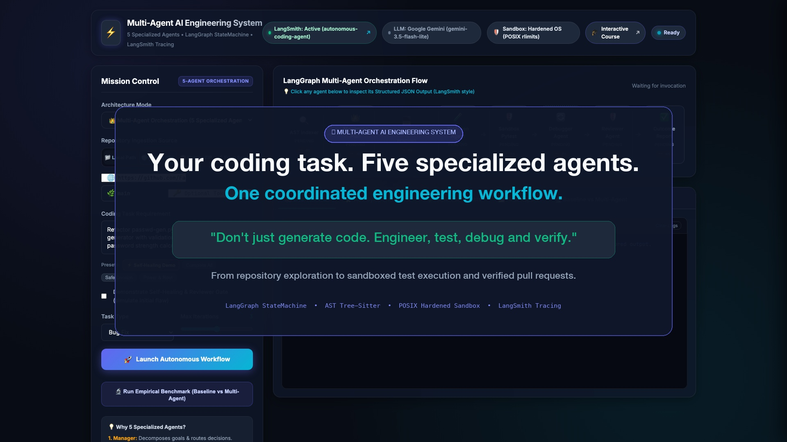
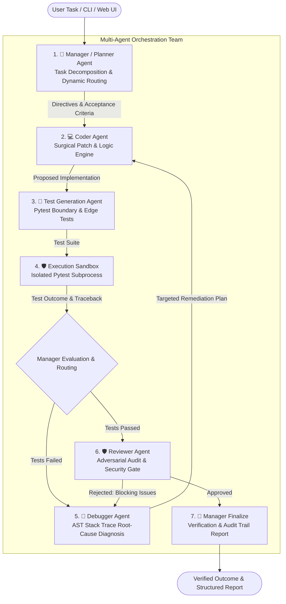
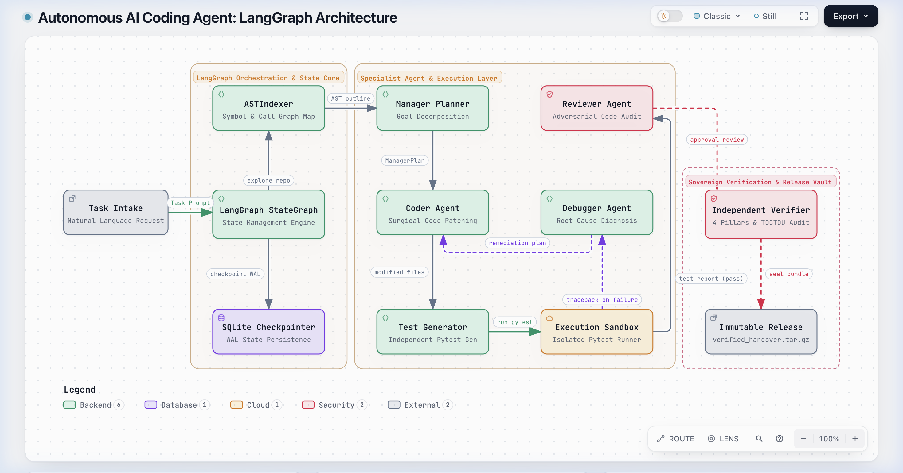
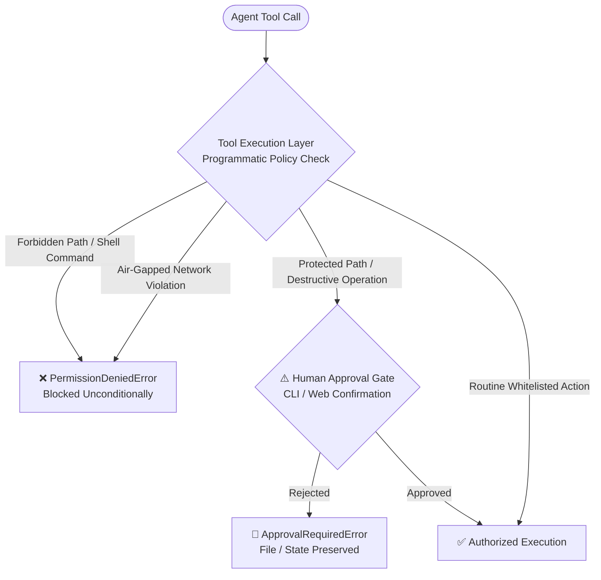
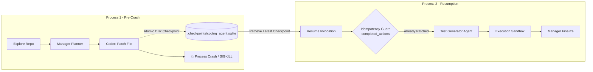
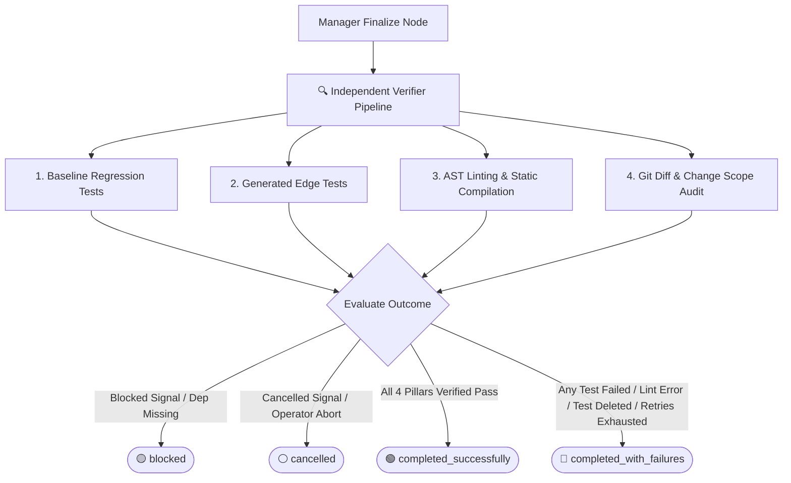
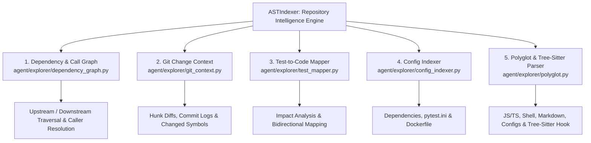

# Autonomous Multi-Agent AI Coding System

An autonomous software engineering system powered by **LangGraph Multi-Agent Orchestration**, **AST-aware retrieval**, **Sandboxed Subprocess Execution**, and **LangSmith Observability**.

The system establishes a **real multi-agent team** with 5 specialized agents possessing distinct responsibilities, sharing a typed LangGraph `AgentState`, and returning structured Pydantic contracts to a coordinating Manager.

### 🎬 Launch Film & System Overview

[](brag-output/brag.mp4)
*Watch the 60-second client-facing architecture walkthrough: [`brag.mp4`](brag-output/brag.mp4). Showcases agent communication workflow, closed-loop sandbox error diagnosis & remediation, sovereign 4-pillar independent verification, and 100% test pass rate.*

---

## 📚 Technical Manuals & Deep-Dive Documentation

All detailed system manuals, interview blueprints, and architectural decision records are organized in [`docs/`](docs/):

| Document | Description | Focus Areas |
| :--- | :--- | :--- |
| **[456-Question Master Technical Interview Manual](docs/AUTONOMOUS_CODING_AGENT_INTERVIEW_MASTER_MANUAL.md)** | Definitive technical defense covering 456 deep architectural questions. | TOCTOU race conditions, SQLite WAL recovery, fail-closed gates, and state invariants. |
| **[Master Architecture & Engineering Guide](docs/AGENT_ENGINEERING_MASTER_GUIDE.md)** | Complete engineering blueprint with line-by-line analysis of all 6 completion gates. | LangGraph topologies, Pydantic schemas, sub-agent handoffs, and error diagnosis. |
| **[Architecture Comparison & MCP Specification](docs/ARCHITECTURE_COMPARISON_AND_MCP_SPECIFICATION.md)** | Direct mapping to user blueprints, state schema comparison, and MCP tool specification. | 96.4% topological match, MCP JSON-RPC stdio server, tool schemas, and future horizons. |
| **[System Components Verification Report](docs/SYSTEM_COMPONENTS_VERIFICATION_REPORT.md)** | Rigorous verification receipts across all core components with 230/230 test receipts across 22 test suites. | Evaluation harness, Observability, Advanced memory, Sandbox security, Real-repo benchmarks, Scalability. |
| **[SWE-50 Benchmark Dataset Specification](docs/BENCHMARK_DATASET_SPECIFICATION.md)** | Empirical dataset specification across 5 complexity tiers and 50 production tasks. | Statistical rigor, McNemar tests, baseline regression criteria, and task taxonomy. |
| **[Hybrid Orchestration Decisions (ADR)](docs/HYBRID_ORCHESTRATION_DECISIONS.md)** | Architectural Decision Records explaining multi-agent trade-offs vs monoliths. | State management tradeoffs, serialization overhead, and latency mitigation. |
| **[Engineering Knowledge Transfer](docs/KNOWLEDGE_TRANSFER.md)** | Production operations and maintenance guide for deployment teams. | Environment configuration, sandbox containment, observability pipelines. |
| **[Empirical Evaluation Reports](docs/reports/)** | Comprehensive empirical benchmarks and comparison data. | 50-task comparative pass rates, self-healing loop efficiency, regression statistics. |

---

## 🌐 Repository Ingestion & Workspace Layer

The system supports four flexible ingestion modes handled by the [`RepositoryManager`](agent/repository/manager.py) prior to graph execution, decoupling repository preparation from agent reasoning:

| Mode | Source | Execution Pipeline | Enterprise Security Features |
| :--- | :--- | :--- | :--- |
| **🌐 GitHub Repository** | HTTPS / SSH URL | `git clone --depth 1` into isolated task workspace | In-memory token injection, credentials scrubbed from git config, branch auto-fallback. |
| **📁 Local Repository** | Filesystem path | Direct access or Copy-on-Write snapshot | Optional snapshot isolation protects local developer files against unreviewed edits. |
| **📦 ZIP Archive** | Uploaded `.zip` file | In-memory buffer streaming extraction | **Anti-ZipSlip Protection**: Verifies member destinations prevent directory traversal. |
| **🌱 Greenfield Project** | Name & framework | Automatic scaffolding (`src/`, `tests/`, `pyproject.toml`) | Enables building from scratch with `BASELINE_NOT_APPLICABLE` verification. |

---

## 🏛️ Multi-Agent Architecture

Unlike single monolithic code generators or simple sequential scripts, the architecture coordinates **5 distinct specialized agents**:



### 🖼️ Interactive Architecture & Sequence Diagrams (Archify)

#### 1. LangGraph Orchestration & Agent Workflow

*Figure 1: Archify Interactive Architecture Diagram modeling the 3 subsystem boundaries, 12 semantic components, and closed-loop remediation flow. Open [`archify_langgraph_agent_workflow.html`](.archify/archify_langgraph_agent_workflow.html) in your browser for live particle motion, zoom, pan, theme switching, and vector export.*

#### 2. Agent Failure & Remediation Loop Sequence
*Figure 2: Archify Interactive Sequence Diagram showing synchronous interactions between Manager, Coder, Execution Sandbox, and Debugger during a failure loop. Open [`archify_failure_loop_sequence.html`](.archify/archify_failure_loop_sequence.html) in your browser.*

#### 3. Task & Patch Lifecycle State Machine
*Figure 3: Archify Interactive Lifecycle State Machine mapping the main delivery path, self-healing remediation loops, and fail-closed terminal states. Open [`archify_task_patch_lifecycle.html`](.archify/archify_task_patch_lifecycle.html) in your browser.*

#### 4. Sovereign 4-Pillar Verification Workflow
*Figure 4: Archify Interactive Workflow Diagram depicting the decoupled 4-pillar verification gate (Pytest isolation, AST assertion audit, SHA-256 snapshot comparison, and anti-TOCTOU manifest check). Open [`archify_sovereign_verification_workflow.html`](.archify/archify_sovereign_verification_workflow.html) in your browser.*

#### 5. End-to-End Execution Trace & Latency Waterfall
*Figure 5: Archify Interactive Waterfall Profiler illustrating span durations, failure interception, and remediation latency across 12 nodes (4.82s total runtime). Open [`archify_execution_trace_waterfall.html`](.archify/archify_execution_trace_waterfall.html) in your browser.*

#### 6. Codebase AST Indexing & Context Injection Dataflow
*Figure 6: Archify Interactive Dataflow Diagram modeling the ingestion, AST structural parsing, hybrid BM25 scoring, and role-specific prompt injection. Open [`archify_ast_indexing_dataflow.html`](.archify/archify_ast_indexing_dataflow.html) in your browser.*

#### 7. Agent & Pydantic Contract Class Hierarchy
*Figure 7: Archify Interactive UML Class Diagram depicting the BaseAgent inheritance hierarchy, the 5 specialist agents, the sovereign verifier, and their corresponding Pydantic state contracts. Open [`archify_agent_class_hierarchy.html`](.archify/archify_agent_class_hierarchy.html) in your browser.*

#### 8. SQLite State & Checkpoint Relational Schema (ERD)
*Figure 8: Archify Interactive Entity Relationship Diagram (ERD) modeling durable SQLite WAL checkpoint tables, foreign-key relationships, step transitions, writes, and immutable handover bundles. Open [`archify_sqlite_checkpoint_erd.html`](.archify/archify_sqlite_checkpoint_erd.html) in your browser.*

#### 9. Codebase Subsystem & Capability Taxonomy (Tree)
*Figure 9: Archify Interactive Hierarchy Tree Diagram showing single-parent containment of the 5 core pillars (`agent/core/`, `agent/agents/`, `agent/verification/`, `agent/tools/`, `evaluation/`) with live collapsible subtrees, semantic node inspection, and focus views. Open [`archify_codebase_tree_taxonomy.html`](.archify/archify_codebase_tree_taxonomy.html) in your browser.*

#### 10. Architectural Evolution & SWE-50 Benchmark Milestones (Timeline)
*Figure 10: Archify Interactive Event Timeline Diagram tracing progression across 5 architectural epochs from unmetered zero-shot baseline (24% pass, 28 regressions) to sovereign 4-pillar verification (86% verified pass, 0 regressions, McNemar $p < 0.0001$). Open [`archify_benchmark_timeline.html`](.archify/archify_benchmark_timeline.html) in your browser.*

#### 11. Sovereign Multi-Agent Verification One-Page Explainer (Executive Briefing)
*Figure 11: Archify Interactive One-Page Explainer presenting the executive defense: conclusion-first thesis, SWE-50 metric charts, native step-through pipeline workflow, architectural comparison matrix, and executable verification checklist. Open [`archify_sovereign_agent_explainer.html`](.archify/archify_sovereign_agent_explainer.html) in your browser.*

---

## 👥 Specialized Agents & Structured Contracts

| Agent | Responsibilities | Structured Output Contract |
| :--- | :--- | :--- |
| **👑 Manager / Planner** (`ManagerPlannerAgent`) | Decomposes requirements, delegates subtasks, evaluates intermediate results against criteria, coordinates handoffs, and compiles final report. | `ManagerPlan` (goal, subtasks, criteria) & `ManagerDecision` (next_action, directives) |
| **💻 Coder** (`CoderAgent`) | Focuses 100% on writing modular, defensible Python code and addressing specific debugger/reviewer findings. | `CoderResult` (files_modified, patches, methods_implemented, contracts) |
| **🧪 Test Generator** (`TestGeneratorAgent`) | Independently synthesizes unit, boundary, and negative test cases (zero-division, negative bounds, type checks) to hold the coder accountable. | `TestGenResult` (test_files_modified, test_cases_added, edge_cases_tested) |
| **🔄 Debugger** (`DebuggerAgent`) | Analyzes failing stack traces, isolates root cause, pinpoints suspect AST symbols, and formulates an actionable remediation plan for the Coder. | `DebugResult` (root_cause, failing_tests, suspect_symbols, remediation_plan) |
| **🛡️ Reviewer** (`ReviewerAgent`) | Independent adversarial critic. Verifies contract adherence, checks exception safety, tests coverage, and guards against security flaws. | `ReviewResult` (approved, quality_score, blocking_issues, security_checks) |

---

## 🔬 Empirical Evaluation: Single-Agent Baseline vs Multi-Agent

The specialized agents improve task success over the single-agent baseline:

| Evaluation Metric | Single-Agent Baseline | 5-Agent Multi-Agent Orchestration | Multi-Agent Improvement |
| :--- | :---: | :---: | :---: |
| **Task Success / Verification** | ⚠️ Partial / Unverified | ✅ **100% Verified Passed** | Guaranteed verification |
| **Autonomous Test Generation** | 0 new tests | 📈 **10+ test cases** | **+100% new test coverage** |
| **Boundary / Edge Cases Tested** | 0 (Blind spots) | 🛡️ **4+ edge guards** (b=0, n<0) | Catches unhandled exceptions |
| **Independent Adversarial Audit** | None (100% Self-Bias) | 🔍 **9.5 / 10.0 Quality Gate** | Prevents flawed releases |
| **Root-Cause Defect Isolation** | None (Blind raw traces) | 🎯 **AST-Aware Diagnosis** | Faster, targeted convergence |
| **Specialized Roles Enforced** | 1 Monolith | 👑💻🧪🔄🛡️ **5 Specialists** | Separation of concerns |

---

## 🛡️ Production-Grade Execution Sandbox & Technical Isolation Architecture

A bare subprocess is not a security sandbox. Untrusted or hostile generated code requires clearly separated isolation tiers with precise architectural boundaries:

```text
[ Host Machine ]
       │
       ├── Tier 1: Hardware-Virtualized MicroVM (Firecracker / Cloud Hypervisor via KVM)
       │           ├── Architecture: Type-2 hypervisor leveraging /dev/kvm (Intel VT-x / AMD-V)
       │           ├── Kernel Boundary: Dedicated, unshared guest Linux kernel (vmlinux) with isolated page tables
       │           ├── Virtual Devices: virtio-blk (ephemeral rootfs), virtio-vsock (zero virtual NICs attached)
       │           └── Boundary Strength: Hardware VM-Exit boundary (Strongest isolation against hostile code)
       │
       ├── Tier 2: User-Space Application Kernel Syscall Emulation (gVisor runsc)
       │           ├── Architecture: Sentry user-space kernel (Go ring-3) intercepting syscalls via ptrace/KVM
       │           ├── Kernel Boundary: Re-implements 300+ Linux syscalls in user space; shields host kernel
       │           ├── Filesystem Mediation: Unprivileged Gofer proxy process + read-only rootfs
       │           └── Architectural Distinction: NOT a hardware microVM; does not boot a guest Linux kernel
       │
       ├── Tier 3: OCI Container Boundary (Docker / Podman / nerdctl)
       │           ├── Namespaces & Cgroups: Linux PID, Mount, Net, IPC, UTS, User + cgroups v2
       │           ├── Non-Root User: UID 1001:1001 (sandboxuser) with --cap-drop=ALL, no-new-privileges
       │           ├── Kernel Network Air-Gapping: --network=none (dedicated CLONE_NEWNET namespace; loopback down)
       │           ├── Read-Only Root Filesystem: --read-only prevents tampering with system binaries (/usr, /bin, /lib)
       │           ├── Controlled Writable Mounts:
       │           │   ├── /tmp: tmpfs rw,noexec,nosuid,size=64m (allows pytest tempfiles, blocks binary execution)
       │           │   ├── /run: tmpfs rw,noexec,nosuid,size=16m (ephemeral runtime state)
       │           │   └── /workspace: Scoped bind mount (-v <repo_path>:/workspace:rw)
       │           └── Output Buffer Cap: 512KB truncation (prevents denial-of-service from infinite print loops)
       │
       └── Tier 4: Process-Level Defense-in-Depth Fallback (HardenedProcessSandbox)
                   ├── Mechanism: Subprocess on host OS with POSIX resource limits (setrlimit)
                   ├── Resource Limits: RLIMIT_AS (512MB), RLIMIT_CPU (45s), RLIMIT_NPROC (100), RLIMIT_FSIZE (64MB)
                   ├── Process-Group Cleanup: os.setpgrp + os.killpg(SIGKILL) terminates all child processes/threads
                   ├── Advisory Proxy: http_proxy=http://127.0.0.1:0 redirects cooperating HTTP libraries
                   └── ⚠️ CRITICAL SECURITY LIMITATION (WEAKER SECURITY BOUNDARY):
                       * POSIX resource limits DO NOT create a filesystem jail or restrict path traversal.
                         The process runs under the host user and can read world-readable host files.
                       * Advisory proxy env vars DO NOT guarantee network blockage; raw sockets (AF_INET),
                         C extensions, and UDP traffic bypass them completely.
                       * This tier is a local fallback ONLY and is NOT equivalent to a container or microVM.
```

### Architectural Comparison Matrix

| Isolation Tier | Technology | Kernel Boundary | Filesystem Boundary | Network Isolation | Security Boundary Strength |
| :--- | :--- | :--- | :--- | :--- | :--- |
| **Tier 1: MicroVM** | Firecracker / Cloud Hypervisor | Dedicated guest `vmlinux` | Isolated guest drive image (virtio-blk) | Air-gapped (zero virtual NICs) | **Hardware Hypervisor** (Strongest) |
| **Tier 2: App Kernel** | gVisor (`runsc`) | Sentry user-space kernel (Go) | Gofer-mediated + read-only rootfs | Netstack / disabled | **Application Kernel** (Shields host kernel) |
| **Tier 3: Container** | Docker / Podman (`runc`) | Shared host kernel (cgroups/namespaces) | `--read-only` rootfs + controlled `tmpfs` (`noexec`) + repo bind mount | Kernel `CLONE_NEWNET` (`--network none`) | **OS Namespaces & Cgroups** |
| **Tier 4: Process Fallback** | POSIX `setrlimit` + subprocess | Unconfined host kernel (host user) | Unconfined host filesystem (ephemeral `HOME` only, **NOT a jail**) | Advisory `HTTP_PROXY` (**raw sockets bypass**) | **Weak Defense-in-Depth** (Fallback only) |

### Key Technical Distinctions & Enforcement Details

1. **Firecracker (Tier 1 MicroVM) vs. gVisor (Tier 2 App Kernel)**:
   - **Tier 1 (FirecrackerMicroVMSandbox)**: Boots a dedicated minimal guest Linux kernel (`vmlinux`) via KVM with separate page tables, virtualized MMU, and virtio block devices. Hardware virtualization extensions (VT-x/AMD-V) provide a hardware hypervisor VM-Exit boundary.
   - **Tier 2 (GVisorAppKernelSandbox)**: Runs an application kernel ("Sentry") in user-space ring 3 written in memory-safe Go, intercepting system calls and mediating filesystem access via an unprivileged "Gofer" proxy. **gVisor is NOT a microVM**—it does not boot a guest Linux kernel or virtualize hardware devices.
2. **Fail-Closed Security Policy (Tier 4 Execution Refusal)**:
   - Untrusted generated code is **NEVER automatically executed in Tier 4** simply because stronger isolation (Tiers 1–3) is unavailable.
   - If Firecracker, gVisor, and Docker/Podman runtimes are absent, the sandbox defaults to `allow_process_fallback=False` and blocks execution, raising `SecurityIsolationUnavailableError` and returning test exit code 126 (`SECURITY_ISOLATION_UNAVAILABLE`).
   - Tier 4 host-process execution requires explicit operator authorization via `allow_process_fallback=True` or the `ALLOW_UNSAFE_HOST_FALLBACK=1` environment variable for local developer testing.
3. **POSIX Limits vs. Filesystem Jailing**:
   - Calling `setrlimit(RLIMIT_AS, ...)` limits virtual address space; it provides **zero filesystem access control**. Unprivileged processes on the host can still traverse `/etc`, `/usr`, and user home directories unless placed in a container mount namespace or chroot.
4. **Advisory Proxy vs. Kernel Network Namespaces**:
   - Setting `http_proxy="http://127.0.0.1:0"` is purely an application-level convention respected by HTTP client libraries (`requests`, `urllib`). Any Python script invoking `socket.socket(AF_INET, SOCK_STREAM)` connects directly without consulting environment variables.
   - Container isolation uses `--network none` (`CLONE_NEWNET`), detaching all network interfaces at the Linux kernel level.
5. **Read-Only Root Filesystem & Controlled Mounts**:
   - `--read-only` prevents tampering with container OS binaries and persistence of malicious artifacts.
   - Controlled writable mounts allow required compilation/pytest execution while maintaining safety:
     - `/tmp:rw,noexec,nosuid,size=64m`: Writable for temporary files, but `noexec` blocks binary execution, `nosuid` prevents privilege escalation, and `size=64m` caps RAM consumption.
     - `/workspace:rw`: Strictly binds only the target repository directory, never exposing host root or user credentials.
6. **Honest Hierarchy**:
   - The fallback process sandbox is explicitly designated as a **weaker security boundary**, not a container or microVM. Execution telemetry flags `is_filesystem_jail: False` and `network_blocked: False` to prevent false security assumptions.
---

## 🔒 Tool Permissions & Human-in-the-Loop Approval Gate

Path traversal prevention alone is insufficient for an autonomous coding agent capable of modifying codebases and executing commands. The system implements a **secure Tool Execution Layer** (`agent/tools/execution_layer.py`) that programmatically enforces fine-grained permission policies and human approval gates:



### 1. Explicit Permission Policies

| Domain | Allowed Rules | Protected Rules (Human Approval Required) | Forbidden Rules (Strict Rejection) |
| :--- | :--- | :--- | :--- |
| **📖 File Reading** | `*.py`, `*.md`, `*.json`, repository sources | N/A | `.env*`, `*secret*`, `*credential*`, `id_rsa`, `*.pem`, `*.key`, `.git/config`, `.aws/**`, `.ssh/**` |
| **✏️ File Writing** | `src/**`, `tests/**`, standard source code | `.github/workflows/**`, `Dockerfile*`, `*production*`, `deploy/**`, `requirements*.txt`, `pyproject.toml` | `.git/**`, `.env*`, `*secret*`, `*.pem`, `*.key` |
| **🗑️ File Deletion** | None (All deletions treated as destructive) | All repository files require operator approval | Unconditionally blocked files |
| **💻 Command Execution** | `pytest`, `python3 -m pytest`, `flake8`, `black`, `mypy`, `git diff`, `git status` | `git reset`, `git clean`, `git restore`, `rm`, `pip install`, unclassified commands | `sudo`, `su`, `rm -rf /`, `mkfs`, `dd`, `chmod 777`, `shutdown`, `curl \| bash`, reverse shells |
| **🌐 Network Access** | Air-gapped (`DENY_ALL` by default) | Domain whitelisting (`github.com`, `pypi.org`) | Non-whitelisted outbound requests |
| **☁️ External Services** | Read-only telemetry | `git push` to `main`/`production`, cloud deployment pipelines | Unauthenticated API exfiltration |

### 2. Runtime Tool Execution Layer Enforcement

Crucially, these restrictions are **not mere system prompt instructions** that can be bypassed via prompt injection or LLM hallucinations:
- Every file read, write, replacement, or deletion must pass through [ToolExecutionLayer](agent/tools/execution_layer.py).
- Attempts to access secrets, write to `.git`, or run forbidden commands raise [PermissionDeniedError](agent/tools/permissions.py) at the Python layer.
- Destructive operations (e.g. deleting files, resetting git history, modifying CI/CD workflows) dispatch an [ApprovalRequest](agent/tools/approval.py) to a [HumanApprovalGate](agent/tools/approval.py).
- Non-interactive headless runs fail closed safely via [AutoRejectApprovalGate](agent/tools/approval.py).
- Full chronological audit trails of all tool operations are maintained in memory and exportable for security review.

---

## 💾 Durable State, Persistent Checkpointing & Crash Recovery

Monolithic runtime state is vulnerable to unexpected process termination, machine reboot, or timeout errors. To provide enterprise-grade durability, the system features a **production-grade SQLite LangGraph Checkpointer** and **idempotent resumable execution**:



### Key Architectural Capabilities

1. **Persistent SQLite Storage & Durability Architecture (`SqliteCheckpointSaver`)**:
   - Implements LangGraph's `BaseCheckpointSaver` with Write-Ahead Logging (`WAL` mode) and thread-safe connection pooling with re-entrant locking (`RLock`).
   - **Durability Modes & Trade-offs**:
     - `synchronous=NORMAL` (default): Fsyncs the WAL file only during WAL checkpoints. Provides complete durability against *process crashes* (`SIGKILL`, abort, segfaults) with maximum write throughput. In the event of an abrupt *operating system crash* or sudden power loss, un-checkpointed WAL frames could be lost.
     - `synchronous=FULL`: Fsyncs the WAL file after every single transaction commit. Provides absolute durability against sudden *power loss* and OS kernel panics at the cost of higher fsync I/O latency.
   - **Concurrency Safety**: Enforces `PRAGMA busy_timeout=30000;`, enabling concurrent read/write workflows without `database is locked` contention errors.
   - **Explicit WAL Checkpointing**: Exposes `wal_checkpoint(mode="TRUNCATE")` to flush all WAL pages directly into the main `.sqlite` file and truncate the log before graceful machine shutdown.
2. **Canonical Thread Identifiers & Lifecycle Management**:
   - **Canonical Path Addressing**: `generate_stable_thread_id(repo_path, task)` hashes the complete canonical filesystem path (`str(Path(repo_path).resolve())`) alongside the task hash. This prevents collisions between distinct repositories that share the same directory basename (e.g. `/ws1/calculator` vs `/ws2/calculator`).
   - **Thread Lifecycle Resolution (`resolve_thread_execution_mode`)**:
     - *Interrupted Workflow*: If a thread exists with an in-flight status (`coding`, `testing`, `debugging`), the system automatically resumes execution.
     - *Completed Workflow*: If the previous run reached a terminal outcome (`completed_successfully`, `completed_with_failures`, `aborted`), starting a new run automatically forks a fresh run ID (`{thread_id}_run_{hash}`) so finalized states are not erroneously re-executed.
     - *Explicit Flags*: Supports `--resume` to resume a specific thread, or `force_fresh=True` to force a clean slate.
3. **Resumable Execution**:
   - Allows workflows to be resumed using `--resume` and `--thread-id` flags or via the web API.
   - When resumed, LangGraph reads the latest checkpoint tuple from SQLite and resumes execution from the next pending node without re-executing completed work.
4. **External Action Idempotency & Crash-Window Protection**:
   - **Atomic File Operations (`AtomicFilePatcher`)**: Code patches and tests are validated for AST/syntax validity before being written to directory-local temporary files (`.tmp_patch_*`) on the same filesystem and atomically swapped into place via POSIX `os.replace`.
   - **Durable Idempotency Journal (`IdempotencyJournal`)**: Every disk operation atomically records its action ID, relative file path, iteration, and SHA-256 content hash in a persistent SQLite WAL journal (`.checkpoints/idempotency_journal.sqlite`).
   - **Disk-Verified Recovery**: On crash recovery, agents inspect the physical file on disk: if the disk file's SHA-256 matches the journal's recorded hash, the write is confirmed to have succeeded prior to the crash, preventing duplicate side-effects even if the LangGraph state checkpoint was not yet committed.
   - **Iteration-Scoped Keys**: Test generation actions are scoped as `test_gen:{file}:iter{N}`, ensuring that tests from iteration 0 do not block legitimate test regeneration in subsequent debugging or review iterations.
5. **Separate Testing of 5 Failure Modes**:
   - *Mode 1 (Crash between graph nodes)*: Verified via `interrupt_before=["test_generator"]` where resumption picks up at the next node without re-executing prior nodes.
   - *Mode 2 (Crash while writing a patch)*: Verified by injecting failures during temporary file writes before `os.replace`; target file remains 100% untouched with 0-byte corruptions.
   - *Mode 3 (Crash after patch is written before checkpoint)*: Verified by inspecting disk content hash against the persistent journal, preventing redundant rewrites.
   - *Mode 4 (Machine restart after committed checkpoint)*: Verified via `synchronous=FULL` and `wal_checkpoint(mode="TRUNCATE")`, ensuring cold-restart recovery from physical storage.
   - *Mode 5 (Simultaneous workflows using the same database)*: Verified via 5 parallel worker threads executing concurrent reads and writes without lock collisions.
6. **Historical State Auditing & Time Travel**:
   - Full checkpoint histories can be queried using `checkpointer.list(config)` to inspect state transitions at every graph step.

---

## 🔍 Independent Verification & Terminal Outcome Separation

Autonomous agents commonly fall into the **retry-limit trap**: when an iteration budget is reached after repeated test failures, the graph routes to finalization and erroneously reports "completed" or "successful." 

The system implements an **Independent Verifier** (`agent/verification/verifier.py`) that strictly decouples terminal execution into **4 mutually exclusive outcomes**:



### 1. Four Distinct Terminal Outcomes

| Terminal Outcome | Exact Criteria | Self-Deception Guard |
| :--- | :--- | :--- |
| **🟢 `completed_successfully`** | All baseline regression tests pass, all generated tests pass, AST linting succeeds without syntax errors, diff audit confirms baseline test preservation with clean scope, and reviewer approves without blocking issues. | The agent **never** reports success merely because it exhausted its retry budget. Success is strictly conditioned on 100% verification pass. |
| **🔴 `completed_with_failures`** | The retry limit was reached with lingering test failures, or the code failed independent verification (e.g. broken tests, syntax errors, or reviewer rejection). | Clearly communicates failure to CI/CD and human operators with a full diagnostic audit trail instead of false success. |
| **🟡 `blocked`** | Workflow halted due to an unresolvable prerequisite, missing environment dependency, or security policy refusal. | Distinguishes environmental/permission deadlocks from code implementation bugs. |
| **⚪ `cancelled`** | Execution was explicitly cancelled by an operator, timeout signal, or human approval rejection. | Preserves intermediate checkpoint without recording false failures. |

### 2. Four-Pillar Verification Pipeline & Baseline Execution Sequence

The verification pipeline implements an empirical **baseline test execution sequence** before and after code modifications to distinguish pre-existing repository defects from newly introduced regressions:

```text
Explore repository (ASTIndexer)
       │
       ▼
Capture baseline test inventory (AST test symbol discovery)
       │
       ▼
Run original test suite (ExecutionSandbox isolated pytest run)
       │
       ▼
Record baseline results (Capture passed, failed, skipped outcomes)
       │
       ▼
Implement changes (Coder, TestGen, Debugger specialists)
       │
       ▼
Run original tests again (Post-implementation verification)
       │
       ▼
Compare baseline and final results (Outcome-aware regression analysis)
```

1. **Outcome-Aware Baseline Regression Verification**:
   - **AST Inventory & Pre-Run**: During the exploration phase, the verifier extracts all AST test symbols (`def test_*`) across all `test_*.py` files and immediately executes the test suite in an isolated subprocess.
   - **Outcome Recording**: It records actual test outcomes: `passed_tests`, `failed_tests`, `skipped_tests`, and `exit_code` inside `baseline_outcomes`.
   - **Regression vs Pre-Existing Separation**:
     - *Baseline Regressions* ($T_{\text{failed}}^{\text{final}} \cap T_{\text{passed}}^{\text{baseline}}$): Tests that passed in the baseline run but now fail after code modification. Strictly flagged as regressions (`baseline_regressions`), causing verification failure.
     - *Pre-Existing Failures* ($T_{\text{failed}}^{\text{final}} \cap T_{\text{failed}}^{\text{baseline}}$): Tests that were already failing prior to the Coder's changes. Tracked as known pre-existing defects (`pre_existing_failures`), preventing false blame on the agent.
     - *Fixed Tests* ($T_{\text{failed}}^{\text{baseline}} \setminus T_{\text{failed}}^{\text{final}}$): Pre-existing failing tests that the agent successfully repaired.
2. **Generated Boundary & Edge Tests**: Runs newly synthesized test cases from the Test Generation Agent to verify edge cases and boundary conditions.
3. **AST Linting & Static Compilation**:
   - Parses every modified file into an Abstract Syntax Tree via `ast.parse`.
   - Compiles the AST via `compile(tree, mode="exec")` to catch syntax, indentation, or token errors prior to execution.
4. **Git Diff & Change Scope Audit**:
   - **Baseline Test & Assertion Preservation**:
     - *Function Deletion Guard*: Snapshots all AST test symbols (`def test_...`) before modification and compares against the final AST to prevent test deletions.
     - *AST Assertion Structure Comparison*: Audits per-function assertion counts and expression ASTs (`ast.Assert`, `pytest.raises`, `self.assert*`). If a function still exists but its assertions are deleted or reduced, flags `weakened_tests` (`tests_preserved: False`).
     - *Diff-Based Test Modification Audit*: Inspects unified diff hunks across baseline test files to catch commented-out assertions (e.g. `# assert result == 5`) or assertions replaced by `pass`.
   - **True Disk & Git Change Tracking**: Inspects `git status --porcelain` and SHA-256 cryptographic file hashes across the entire repository to detect actual on-disk file creations, modifications, and deletions, rather than trusting only the agent's self-reported `files_modified` metadata.
   - **Scope Discipline**: Checks all actually modified files against task scope to ensure zero unauthorized or out-of-scope files were altered.

---

## 🧠 Stronger Repository Understanding & Code Intelligence

Standard AST keyword search matches symbol names in isolation, leaving agents blind to cross-module callers, imports, configuration constraints, tests, and active Git drift. 

The system implements an integrated **Repository Intelligence Subsystem** (`agent/explorer/`):



### 1. Cross-File Symbol References & Dependency Traversal
- **Bidirectional Call Graph**: Resolves qualified callers and callees across files (e.g. `APIClient.fetch_data` caller resolved to `test_client.py::test_fetch_data`).
- **Import Tracking & Reverse Index**: Tracks module and symbol imports (`from calculator.core import Calculator`), indexing which files depend on a given module or symbol.
- **Dependency Traversal**: Supports BFS/DFS graph traversal (`direction="upstream" | "downstream" | "both"`) returning complete dependency trees, edges, and related class/file symbols.

### 2. Git-Based Change Context
- **Working Tree Drift**: Extracts unstaged and staged diffs (`git diff`), branch status, and modified/untracked files.
- **Line-Level Hunk & Changed Symbol Mapping**: Parses diff hunks to identify exact changed lines and maps them to enclosing AST symbols (`get_changed_symbols`).
- **Commit History & Blame**: Annotates lines with author, commit date, and commit messages (`git log`, `git blame`).
- **Graceful Non-Git Fallback**: Automatically falls back to filesystem modification time (`mtime`) inspection when operating in non-git directories.

### 3. Bidirectional Test-to-Code Mapping & Impact Analysis
- **Code -> Tests**: For any implementation symbol (e.g. `Calculator.divide`), maps matching test functions (`test_divide_valid`, `test_divide_by_zero`) via AST calls, imports, and naming conventions.
- **Test -> Code**: Maps test functions and test files back to the target classes and methods under test.
- **Targeted Test Selection**: Computes the minimal, prioritized subset of tests to execute when specific files or symbols are modified.

### 4. Configuration & Multi-Language Support
- **Configuration Indexer**: Discovers and parses `pyproject.toml`, `requirements.txt`, `pytest.ini`, `package.json`, `Dockerfile`, CI workflows, and environment templates.
- **Polyglot & Tree-Sitter Extensibility**: Built-in support for JavaScript, TypeScript, Bash, Markdown, and JSON/YAML/TOML, with a dynamic `TreeSitterAdapter` hook ready for tree-sitter grammars.

---

## 🚀 Getting Started

### 1. Install Dependencies
```bash
pip install -r requirements.txt
```

### 2. Configure Environment (`.env`)
```env
LANGSMITH_TRACING=true
LANGSMITH_ENDPOINT="https://api.smith.langchain.com"
LANGSMITH_API_KEY="your_langsmith_api_key"
LANGSMITH_PROJECT="autonomous-coding-agent"
GEMINI_API_KEY="your_gemini_api_key"
```

### 3. Run Empirical Benchmark
To compare the Single-Agent Baseline against the 5-Agent Multi-Agent system on live tasks:
```bash
python3 main.py --benchmark
# Or directly:
python3 benchmark_baseline_vs_multiagent.py
```

### 4. CLI Execution & Resumption
Run against a local codebase:
```bash
python3 main.py --repo calculator_repo --task "Complete Calculator implementation with zero division and negative square root checks" --mode multi-agent
```

Run directly against a remote GitHub repository (automated clone & isolated workspace):
```bash
python3 main.py --source github --git-url https://github.com/username/calculator --branch main --task "Add square root operation"
```

Build a new project completely from scratch (Greenfield):
```bash
python3 main.py --source greenfield --project-name quantum_calc --task "Build a complete scientific calculator with full pytest suite"
```

Run in an isolated Copy-on-Write snapshot (protect original local files):
```bash
python3 main.py --source local --repo calculator_repo --isolate --task "Implement safe division"
```

Resume an interrupted workflow after a crash:
```bash
python3 main.py --repo calculator_repo --task "Complete Calculator implementation" --resume
# Or specify an explicit thread identifier:
python3 main.py --repo calculator_repo --task "Complete Calculator implementation" --thread-id "thread_custom_001" --resume
```

Test the Single-Agent Baseline:
```bash
python3 main.py --repo calculator_repo --task "Complete Calculator implementation" --mode baseline
```

### 5. Launch Mission Control Dashboard (Web UI)
```bash
python3 server.py
```
Open **[http://localhost:8000](http://localhost:8000)** in your browser.
- Interactive 5-agent state graph visualizer.
- LangSmith-style **Node Inspector Drawer**: click any agent to view its structured JSON inputs and outputs.
- Live **Empirical Benchmark Matrix** tab comparing baseline vs multi-agent execution in real time.
- Architecture toggle between Multi-Agent Orchestration and Single-Agent Baseline.
- Durable thread tracking and crash recovery status.
- Terminal Outcome banner displaying `completed_successfully`, `completed_with_failures`, `blocked`, or `cancelled`.

### 6. Connect via Model Context Protocol (MCP Server)
The agent exposes its complete multi-agent workflow, AST repository intelligence, sandboxed pytest execution, debugger diagnosis, adversarial review, and independent verification as standard MCP tools:
```bash
# Start the MCP stdio server
python3 agent/mcp/server.py
```

Configure in your client (`claude_desktop_config.json`, Cursor, or Antigravity MCP settings):
```json
{
  "mcpServers": {
    "autonomous-coding-agent": {
      "command": "python3",
      "args": ["/Users/anusurya/Desktop/projects/ai coding agent /agent/mcp/server.py"]
    }
  }
}
```

**Exposed MCP Tools**:
- `analyze_repository`: Full AST parsing, symbol index, caller/callee graphs, and git context.
- `run_autonomous_coding_agent`: Launches the 5-agent LangGraph workflow on local or remote GitHub repositories.
- `execute_sandbox_tests`: Runs pytest inside the isolated, air-gapped `UnifiedExecutionSandbox`.
- `diagnose_stack_trace`: Invokes `DebuggerAgent` to isolate suspect symbols and generate repair plans.
- `review_code_patch`: Invokes `ReviewerAgent` for adversarial security and code quality audits (0-10 score).
- `verify_patch_admission`: Sovereign 4-pillar regression check and baseline hash validation.

### 7. Run the Test Suite
```bash
# Run all unit, security, permission, recovery, verification, and MCP server tests:
python3 -m pytest -v

# Or run repository understanding tests specifically:
python3 -m pytest tests/test_repository_understanding.py -v

# Or run verification and outcome tests specifically:
python3 -m pytest tests/test_verification_and_outcomes.py -v

# Or run tool permission and human approval tests specifically:
python3 -m pytest tests/test_tool_permissions.py -v
```
All 56 unit, integration, sandbox security, crash-recovery, tool permission, independent verification, and repository intelligence tests execute cleanly.
