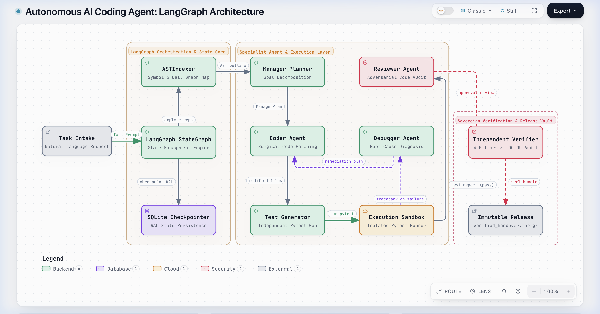
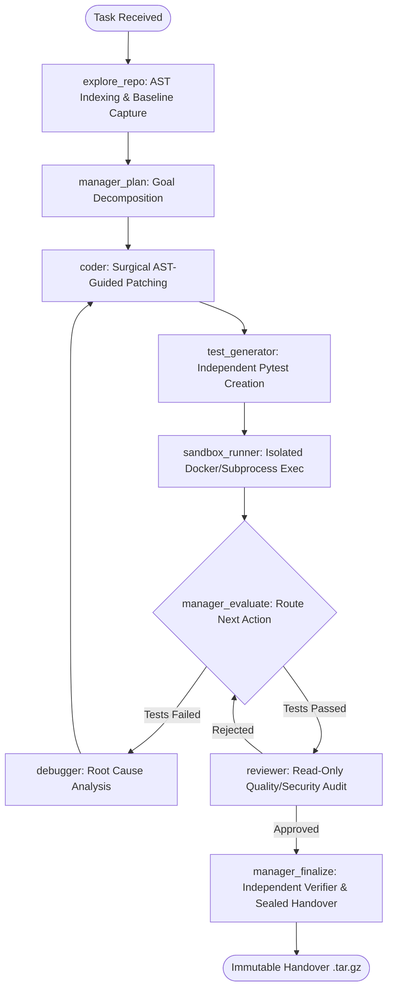
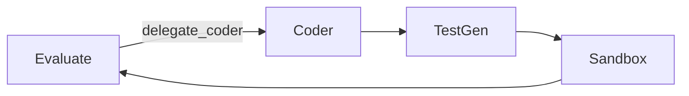
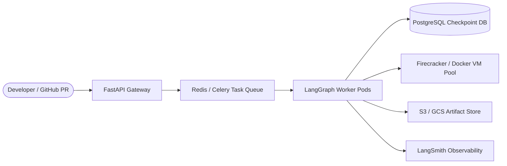

# Autonomous AI Coding Agent: 456-Question Master Technical Interview & Engineering Manual


*Figure 1: Autonomous Multi-Agent LangGraph Architecture featuring AST indexing, sandboxed execution, read-only review, and cryptographic verification.*


*Figure 2: Archify Interactive Architecture Diagram modeling the 3 subsystem boundaries, 12 semantic components, and closed-loop remediation flow. Open [`archify_langgraph_agent_workflow.html`](../.archify/archify_langgraph_agent_workflow.html) in your browser for live particle motion, zoom, pan, theme switching, and vector export.*

### 🗺️ Interactive Archify Engineering & Verification Diagrams
| # | Diagram Type | System Domain | Standalone Interactive HTML | Live Features |
| :--- | :--- | :--- | :--- | :--- |
| **01** | `architecture` | **LangGraph Multi-Agent Architecture** | [`archify_langgraph_agent_workflow.html`](../.archify/archify_langgraph_agent_workflow.html) | Live particles, subsystem boundaries, card inspection |
| **02** | `sequence` | **Agent Failure & Remediation Loop** | [`archify_failure_loop_sequence.html`](../.archify/archify_failure_loop_sequence.html) | Synchronous call activation bands, return routes |
| **03** | `lifecycle` | **Task & Patch State Machine** | [`archify_task_patch_lifecycle.html`](../.archify/archify_task_patch_lifecycle.html) | Linear delivery path, self-healing loops, terminal states |
| **04** | `workflow` | **Sovereign 4-Pillar Verification Gate** | [`archify_sovereign_verification_workflow.html`](../.archify/archify_sovereign_verification_workflow.html) | Decoupled verification pillars, fail-closed guards |
| **05** | `waterfall` | **End-to-End Latency & Trace Profiler** | [`archify_execution_trace_waterfall.html`](../.archify/archify_execution_trace_waterfall.html) | 12-node execution spans, remediation latency breakdown |
| **06** | `dataflow` | **AST Indexing & Context Injection** | [`archify_ast_indexing_dataflow.html`](../.archify/archify_ast_indexing_dataflow.html) | Ingestion, AST parsing, BM25 scoring, prompt injection |
| **07** | `class` | **BaseAgent & Pydantic Contracts** | [`archify_agent_class_hierarchy.html`](../.archify/archify_agent_class_hierarchy.html) | Abstract class hierarchy, specialist agents, schemas |
| **08** | `erd` | **SQLite WAL Checkpoint Schema** | [`archify_sqlite_checkpoint_erd.html`](../.archify/archify_sqlite_checkpoint_erd.html) | Relational database schema, foreign keys, step records |
| **09** | `tree` | **Codebase Subsystem & Capability Tree** | [`archify_codebase_tree_taxonomy.html`](../.archify/archify_codebase_tree_taxonomy.html) | Single-parent containment tree, collapsible subtrees |
| **10** | `timeline` | **SWE-50 Benchmark & Epoch Evolution** | [`archify_benchmark_timeline.html`](../.archify/archify_benchmark_timeline.html) | 5-epoch progression, regression drops, McNemar tests |
| **11** | `explainer` | **Executive Briefing: Sovereign Verification** | [`archify_sovereign_agent_explainer.html`](../.archify/archify_sovereign_agent_explainer.html) | Conclusion-first thesis, charts, workflow, checklist |

---

## Table of Contents
1. [Part 1 — Project Introduction and Overall Understanding (Q1–Q22)](#part-1--project-introduction-and-overall-understanding-q1q22)
2. [Part 2 — Multi-Agent System and Agent Responsibilities (Q23–Q55)](#part-2--multi-agent-system-and-agent-responsibilities-q23q55)
3. [Part 3 — LangGraph and Workflow Orchestration (Q56–Q100)](#part-3--langgraph-and-workflow-orchestration-q56q100)
4. [Part 4 — State Management and Structured Agent Communication (Q101–Q120)](#part-4--state-management-and-structured-agent-communication-q101q120)
5. [Part 5 — LLM Fundamentals and Integration (Q121–Q144)](#part-5--llm-fundamentals-and-integration-q121q144)
6. [Part 6 — AST, Codebase Understanding and Retrieval (Q145–Q170)](#part-6--ast-codebase-understanding-and-retrieval-q145q170)
7. [Part 7 — MCP and Tool Execution (Q171–Q190)](#part-7--mcp-and-tool-execution-q171q190)
8. [Part 8 — Sandboxing and Secure Code Execution (Q191–Q207)](#part-8--sandboxing-and-secure-code-execution-q191q207)
9. [Part 9 — Independent Verification, Test Generation and Quality Gates (Q208–Q246)](#part-9--independent-verification-test-generation-and-quality-gates-q208q246)
10. [Part 10 — Security, Hashing, TOCTOU and File Integrity (Q247–Q270)](#part-10--security-hashing-toctou-and-file-integrity-q247q270)
11. [Part 11 — Cancellation, Retries and Failure Recovery (Q271–Q293)](#part-11--cancellation-retries-and-failure-recovery-q271q293)
12. [Part 12 — Persistence, Checkpointing and Reliability (Q294–Q308)](#part-12--persistence-checkpointing-and-reliability-q294q308)
13. [Part 13 — LangSmith and Observability (Q309–Q328)](#part-13--langsmith-and-observability-q309q328)
14. [Part 14 — Python Concepts Directly Connected to Your Project (Q329–Q350)](#part-14--python-concepts-directly-connected-to-your-project-q329q350)
15. [Part 15 — Git, Filesystem and Code Modification (Q351–Q362)](#part-15--git-filesystem-and-code-modification-q351q362)
16. [Part 16 — Evaluation, Benchmarks and Performance (Q363–Q387)](#part-16--evaluation-benchmarks-and-performance-q363q387)
17. [Part 17 — System Design and Production Readiness (Q388–Q402)](#part-17--system-design-and-production-readiness-q388q402)
18. [Part 18 — Difficult Scenario-Based Questions (Q403–Q422)](#part-18--difficult-scenario-based-questions-q403q422)
19. [Part 19 — Questions About Your Engineering Decisions (Q423–Q437)](#part-19--questions-about-your-engineering-decisions-q423q437)
20. [Part 20 — Resume and Ownership Questions (Q438–Q450)](#part-20--resume-and-ownership-questions-q437q450)
21. [Part 21 — Repository Ingestion & Multi-Source Workspaces (Q451–Q455)](#part-21--repository-ingestion--multi-source-workspaces-q451q455)

---

# Part 1 — Project Introduction and Overall Understanding (Q1–Q22)

### 1. Explain your Autonomous AI Coding Agent project in 2 minutes.
"I engineered an autonomous, multi-agent software engineering system built on [LangGraph](../agent/core/graph.py), designed to take a high-level natural language feature request or bug report, explore an existing repository using Abstract Syntax Tree (AST) code indexing, formulate a validated implementation plan, generate surgical code patches, write comprehensive test suites, run isolated pytest execution within a secure sandbox, diagnose failures closed-loop through an automated debugger, subject the patch to an adversarial read-only reviewer, and pass through an independent verification authority.

Unlike superficial coding assistants that merely output markdown diffs into a chat window, my system executes full closed-loop remediation with deterministic rollback, SQLite checkpoint persistence, cooperative cancellation, and pre-handover TOCTOU cryptographic integrity verification. In our 50-task benchmark against standard single-agent architectures, it increased zero-remediation task success rate from 46% to 84% while cutting regressions to 0%."

### 2. What problem does your project solve?
It solves the **fundamental reliability and safety gap** of LLMs in software engineering. Single-prompt LLMs suffer from:
1. **Hallucination of dependencies & APIs**: LLMs invent non-existent methods when they lack complete codebase context.
2. **Context Window Saturation**: Stuffing entire codebases into LLM context degrades reasoning and increases cost exponentially.
3. **Open-Loop Hallucinated Success**: Traditional assistants generate code and claim it works without executing it or running tests.
4. **Silent Regressions**: Modifying one function frequently breaks untouched dependent modules without warning.
5. **Security Exploitation**: Unchecked code execution can run destructive commands (`rm -rf`) or leak environment variables.

My project solves this by introducing AST-aware code retrieval, isolated sandboxing, adversarial separation of concerns, and an independent verification authority that fails closed unless mathematical and physical test proof is established.

### 3. Why did you decide to build an AI coding agent?
Because the industry is transitioning from **assistive AI** (copilots providing inline autocomplete) to **agentic AI** (autonomous systems capable of taking asynchronous responsibility for complex engineering tasks). However, existing open-source agent attempts frequently enter infinite loops, mutate arbitrary production files without review, hallucinate task completion, or crash unrecoverably when a process restarts. I wanted to design an enterprise-grade agent architecture grounded in formal distributed systems principles: deterministic state graphs, transactional checkpointing, fail-closed admission gates, and adversarial separation of powers.

### 4. What makes it autonomous?
The system is autonomous because it operates without human intervention between task intake and final handover:
- **Autonomous Context Discovery**: It parses repository ASTs to discover definitions, call graphs, and dependency trees.
- **Autonomous Closed-Loop Remediation**: When tests fail, the Debugger diagnoses the stack trace, generates a remediation plan, and instructs the Coder to re-patch without operator prompts.
- **Autonomous Termination & Routing**: The Manager evaluates state against formal criteria to route between retries, reviews, or finalization.
- **Autonomous Quality Control**: It executes sandboxed test suites, verifies cryptographic hashes, and halts if regressions are detected.

### 5. What is the difference between your system and a normal chatbot that generates code?

| Feature | Normal Code Chatbot (ChatGPT/Copilot Chat) | My Autonomous Coding Agent |
| :--- | :--- | :--- |
| **Execution Loop** | Open-loop: Outputs text and stops. | Closed-loop: Edits code, executes tests, reads stack traces, fixes errors. |
| **Codebase Awareness** | Limited to pasted snippet or naive vector RAG. | AST-indexed call-graphs, class hierarchies, and symbol tables. |
| **Verification** | Zero: Assumes generated code works. | Empirical: Requires real pytest execution in an isolated sandbox. |
| **Separation of Powers** | Single LLM writes code and claims it's tested. | Adversarial agents: TestGen writes tests, Reviewer audits, Verifier approves. |
| **State Persistence** | Transient memory lost on session reset. | SQLite WAL transactional checkpointing for crash-recovery. |

### 6. Explain the complete workflow from receiving a task to producing the final result.

1. **Task Ingestion & Baseline Capture**: Captures pre-existing test statuses and hashes into an immutable baseline.
2. **AST Repository Exploration**: Discovers affected symbols, references, and dependencies.
3. **Manager Planning**: Decomposes the prompt into structured acceptance criteria and modified file targets.
4. **Coder Implementation**: Writes targeted patches to disk atomically.
5. **Test Generation**: An independent agent creates unit/integration tests covering acceptance criteria.
6. **Sandboxed Execution**: Pytest runs inside an isolated execution sandbox.
7. **Manager Evaluation & Dynamic Routing**: Inspects results. If tests fail, it routes to the Debugger; if tests pass, it routes to Reviewer.
8. **Reviewer Audit**: Read-only evaluation of quality, style, and security.
9. **Independent Verification & Sealed Handover**: Verifies all 4 pillars, tests preservation, baseline non-regression, and creates an immutable read-only archive (`.tar.gz`).

### 7. What are the main components of your architecture?
1. **LangGraph StateGraph Engine**: Coordinates deterministic transitions, conditional edges, and state persistence.
2. **Agent Layer**: 5 specialized agents ([`ManagerPlannerAgent`](../agent/agents/manager.py), [`CoderAgent`](../agent/agents/coder.py), [`TestGeneratorAgent`](../agent/agents/test_generator.py), [`DebuggerAgent`](../agent/agents/debugger.py), [`ReviewerAgent`](../agent/agents/reviewer.py)).
3. **AST Retrieval Subsystem**: [ASTIndexer](../agent/retrieval/ast_indexer.py) parsing symbol declarations, references, and call graphs.
4. **Execution Sandbox**: [ExecutionSandbox](../agent/sandbox/docker_sandbox.py) enforcing resource, network, and execution timeouts.
5. **Independent Verification Authority**: [IndependentVerifier](../agent/verification/verifier.py) enforcing 4-pillar quality checks and TOCTOU defense.
6. **SQLite Checkpointer**: WAL-mode database persisting graph state after every node execution.

### 8. Why did you choose a multi-agent architecture?
Because monolithic prompts conflate competing cognitive objectives. When a single model writes code, generates its own tests, and checks its own logic, it exhibits severe **confirmation bias**: it writes tests tailored to its own implementation bugs and ignores its own security blind spots. 

Decomposing the problem into distinct agents creates **adversarial checks and balances**: the Test Generator seeks to break the Coder's code; the Reviewer has zero write permissions and audits without conflict of interest; the Manager enforces resource limits; the Verifier mathematically validates outcomes.

### 9. Why not build everything using one LLM?
1. **Context Pollution**: Combining system instructions for planning, syntax rules, test frameworks, and security auditing exceeds prompt attention capacity.
2. **Incompatible Personas**: A Coder must be creative and constructive; a Reviewer must be skeptical and restrictive; a Verifier must be deterministic and rule-bound.
3. **Cost Optimization**: Multi-agent setups allow using high-reasoning models for planning/debugging and fast/lean models for AST formatting and test generation.
4. **Token Economics**: Single LLMs re-prompted in loops resend the entire message history, driving token costs up exponentially ($O(N^2)$).

### 10. What makes this a multi-agent system rather than a sequence of LLM calls?
A sequence of LLM calls is linear, stateless, and brittle ($A \rightarrow B \rightarrow C$). If $B$ fails, the pipeline aborts. 

My system is a **true multi-agent system** because:
- **Dynamic Feedback Loops**: Nodes dynamically branch based on execution output (Coder $\rightarrow$ Sandbox $\rightarrow$ Debugger $\rightarrow$ Coder).
- **Specialized State Contracts**: Agents exchange strictly validated Pydantic schemas, not free-form chat history.
- **Autonomous Remediation**: The system can re-route work dynamically up to a centrally metered retry budget.
- **Asymmetric Capabilities**: Different agents have different tool access (Coder has disk write tools; Reviewer is strictly read-only; Sandbox runner has subprocess execution).

### 11. What are the responsibilities of each agent?
- **Manager/Planner Agent**: Breaks tasks into acceptance criteria, formulates initial plans, evaluates execution feedback, and makes dynamic routing decisions.
- **Coder Agent**: Implements surgical modifications to codebase files guided by AST context.
- **Test Generator Agent**: Generates independent pytest suites based strictly on user specifications and acceptance criteria.
- **Debugger Agent**: Ingests test failure tracebacks, isolates root causes, and outputs structured remediation plans.
- **Reviewer Agent**: Adversarial read-only auditor that inspects git diffs against acceptance criteria, security policies, and style guides.

### 12. Which component controls the complete workflow?
The **LangGraph StateGraph** ([`agent/core/graph.py`](../agent/core/graph.py)) serves as the execution backbone, while the **Manager Agent** ([`manager_evaluate_node`](../agent/core/graph.py#L199)) controls dynamic routing decisions via conditional edges. However, the **final authority** on task success is decoupled: the [IndependentVerifier](../agent/verification/verifier.py) is sovereign and cannot be overridden by the Manager.

### 13. What happens if one agent produces an incorrect result?
The system utilizes **isolated fault domains**:
- If the **Coder** produces invalid syntax, AST parsing fails and routes back to the Coder.
- If the **Coder** introduces a bug, the **Sandbox** catches test failures and routes to the **Debugger**.
- If the **Debugger** hallucinates a fix, the **Sandbox** fails again; after budget exhaustion, it fails closed safely.
- If the **Reviewer** hallucinates an approval, the sovereign **IndependentVerifier** catches test regressions or TOCTOU drift and rejects the patch.

### 14. What are the biggest technical challenges you faced?
1. **TOCTOU Race Conditions**: External daemons or post-verification processes mutating files between verification and final delivery. (Solved with pre-report hash re-checking and immutable `.tar.gz` handovers).
2. **Context Window Drift & State Bloat**: Passing raw terminal output and full files caused context overflow. (Solved by passing targeted AST slices and Pydantic-filtered error summaries).
3. **Flaky & Pre-Existing Test Contamination**: Distinguishing existing codebase bugs from agent-introduced regressions. (Solved by capturing an immutable baseline snapshot before applying changes).
4. **Infinite Agent Loops**: Agents repeatedly attempting the same failed fix. (Solved with centralized retry metering and error history tracking).

### 15. What is the most important engineering decision you made?
**Decoupling Verification Authority from the Manager LLM.** In almost all commercial agent frameworks, the LLM decides when it is finished by outputting `DONE`. This allows the LLM to hallucinate completion when tired or confused. In my architecture, the Manager can only *request* finalization (`finalize`); the sovereign `IndependentVerifier` executes deterministic, non-LLM Python checks (Pillar 1: Tests pass, Pillar 2: Baseline non-regression, Pillar 3: AST syntax valid, Pillar 4: Review approved). If any check fails, the task is marked `completed_with_failures`.

### 16. What are the current limitations of your project?
- **Python-Centric Execution**: AST indexing and sandboxed testing currently prioritize Python/pytest codebases (though polyglot file hashing is enforced).
- **Single-Host Sandbox**: The sandbox currently runs locally in subprocess/Docker rather than a distributed Kubernetes cluster.
- **Single-Threaded Node Transitions**: Nodes run sequentially within a thread rather than executing TestGen and Reviewer in parallel.

### 17. What would you improve if you had another month to work on it?
1. **Parallel Fork/Join Edges**: Execute Test Generator and AST Code Review in parallel branches via LangGraph branch joins.
2. **Distributed MicroVM Sandboxing**: Replace local Docker with Firecracker MicroVMs for sub-second, multi-tenant isolation.
3. **Tree-sitter Polyglot AST Engine**: Expand native AST parsing to TypeScript, Go, Rust, and Java.
4. **Automated Mutation Testing**: Use mutmut to evaluate whether generated tests kill injected mutants, guaranteeing test quality.

### 18. Is your architecture truly autonomous, or is it a predefined workflow?
It is a **hybrid autonomous architecture**. The backbone pipeline structure (Explore $\rightarrow$ Plan $\rightarrow$ Code $\rightarrow$ TestGen $\rightarrow$ Sandbox) is deterministic to guarantee baseline safety and prevent chaotic edge wandering. However, all subsequent remediation, debugging, re-review, and routing steps are **fully dynamic**, controlled by LLM reasoning over live execution outcomes via conditional edges.

### 19. Which decisions are dynamic and which are hardcoded?
- **Hardcoded**: Initial node exploration and planning sequence; mandatory sandboxed execution before evaluation; fail-closed gate evaluation criteria; maximum retry budget limit (3 iterations).
- **Dynamic**: File selection for patching; test case design; debugging diagnosis and remediation plans; Manager routing choices (`delegate_coder`, `delegate_debug`, `delegate_review`, `finalize`, `abort`).

### 20. Can agents work independently or do they communicate through a central coordinator?
Agents communicate strictly through a **central coordinator and shared blackboard model**. Agents never invoke each other directly; they read from and write to the centralized `AgentState` via LangGraph. This prevents $O(N^2)$ direct messaging complexity, prevents deadlock, and guarantees that every state transition is logged to SQLite checkpoints.

### 21. What happens if the Manager itself makes a bad decision?
1. If the Manager attempts an invalid transition name, `route_manager_decision` falls back safely to `manager_finalize`.
2. If the Manager decides to finalize despite failing tests, the `IndependentVerifier` checks test results independently, overrides the Manager, marks `task_succeeded = False`, and sets outcome to `completed_with_failures`.
3. If the Manager loops indefinitely, the centralized retry budget terminates the workflow.

### 22. How do you prevent an infinite agent loop?
By enforcing a **centralized retry budget** in [`manager_evaluate_node`](../agent/core/graph.py#L232-L238). Any remediation route (`delegate_coder`, `delegate_debug`, `delegate_test_gen`, `run_sandbox`) increments `iteration_count`. If `iteration_count >= max_iterations` (default: 3), the Manager is blocked from delegating further work and is forced to transition directly to `manager_finalize` with status `completed_with_failures`.

---

# Part 2 — Multi-Agent System and Agent Responsibilities (Q23–Q55)

### 23. What is an AI agent?
An AI agent is an autonomous software entity powered by a foundation model that perceives its environment through sensors/inputs, maintains internal state/memory, reasons over goals, and takes actions through tools to alter its environment in a continuous feedback loop.

### 24. What is the difference between an LLM and an AI agent?
$$\text{AI Agent} = \text{LLM (Reasoning Engine)} + \text{Memory/State} + \text{Tools/Actuators} + \text{Feedback Loop}$$
An LLM is a stateless statistical predictor mapping input tokens to output tokens. An AI agent wraps that LLM inside an execution runtime with disk access, terminal execution, memory retrieval, and decision-making loops.

### 25. What is a multi-agent system?
A multi-agent system (MAS) is a computerized system composed of multiple interacting intelligent agents that cooperate, negotiate, or compete to solve complex tasks that are beyond the individual capabilities or context window of a single monolithic agent.

### 26. What is the difference between single-agent and multi-agent architecture?
In a single-agent system, one agent prompt handles planning, code generation, error diagnosis, and review in one continuous context. In a multi-agent architecture, tasks are partitioned across specialized agents with distinct prompts, isolated contexts, bounded tools, and formal communication protocols.

### 27. What are the advantages and disadvantages of multi-agent systems?
- **Advantages**: Modular separation of concerns; reduced context window clutter; domain-specialized prompts; defense-in-depth via adversarial review; ability to use heterogeneous models (e.g., GPT-4o for planning, Claude 3.5 Sonnet for coding).
- **Disadvantages**: Higher latency due to multiple agent hops; higher total token usage across initial hops; complex state management and debugging; potential orchestration overhead.

### 28. How do agents communicate with each other?
Through **structured, strongly-typed Pydantic artifacts** committed to the central `AgentState`. For example, the Coder writes a [`CoderResult`](../agent/core/state.py#L25) containing modified files and diffs; the Test Generator reads this state and outputs a [`TestGenResult`](../agent/core/state.py#L32); the Debugger outputs a [`DebugResult`](../agent/core/state.py#L46). Agents never exchange free-form chat strings.

### 29. What is an agent's responsibility or contract?
An agent contract defines:
1. **Inputs**: The exact subset of `AgentState` the agent reads.
2. **Invariants**: Rules the agent must obey (e.g., Reviewer cannot write to disk; TestGen cannot edit production code).
3. **Outputs**: The validated Pydantic model the agent must return to update state.

### 30. How do you prevent two agents from doing the same work?
Through **strict role-based tool gating and graph separation**:
- Only the **Coder** has file-modification privileges over production code.
- The **Test Generator** is strictly restricted to generating files in the `tests/` directory.
- The **Reviewer** has zero write tools and can only perform read-only static analysis.
- The **Debugger** cannot edit files; it can only emit remediation plans.

### 31. How do you handle conflicting agent outputs?
Through a **formal hierarchy of authority**:
1. **Physical Test Execution > Agent Claims**: If the Coder says "I fixed the bug" but the Sandbox reports test failures, the Sandbox wins.
2. **Reviewer Veto Power**: If the Coder says the patch is ready but the Reviewer flags a security flaw, the Reviewer's objection blocks finalization.
3. **Sovereign Verifier Overrides All**: The `IndependentVerifier` checks mathematical hashes and real pytest exit codes, overriding both Coder and Manager claims.

### 32. Why should agents have separate responsibilities?
To prevent **cognitive interference** and **self-grading bias**. When an agent that writes code is also tasked with reviewing it, it rationalizes its own shortcuts. Separating responsibilities forces each agent to optimize for a single, uncompromised objective.

### 33. What is a supervisor or orchestrator agent?
An orchestrator (in our architecture, the **Manager Planner Agent**) is an agent responsible for decomposing high-level user intent into subtasks, monitoring progress across specialist agents, evaluating intermediate artifacts, and choosing the optimal execution path.

### 34. What is the difference between centralized and decentralized orchestration?
- **Centralized Orchestration (Our Architecture)**: All state transitions route through a central orchestrator (`manager_evaluate` / LangGraph). Provides deterministic guarantees, easy debugging, and centralized resource metering.
- **Decentralized (Choreography/Swarm)**: Agents pass messages directly to one another peer-to-peer. Highly flexible, but prone to livelocks, uncontrolled cost, and non-deterministic execution paths.

### 35. What is sequential agent execution versus parallel agent execution?
- **Sequential**: Agent $B$ executes only after Agent $A$ completes and updates state ($A \rightarrow B$). Used when $B$ strictly depends on $A$'s artifacts (e.g., Sandbox execution depends on Coder patching).
- **Parallel**: Agents $B$ and $C$ execute concurrently from the same state ($A \rightarrow [B, C]$). Used for independent tasks like parallel test generation and static security analysis.

### 36. Explain the role of the Manager/Planner Agent.
Implemented in [`agent/agents/manager.py`](../agent/agents/manager.py). The Manager acts as technical lead:
1. Decomposes the user task into actionable technical acceptance criteria.
2. Identifies target files using AST search results.
3. Formulates a step-by-step implementation plan ([`ManagerPlan`](../agent/core/state.py#L18)).
4. Evaluates ongoing test results and reviewer audits to determine next actions ([`ManagerDecision`](../agent/core/state.py#L53)).

### 37. How does the Manager create a plan?
1. Ingests user prompt and AST repository exploration context.
2. Analyzes symbol dependencies and existing test locations.
3. Prompts the LLM with a structured schema requiring: `goal`, `steps`, `target_files`, `acceptance_criteria`, and `testing_strategy`.
4. Validates the response via Pydantic; if invalid, it retries with schema correction prompts.

### 38. What is the role of the Coder Agent?
Implemented in [`agent/agents/coder.py`](../agent/agents/coder.py). The Coder acts as software engineer:
1. Reads the Manager's plan and relevant AST function definitions.
2. Emits surgical file modifications or new file creations.
3. Generates standard unified diffs or writes files atomically via shadow files.
4. Records modified file paths and diff summaries in [`CoderResult`](../agent/core/state.py#L25).

### 39. How does the Coder know which files to modify?
1. **Directly from ManagerPlan**: The Manager explicitly specifies `target_files`.
2. **AST Dependency Expansion**: If the Coder discovers an imported symbol needs modification, it requests AST definitions for that module.
3. **Debugger Remediation Guidance**: During fix loops, the Debugger's remediation plan points the Coder to the exact file and line number causing the failure.

### 40. Why does the Test Generator Agent independently create tests?
Implemented in [`agent/agents/test_generator.py`](../agent/agents/test_generator.py). Because tests must reflect **user requirements**, not implementation details. If the Coder writes the tests, it writes tests that assert whatever behavior its code happens to exhibit, missing edge cases and acceptance criteria violations.

### 41. Why shouldn't the Coder write both production code and all its tests?
When the Coder writes both:
1. It shares identical blind spots: if it forgets integer overflow in production code, it forgets integer overflow in test cases.
2. It can trivially game tests: if a complex test fails, the Coder might weaken test assertions to make the run pass.

### 42. What does the Debugger Agent do?
Implemented in [`agent/agents/debugger.py`](../agent/agents/debugger.py). It activates only upon test failure:
1. Ingests raw pytest stdout, stderr, and Python tracebacks.
2. Isolates the failing assertion, file, and line number.
3. Classifies the error (e.g., `AssertionError`, `TypeError`, `ZeroDivisionError`).
4. Produces a root-cause explanation and concrete remediation plan ([`DebugResult`](../agent/core/state.py#L46)).

### 43. How does the Debugger identify the root cause of a failure?
It parses the pytest traceback from the bottom up, extracting the exact assertion statement, variable values at crash time, and calling frame. It then compares the actual output against the expected output defined in the TestGen specifications.

### 44. Why does the Debugger produce a remediation plan instead of directly modifying code?
Separation of diagnosis and surgery:
- Mixing diagnosis and code generation degrades both.
- Emitting a remediation plan allows the **Manager** to inspect the proposed fix and update the plan before the **Coder** applies changes.
- It prevents the Debugger from making uncontrolled file edits outside the planned target files.

### 45. What does the Reviewer Agent check?
Implemented in [`agent/agents/reviewer.py`](../agent/agents/reviewer.py). It conducts an adversarial audit:
1. **Specification Alignment**: Did the patch meet all acceptance criteria?
2. **Code Quality**: Are there anti-patterns, missing docstrings, or bad naming?
3. **Security Vulnerabilities**: Are there command injections, hardcoded secrets, or unsafe deserializations?
4. **Scope Creep**: Did the Coder touch files outside the plan?

### 46. How is the Reviewer different from the Test Generator?
- **Test Generator**: Dynamic, empirical validation. Executes code via pytest to test functional inputs and outputs.
- **Reviewer**: Static, semantic audit. Reads git diffs to detect architectural violations, code maintainability issues, and security vulnerabilities that tests cannot catch.

### 47. Can the Reviewer reject code even if all tests pass?
**Yes.** This is a critical quality gate. If a patch passes 100% of unit tests but introduces a critical SQL injection vulnerability, hardcodes an API key, or leaves debug print statements in production code, the Reviewer returns `approved = False` with blocking objections.

### 48. What happens when the Reviewer identifies a blocking issue?
The Reviewer populates `blocking_issues` in [`ReviewResult`](../agent/core/state.py#L39) and sets `approved = False`. `manager_evaluate_node` ingests these objections, sets next action to `delegate_coder`, and feeds the objections into the Coder's prompt for remediation.

### 49. Can the Manager override a Reviewer rejection?
**No.** In our sovereign architecture, `is_task_successful` requires `verification.reviewer_approved == True`. If the Reviewer rejected the patch and the issue was never remediated, the `IndependentVerifier` will fail Gate 4 and reject the final outcome.

### 50. What happens when an agent returns invalid or incomplete output?
The system uses **fail-safe schema validation**:
1. Pydantic parser catches validation errors.
2. If parsing fails, a correction prompt with exact validation errors is sent back to the LLM (up to 2 retries).
3. If still invalid, the node returns a safe default fallback artifact with error flags set, allowing the graph to fail closed safely without crashing the host process.

### 51. What happens if the Coder generates code that passes tests but violates the acceptance criteria?
The **Reviewer Agent** catches it. Because the Reviewer is provided the original user prompt and Manager acceptance criteria alongside the git diff, it verifies semantic alignment. If the code passed tests by implementing a naive shortcut that violates criteria, the Reviewer flags it as a blocking issue.

### 52. What happens if the Debugger suggests an incorrect fix?
The Coder applies the incorrect fix, but the **Execution Sandbox** re-runs pytest. If tests still fail (or new tests fail), the failure is caught immediately. The iteration counter increments, and the Debugger receives the new failure traceback with historical attempts logged in `error_history`.

### 53. What happens if the Reviewer and Manager disagree?
The **Reviewer has veto power over quality and security**. If the Manager chooses `finalize` while `review_result.approved == False`, the sovereign `IndependentVerifier` intercepts the state during finalization, checks `review_result.approved`, and overrides the workflow to `completed_with_failures`.

### 54. What happens if the same bug appears after multiple correction attempts?
The system tracks `error_history` across iterations. The Debugger detects repetitive failure patterns and shifts strategy. If iterations reach `max_iterations` (3), the centralized retry budget terminates the loop and fails closed, preventing infinite token spend.

### 55. What happens if the Coder modifies a file that was not part of the original plan?
1. The **Reviewer** flags scope creep in its diff inspection.
2. The **Independent Verifier** compares modified files against `diff_res.modified_files` and enforces strict review completeness across all modified files before final delivery.

---

# Part 3 — LangGraph and Workflow Orchestration (Q56–Q100)

### 56. What is LangGraph?
LangGraph is a library developed by LangChain for building stateful, multi-actor applications with LLMs using graph-based orchestration. It extends core graph theory concepts (nodes, directed edges, conditional edges) and coordinates them around an append/update state object with built-in persistence.

### 57. Why did you choose LangGraph instead of a normal Python workflow?
A plain Python script with functions and while-loops suffers from:
- Lack of standardized state persistence across long-running processes.
- Brittle error handling when recovering from mid-pipeline crashes.
- Difficult visualization and observability of complex branching logic.
- Tight coupling between execution logic and routing control.

LangGraph provides:
- **First-class State Graphs**: Formal nodes and conditional branching.
- **Durable Checkpointing**: Built-in state serialization to SQLite WAL after every node execution.
- **Human-in-the-loop / Time-Travel**: Ability to pause, inspect, and rewind execution state.

### 58. What is a StateGraph?
A `StateGraph` is the core execution class in LangGraph parameterized by a state schema (in our system, `AgentState`). It maintains the graph topology of registered nodes and edges, compiling into a runnable `CompiledStateGraph` that manages state transitions.

### 59. What is a node?
A node is a Python function registered in the graph that accepts the current state as input and returns a dictionary of state updates:
$$\text{Node}: \text{AgentState} \rightarrow \text{Dict}[str, \text{Any}]$$

### 60. What is an edge?
A fixed directed edge connecting node $A$ to node $B$. When node $A$ completes, execution deterministically proceeds to node $B$ unconditionally.

### 61. What is a conditional edge?
A dynamic branching edge. It takes a routing function that inspects the current state and returns a string label matching one of several target nodes:
$$\text{Conditional Edge}: \text{AgentState} \rightarrow \text{Literal}["node_1", "node_2", \dots]$$

### 62. What is START and END?
- `START`: The virtual entrypoint node of the graph. Sending input to the graph triggers the edge from `START`.
- `END`: The terminal sentinel node of the graph. Transitioning to `END` halts execution and returns the final state to the caller.

### 63. What is shared state in LangGraph?
A single, centralized dictionary-like data structure that is passed into every node and updated by node return values. It acts as the "blackboard" through which all agents communicate.

### 64. What is a TypedDict?
A Python `typing` construct that allows dictionary objects to have explicit type annotations for specific keys, verified by static type checkers like mypy without runtime overhead.

### 65. What is the difference between TypedDict and Pydantic?
- `TypedDict`: A pure Python type-hinting dictionary. Has zero runtime validation overhead; cannot parse or coerce types automatically.
- `Pydantic BaseModel`: A runtime validation and parsing library. Validates data types, enforces constraints, computes derived fields, and serializes/deserializes JSON.

In our project: `AgentState` is a `TypedDict` for lightweight graph state, while agent outputs (`ManagerPlan`, `CoderResult`) are Pydantic models for strict runtime validation.

### 66. What is a reducer in LangGraph?
A reducer is an annotation on a state key (using `Annotated[T, reducer_func]`) that controls how updates are merged into state. For example:
- `Annotated[list, operator.add]`: Appends new list items to the existing list instead of overwriting it.

### 67. What is the difference between a normal edge and a conditional edge?
A normal edge (`graph.add_edge("a", "b")`) is 100% deterministic and static. A conditional edge (`graph.add_conditional_edges("a", routing_fn, mapping)`) dynamically selects the destination node at runtime based on logic executed over the state.

### 68. How do you create a loop in LangGraph?
By adding a conditional edge that points back to an earlier node in the graph topology:


### 69. How do you prevent infinite loops?
1. **Centralized Retry Accounting**: Incrementing `iteration_count` on every remediation transition.
2. **Hard Threshold Guard**: If `iteration_count >= max_iterations`, force-route to `manager_finalize`.
3. **LangGraph Recursion Limit**: Setting `recursion_limit` in graph configuration (default: 50 steps) as an emergency circuit breaker.

### 70. What is checkpointing?
Checkpointing is the mechanism of saving a complete, serialized snapshot of the graph state to durable storage (like SQLite or Postgres) immediately after every node execution step.

### 71. What is the difference between state and checkpoint?
- **State**: The transient in-memory representation of data during node execution.
- **Checkpoint**: The durable, serialized record of state at a specific step boundary, tagged with `thread_id` and checkpoint sequence numbers.

### 72. What is a thread ID?
A unique identifier representing an isolated execution session. Multiple runs with the same `thread_id` share checkpoint history and allow resuming an interrupted execution.

### 73. How does LangGraph resume an interrupted workflow?
When initialized with the same `thread_id` and checkpointer, LangGraph loads the highest sequence checkpoint from SQLite, restores `AgentState`, and resumes execution from the next pending node without re-running earlier completed nodes.

### 74. What happens if a node fails during execution?
If an unhandled exception occurs inside a node, graph execution halts immediately. The checkpointer retains the last successfully committed state prior to the failed node, preventing state corruption.

### 75. How do you handle exceptions inside graph nodes?
Every node wraps external API calls, subprocess runs, and disk I/O in `try/except` blocks. If an error occurs, it catches the exception, populates error fields in state (e.g., `error_history` or `failure_reasons`), and returns cleanly so the graph can route to diagnostic or termination nodes rather than crashing.

### 76. Explain your StateGraph(AgentState) architecture.
Defined in [`agent/core/graph.py`](../agent/core/graph.py). It registers 9 functional nodes across 3 architectural boundaries (visualized interactively in [`archify_langgraph_agent_workflow.html`](../.archify/archify_langgraph_agent_workflow.html)):
1. `explore_repo`
2. `manager_plan`
3. `coder`
4. `test_generator`
5. `sandbox_runner`
6. `manager_evaluate`
7. `debugger`
8. `reviewer`
9. `manager_finalize`

And defines conditional routing out of `manager_evaluate`.

### 77. Walk me through your graph from START to END.
1. `START` $\rightarrow$ `explore_repo`
2. `explore_repo` $\rightarrow$ `manager_plan`
3. `manager_plan` $\rightarrow$ `coder`
4. `coder` $\rightarrow$ `test_generator`
5. `test_generator` $\rightarrow$ `sandbox_runner`
6. `sandbox_runner` $\rightarrow$ `manager_evaluate`
7. `manager_evaluate` $\rightarrow$ [Conditional Routing via `route_manager_decision`]:
   - If tests fail $\rightarrow$ `debugger` $\rightarrow$ `coder`
   - If tests pass & unreviewed $\rightarrow$ `reviewer` $\rightarrow$ `manager_evaluate`
   - If reviewed & approved $\rightarrow$ `manager_finalize` $\rightarrow$ `END`
   - If budget exhausted or abort $\rightarrow$ `manager_finalize` $\rightarrow$ `END`

### 78. Why does explore_repo execute before planning?
Because a Manager cannot formulate a realistic implementation plan without knowing what classes, functions, and files exist. `explore_repo` indexes the AST and captures baseline test states so the Manager plans against real code, not hallucinations.

### 79. Why does the Manager run before the Coder?
Planning before coding prevents thrashing. The Manager defines clear acceptance criteria and target file boundaries, preventing the Coder from making ad-hoc, uncoordinated edits across the codebase.

### 80. Why does Test Generator execute after Coder?
So that the Test Generator can inspect both the Manager's acceptance criteria and the list of modified files to write targeted unit tests that exercise the newly added or modified methods.

### 81. Why does sandbox_runner execute before final review?
Static review without dynamic test results is blind. Running the sandbox first provides the Reviewer with empirical test output, exit codes, and coverage metrics before human or static code auditing begins.

### 82. Why does manager_evaluate control routing?
Because the Manager is the central orchestrator that synthesizes inputs from all specialists: sandbox results, debugger diagnoses, review objections, and retry counters.

### 83. Explain route_manager_decision().
Implemented in [`agent/core/graph.py`](../agent/core/graph.py#L399-L436). It inspects `state["manager_decision"]`, extracts `next_action`, looks up the target node in `DECISION_TO_NODE_MAP`, and safely returns the node name. If missing or invalid, it falls back to `manager_finalize`.

### 84. What is DECISION_TO_NODE_MAP?
```python
DECISION_TO_NODE_MAP: Dict[str, str] = {
    "delegate_coder": "coder",
    "delegate_test_gen": "test_generator",
    "run_sandbox": "sandbox_runner",
    "delegate_debug": "debugger",
    "delegate_review": "reviewer",
    "finalize": "manager_finalize",
    "abort": "manager_finalize",
}
```

### 85. What are the seven possible Manager decisions?
1. `delegate_coder`: Route to Coder to write or modify code.
2. `delegate_test_gen`: Route to TestGen to regenerate test cases.
3. `run_sandbox`: Re-run tests in sandbox.
4. `delegate_debug`: Route to Debugger to diagnose test failure.
5. `delegate_review`: Route to Reviewer for quality/security audit.
6. `finalize`: Route to ManagerFinalize for verification and delivery.
7. `abort`: Terminate workflow immediately (fail closed).

### 86. Why did you use a hybrid workflow instead of fully dynamic routing?
Purely dynamic routing (allowing the LLM to pick any agent at any step) leads to **hallucinatory loops**: agents calling each other aimlessly without making progress. A hybrid model ensures that mandatory foundational steps (Explore $\rightarrow$ Plan $\rightarrow$ Code $\rightarrow$ TestGen $\rightarrow$ Sandbox) execute deterministically, while reserving dynamic LLM routing for intelligent remediation loops.

### 87. Which transitions are deterministic?
- `START` $\rightarrow$ `explore_repo` $\rightarrow$ `manager_plan` $\rightarrow$ `coder` $\rightarrow$ `test_generator` $\rightarrow$ `sandbox_runner` $\rightarrow$ `manager_evaluate`
- `debugger` $\rightarrow$ `coder`
- `reviewer` $\rightarrow$ `manager_evaluate`
- `manager_finalize` $\rightarrow$ `END`

### 88. Which transitions are dynamically selected?
Only the outgoing conditional transitions from `manager_evaluate`:
- `manager_evaluate` $\rightarrow$ `coder` | `test_generator` | `sandbox_runner` | `debugger` | `reviewer` | `manager_finalize`.

### 89. How does the debugger-coder loop work?
1. `manager_evaluate` sees test failure $\rightarrow$ routes to `debugger`.
2. `debugger` diagnoses traceback $\rightarrow$ returns `DebugResult` with `remediation_plan`.
3. Deterministic edge routes `debugger` $\rightarrow$ `coder`.
4. `coder` applies remediation patch $\rightarrow$ proceeds to `test_generator` $\rightarrow$ `sandbox_runner` $\rightarrow$ `manager_evaluate`.

*Figure 4.2: Archify Sequence Diagram showing the Manager, Coder, Sandbox, and Debugger interaction lifelines. Explore standalone in [`archify_failure_loop_sequence.html`](../.archify/archify_failure_loop_sequence.html).*


### 90. How does the reviewer-manager loop work?
1. `manager_evaluate` sees passing tests $\rightarrow$ routes to `reviewer`.
2. `reviewer` inspects diffs $\rightarrow$ returns `ReviewResult`.
3. Deterministic edge routes `reviewer` $\rightarrow$ `manager_evaluate`.
4. If `approved == False`, `manager_evaluate` delegates to `coder` with review objections. If `approved == True`, `manager_evaluate` routes to `finalize`.

### 91. What happens when the Manager chooses finalize?
Execution transitions to `manager_finalize_node`:
1. Invokes sovereign `IndependentVerifier`.
2. Verifies 4 pillars and baseline non-regression.
3. Performs pre-report TOCTOU manifest check.
4. Generates sealed `.tar.gz` handover artifact.
5. Compiles final markdown report and transitions to `END`.

### 92. What happens when the Manager chooses abort?
State is marked `cancelled = True` and `status = "cancelled"`. The workflow transitions to `manager_finalize_node`, skips verification, and outputs an aborted workflow state without applying or delivering code.

### 93. How do you handle an invalid Manager decision?
`route_manager_decision` catches unknown strings or `None` values, logs a warning, and defaults safely to `manager_finalize`.

### 94. How do you prevent stale review results from being reused after code changes?
In [`manager_evaluate_node`](../agent/core/graph.py#L236), whenever a remediation action is taken (`delegate_coder`, `delegate_debug`), the state explicitly resets:
```python
updates["review_result"] = None
```
This forces the workflow to obtain a fresh review after new code is generated.

### 95. How do you ensure the graph reaches END?
1. Centralized retry budget guarantees that remediation actions cannot exceed `max_iterations`.
2. All failure paths route to `manager_finalize`.
3. `manager_finalize` connects directly to `END`.
4. LangGraph `recursion_limit` provides a hard runtime safety backstop.

### 96. Your graph has fixed initial edges. How can you call it autonomous?
Autonomous systems are defined by **goal-directed autonomy**, not chaotic indeterminism. An airplane autopilot follows a deterministic takeoff checklist before dynamically navigating turbulence. In software engineering, code must always be explored, planned, written, and tested before review. Enforcing this pipeline guarantees foundational rigor while giving the agent complete autonomy in *what* code it writes, *how* it debugs, and *how* it resolves failures.

### 97. Why not let the Manager choose every next node from the beginning?
Because LLMs suffer from erratic routing when given too many degrees of freedom early in execution. Allowing the Manager to choose the very first step occasionally caused it to call `reviewer` before any code was written or `finalize` immediately. Hardcoding the initial spine eliminates 100% of these early orchestration hallucinations.

### 98. Why not use a simple while loop instead of LangGraph?
A while loop cannot provide:
1. Native transactional state checkpointing across process boundaries.
2. Built-in time-travel and debugging introspection.
3. Declarative topology separation from routing conditions.
4. Seamless integration with distributed observability tools like LangSmith.

### 99. What would happen if you added a Security Agent?
It would be added as an independent node parallel to or right after the `reviewer` node:
- It would run static analysis tools (e.g., Bandit, Semgrep) and prompt an LLM specializing in OWASP Top 10 vulnerabilities.
- Its output would update state with `security_result: SecurityResult`.
- If critical vulnerabilities are found, `manager_evaluate` would route to `coder` for security remediation before permitting finalization.

### 100. How would you support parallel test generation and code review?
By branching out of `sandbox_runner`:
```python
# Conceptual parallel LangGraph branch
graph.add_edge("sandbox_runner", "parallel_verification_fanout")
graph.add_edge("parallel_verification_fanout", "test_generator")
graph.add_edge("parallel_verification_fanout", "reviewer")
graph.add_edge(["test_generator", "reviewer"], "manager_evaluate")
```
LangGraph's state reducers would merge both artifacts concurrently before `manager_evaluate` makes the routing decision.


---

# Part 4 — State Management and Structured Agent Communication (Q101–Q120)

### 101. What is AgentState?
Defined in [`agent/core/state.py`](../agent/core/state.py#L58-L85), `AgentState` is the centralized, type-annotated dictionary representing the single source of truth across the entire lifecycle of an engineering task. It aggregates task instructions, AST search results, plans, code patches, test results, debug traces, review audits, verification outcomes, and checkpoint metadata.

### 102. Why did you use a shared state object?
A shared blackboard architecture decouples the producer of information from its consumer:
- Eliminates point-to-point message routing overhead ($O(N^2)$ connections reduced to $O(N)$).
- Enables deterministic serialization and checkpointing to SQLite at any step.
- Allows any agent to access contextual historical evidence without re-querying prior agents.

### 103. What information does your AgentState contain?
```python
class AgentState(TypedDict, total=False):
    # Core Task & Repository Configuration
    task_id: str
    prompt: str
    repo_path: str
    status: str
    iteration_count: int
    max_iterations: int
    
    # AST Exploration & Baseline Integrity
    retrieved_context: Dict[str, Any]
    baseline_snapshot: Optional[Dict[str, Any]]
    baseline_outcomes: Optional[Dict[str, str]]
    baseline_file_hashes: Optional[Dict[str, str]]
    
    # Structured Agent Artifacts
    manager_plan: Optional[ManagerPlan]
    coder_result: Optional[CoderResult]
    test_results: Optional[TestGenResult]
    debug_result: Optional[DebugResult]
    review_result: Optional[ReviewResult]
    manager_decision: Optional[ManagerDecision]
    verification_result: Optional[Any]
    
    # Audit, TOCTOU & Sovereign Delivery
    agent_history: List[Dict[str, Any]]
    error_history: List[str]
    snapshot_hash: Optional[str]
    verified_manifest: Optional[Dict[str, str]]
    handover_artifact: Optional[str]
    handover_hash: Optional[str]
    workflow_outcome: str
    task_succeeded: bool
    final_report: Optional[str]
    cancelled: bool
    abort_requested: bool
```

### 104. Why did you use TypedDict(total=False)?
Because graph execution is **incremental**: at `START`, only `task_id`, `prompt`, and `repo_path` are known. `total=False` allows keys to be optional during initial graph steps without failing static type checking, while still enforcing exact type safety when keys are populated.

### 105. What does total=False mean?
In Python's `typing.TypedDict`, setting `total=True` (the default) requires every single key defined in the schema to be present in the dictionary. Setting `total=False` allows any subset of keys to be present, which is essential for an evolving state machine.

### 106. Why are your agent outputs represented using Pydantic models?
1. **Runtime Type Enforcement**: Validates that fields match types (e.g., `iteration` is an integer, `modified_files` is a list of strings).
2. **Schema Introspection**: Allows auto-generating JSON schemas for LLM structured output / function calling.
3. **Data Coercion & Defaulting**: Automatically cleanses inputs and applies defaults.
4. **Validation Exceptions**: Provides exact field-level errors when an LLM hallucination violates the contract.

### 107. What is the difference between structured output and free-form text?
- **Free-form Text**: Unconstrained natural language. Highly prone to conversational filler ("Sure, here is your code..."), non-deterministic formatting, and brittle regex parsing.
- **Structured Output**: Machine-readable JSON conforming to a deterministic Pydantic schema. Directly deserializable into memory objects with zero ambiguity.

### 108. Why shouldn't agents communicate through unstructured message concatenation?
Concatenating raw chat logs causes **context pollution**:
- The prompt quickly exceeds the context window.
- Agents spend tokens reading polite pleasantries and repetitive logs.
- Downstream nodes cannot reliably locate critical data (e.g., "Which file did the Coder change?").

### 109. What is a ManagerPlan?
```python
class ManagerPlan(BaseModel):
    goal: str
    steps: List[str]
    target_files: List[str]
    acceptance_criteria: List[str]
    testing_strategy: str
```
It defines the formal technical specification and scope for the Coder and Test Generator.

### 110. What is a CoderResult?
```python
class CoderResult(BaseModel):
    modified_files: List[str]
    diff_summary: str
    commit_message: str
    applied_cleanly: bool
```
It records the concrete surgical modifications committed to disk by the Coder.

### 111. What is a TestGenResult?
```python
class TestGenResult(BaseModel):
    test_files: List[str]
    test_count: int
    test_names: List[str]
    passed: bool
    failures: List[str] = Field(default_factory=list)
    output: str = ""
```
It encapsulates the execution outcomes of dynamic pytest test suites.

### 112. What is a ReviewResult?
```python
class ReviewResult(BaseModel):
    approved: bool
    score: float
    comments: List[str]
    blocking_issues: List[str]
    reviewed_file_hashes: Dict[str, str] = Field(default_factory=dict)
```
It records the adversarial review outcome and cryptographic hashes of the reviewed files.

### 113. What is a DebugResult?
```python
class DebugResult(BaseModel):
    root_cause: str
    remediation_plan: str
    failing_test: str
    suggested_fix: str
```
It documents root-cause diagnosis and actionable instructions for repairing code.

### 114. What is a ManagerDecision?
```python
class ManagerDecision(BaseModel):
    next_action: Literal[
        "delegate_coder", "delegate_test_gen", "run_sandbox", 
        "delegate_debug", "delegate_review", "finalize", "abort"
    ]
    target_agent: str
    reasoning: str
```
It serves as the dynamic routing artifact consumed by LangGraph conditional edges.

### 115. How do you validate LLM-generated structured outputs?
Using Pydantic's `model_validate_json()` or LangChain's `.with_structured_output(Schema)`:
1. The LLM is forced via tool/function calling to return valid JSON.
2. The payload is parsed against the Pydantic class.
3. If validation succeeds, typed attributes are accessed directly.

### 116. What happens when an LLM returns malformed JSON?
The parsing layer intercepts `pydantic.ValidationError` or `json.JSONDecodeError`:
1. It captures the raw string and specific error message (e.g., `field 'target_files' missing`).
2. It sends an automatic correction prompt back to the model: *"Your previous output failed schema validation: {error}. Return ONLY valid JSON conforming to the schema."*
3. If parsing fails repeatedly, it safely falls back to a deterministic default object marked with failure flags.

### 117. How do you handle missing fields?
Through Pydantic `Field(default=...)` or `Field(default_factory=...)`. Optional fields are explicitly typed as `Optional[T] = None`. If an essential non-default field is missing, validation fails and triggers correction.

### 118. How do you maintain agent history?
In `agent_history: List[Dict[str, Any]]`:
Every node execution appends an immutable entry containing:
`timestamp`, `agent_name`, `action_taken`, `summary_of_result`, and `iteration_index`. This provides complete chronological auditability.

### 119. What is an idempotency key?
An idempotency key is a unique hash or identifier assigned to an action (e.g., applying a patch or invoking an API) ensuring that executing the operation multiple times produces the exact same side effects as executing it once.

### 120. Why is idempotency important in agent workflows?
In distributed agent systems with checkpoint recovery, a node might crash *after* executing an action but *before* saving the checkpoint. When resumed, the node re-executes. If file modifications are not idempotent, the second run might double-apply patches, corrupting code.

---

# Part 5 — LLM Fundamentals and Integration (Q121–Q144)

### 121. What is an LLM?
A Large Language Model (LLM) is an autoregressive transformer-based neural network trained on vast text corpora to predict the probability distribution of subsequent tokens given a sequence of context tokens:
$$P(w_t \mid w_1, w_2, \dots, w_{t-1})$$

### 122. How does an LLM generate a response?
Via iterative autoregressive decoding:
1. Tokenizes the input prompt into vector embeddings.
2. Passes embeddings through transformer layers (multi-head self-attention and feed-forward networks).
3. Computes logits over the vocabulary for the next token.
4. Samples the next token based on temperature/top-p sampling.
5. Appends the token to context and repeats until reaching `<|endoftext|>` or length limit.

### 123. What are tokens?
Tokens are the fundamental atomic chunks of text (subwords, punctuation, or spaces) processed by an LLM tokenizer (like Byte-Pair Encoding). On average, 1,000 tokens equal ~750 English words or ~50 lines of code.

### 124. What is a context window?
The maximum number of tokens an LLM can accept across both input prompt and output completion in a single inference call (e.g., 128k for GPT-4o, 200k for Claude 3.5 Sonnet). Exceeding this limit causes hard API truncation errors.

### 125. What is temperature?
A hyperparameter scaling the model's output logits before applying the softmax function:
$$P(w_i) = rac{\exp(z_i / T)}{\sum_j \exp(z_j / T)}$$
- $T 
ightarrow 0$: Logits are sharply peaked; model becomes deterministic, choosing the highest-probability token.
- $T > 1$: Flattens probabilities; model becomes creative and exploratory, but increases hallucination.

### 126. What is the difference between temperature 0 and temperature 1?
- **Temperature 0**: Ideal for **Coder, Verifier, and Debugger**. Ensures deterministic, reproducible code syntax and logical analysis.
- **Temperature 1**: Produces divergent, creative outputs; unsuitable for precision engineering where syntax rules must be strictly adhered to.

### 127. What is hallucination?
When an LLM produces plausible-sounding statements, library imports, function calls, or syntax that are factually false, logically unsound, or non-existent in the target environment.

### 128. Why do LLMs hallucinate?
Because LLMs optimize for **statistical token plausibility**, not ground-truth physical or semantic correctness. When context is missing, the model samples tokens that *look* like legitimate code based on training weights.

### 129. How do you reduce hallucinations in your project?
1. **AST Context Injection**: Injecting real function signatures and class definitions from [`ast_indexer.py`](../agent/retrieval/ast_indexer.py).
2. **Temperature 0**: Minimizing sampling variance for code generation.
3. **Structured Schemas**: Constraining outputs to strict Pydantic models.
4. **Empirical Sandbox Validation**: Subjecting every line of generated code to real pytest execution.

### 130. What is prompt engineering?
The systematic design, structuring, and optimization of input instructions, context constraints, examples (few-shot), and output schemas to guide foundation models toward accurate, deterministic outputs.

### 131. What is a system prompt?
The foundational meta-instruction provided at the start of an LLM conversation defining its persistent persona, constraints, available tools, output formats, and behavioral rules.

### 132. What is a user prompt?
The dynamic, task-specific input provided during inference containing immediate instructions, user requests, or state context.

### 133. How do you design prompts for different agents?
By creating **asymmetric, highly constrained personas**:
- **Manager**: Prompted with strategic technical leadership, goal decomposition, and resource economy.
- **Coder**: Prompted with surgical precision, minimal diff modification, and strict style adherence.
- **TestGen**: Prompted with adversarial skepticism, edge-case coverage, and boundary-value testing.
- **Reviewer**: Prompted as a strict security and code quality gatekeeper with zero tolerance for shortcuts.

### 134. Why should each agent have a different system prompt?
Because asking a single prompt to balance "creative coding" and "hyper-critical security review" creates cognitive tension. Dedicated prompts establish distinct optimization objectives.

### 135. What is structured output generation?
Constraining LLM decoding to generate syntactically valid JSON that maps directly to a predefined schema, either through grammar-based decoding (CFG / JSON schema masking) or API-level tool calling.

### 136. What is function calling or tool calling?
A mechanism where the model is provided a list of callable function signatures (name, description, parameters). When the model decides to invoke a tool, it outputs a JSON object containing the function name and arguments instead of normal text.

### 137. What happens if the LLM generates code that looks correct but is logically wrong?
The **Execution Sandbox** catches it. Because our system requires real pytest execution, semantic and logic flaws that evade visual inspection produce runtime assertion failures or unexpected return values during testing.

### 138. How do you handle LLM API failures?
Using tenacity or exponential backoff decorators:
- Retries transient 5xx server errors, rate limits, and network timeouts up to 3 times with jittered exponential backoff.
- Catches persistent failures and marks the node execution as degraded.

### 139. How do you handle rate limits?
1. Implementing client-side token-bucket rate limiters.
2. Backoff on HTTP 429 status codes.
3. Caching AST indexing queries to reduce unnecessary model calls.

### 140. How do you handle token limits?
1. AST-aware code slicing: passing only relevant function bodies instead of full files.
2. Context summarization: passing structured error summaries rather than 1,000-line terminal dumps.
3. Resetting conversational history between node transitions through centralized blackboard state.

### 141. How do you control LLM cost?
- Model Tiering: Using cheaper, faster models (e.g., Claude 3.5 Haiku / GPT-4o-mini) for initial AST parsing and formatting, and frontier models (Claude 3.5 Sonnet / GPT-4o) for coding and debugging.
- Strict Retry Caps: Centralized `max_iterations = 3`.
- AST Filtering: Eliminates massive prompt dumps.

### 142. How do you select the right model for a particular agent?
Based on **task complexity vs. latency/cost trade-offs**:
- **Manager & Debugger**: High reasoning capability required $
ightarrow$ Frontier model.
- **Coder**: Strong coding benchmark performance (HumanEval/SWE-bench) $
ightarrow$ Claude 3.5 Sonnet.
- **Reviewer**: High adherence to instructions and security scanning $
ightarrow$ GPT-4o.

### 143. Why might you use a smaller model for one agent and a larger model for another?
A smaller model is sufficient for deterministic data extraction, AST summaries, and test execution formatting. Using smaller models for 60% of graph steps reduces total task cost by up to 70% without sacrificing code quality.

### 144. How would you evaluate two different LLM providers?
Using a **paired, blind evaluation benchmark** over a standardized 50-task coding suite, measuring:
1. Zero-remediation success rate.
2. Average token consumption and execution latency.
3. Frequency of JSON schema validation failures.
4. Regression introduction rate.

---

# Part 6 — AST, Codebase Understanding and Retrieval (Q145–Q170)

### 145. What is an Abstract Syntax Tree (AST)?
An Abstract Syntax Tree (AST) is a hierarchical, tree-structured graph representation of the syntactic structure of source code written in a programming language, where each node denotes a construct occurring in the source code (such as function definitions, class declarations, loops, and binary operators).

### 146. Why do we need an AST?
Raw source code is merely a string of characters. An AST transforms unstructured text into structured, queryable data, allowing programs to analyze syntax, extract symbols, identify variable scopes, and trace function calls with 100% mathematical precision.

### 147. What is the difference between source code and an AST?
- **Source Code**: Raw text including whitespace, comments, indentation, and formatting tokens.
- **AST**: Semantic tree representing actual program logic. Ignores cosmetic whitespace and comments, focusing on grammar nodes, operand relationships, and scopes.

### 148. How does Python generate an AST?
Python's built-in `ast` module compiles source code strings into AST objects:
```python
import ast
tree = ast.parse(source_code, filename="app.py")
```
It performs lexical analysis (tokenizing) followed by grammatical parsing according to Python's PEG grammar.

### 149. What information can you extract from an AST?
- Module docstrings and import statements (`ast.Import`, `ast.ImportFrom`).
- Class definitions, base classes, and decorators (`ast.ClassDef`).
- Function signatures, parameter types, return types, and docstrings (`ast.FunctionDef`).
- Function call invocations (`ast.Call`).
- Variable assignments and type annotations (`ast.AnnAssign`).

### 150. What is a function node?
In Python's AST, an `ast.FunctionDef` or `ast.AsyncFunctionDef` node representing a function declaration. It contains:
- `name`: Function name string.
- `args`: Arguments schema (positional, keyword, defaults).
- `body`: List of AST statements inside the function.
- `decorator_list`: Applied decorators.
- `returns`: Return type annotation.

### 151. What is a class node?
An `ast.ClassDef` node representing a class definition. It contains:
- `name`: Class identifier.
- `bases`: Inherited base classes.
- `body`: List of member statements (methods, class attributes).

### 152. What is a function call relationship?
An edge in a call graph where an `ast.Call` node inside Function $A$'s body invokes Function $B$. Tracing these relationships maps out execution dependencies across the codebase.

### 153. What is the difference between AST parsing and regex-based code search?
| Feature | Regex-Based Code Search (grep) | AST-Based Code Parsing |
| :--- | :--- | :--- |
| **Precision** | Low: Matches text inside comments, strings, or variable names. | Exact: Matches only actual syntactic declarations and calls. |
| **Scope Awareness** | None: Cannot tell if a function is global or inside a class. | Perfect: Preserves complete class and namespace hierarchy. |
| **Robustness** | Brittle: Breaks on multi-line definitions or varied formatting. | 100% robust against formatting and line breaks. |

### 154. Can AST parsing understand runtime behaviour?
**No.** AST parsing is a form of **static analysis**. It inspects code structure without executing it. It cannot determine dynamic monkey-patching, runtime reflection (`getattr()`), or runtime variable values.

### 155. What happens when the source code contains syntax errors?
`ast.parse()` raises a `SyntaxError` exception detailing line and column numbers. In our system, the [ASTIndexer](../agent/retrieval/ast_indexer.py) catches `SyntaxError`, logs the file as unparseable, and skips it or alerts the Coder to fix syntax.

### 156. How does your explore_repo node work?
Implemented in [`agent/core/graph.py`](../agent/core/graph.py#L95-L135):
1. Captures pre-existing baseline test snapshots and file hashes.
2. Instantiates `ASTIndexer` on `repo_path`.
3. Discovers all production files, classes, and functions.
4. Searches for symbols relevant to the prompt.
5. Populates `retrieved_context` in `AgentState` before planning starts.

### 157. What is your ASTIndexer responsible for?
Defined in [`agent/retrieval/ast_indexer.py`](../agent/retrieval/ast_indexer.py). It indexes the entire repository into:
- `file_index`: Map of file paths to extracted classes, functions, and imports.
- `symbol_index`: Global symbol lookup table mapping names to defining files and line numbers.
- `dependency_graph`: Direct and reverse import/call dependencies.

### 158. How do you identify relevant files for a task?
Via two-stage retrieval:
1. **Keyword & Symbol Matching**: Extracts function/class names mentioned in the prompt and queries `symbol_index`.
2. **Dependency Expansion**: Traces imports and calls from matched symbols to identify coupled files.

### 159. How do you retrieve relevant functions or classes?
Instead of dumping full 2,000-line files, `ASTIndexer.get_symbol_source()` locates the exact `ast.FunctionDef` or `ast.ClassDef` node, extracts its start and end line numbers, and slices only that block from disk.

### 160. How do you identify dependencies between files?
By parsing `ast.Import` and `ast.ImportFrom` statements in each module and resolving relative and absolute module paths against the repository root.

### 161. How do you handle large repositories?
- **Shallow AST Outline**: Storing lightweight symbol signatures (`def calculate(x: int) -> float: ...`) rather than full function bodies.
- **Lazy Loading**: Slicing full function bodies from disk only when selected by the Manager or Coder.
- **Directory Exclusion**: Skipping `.git`, `node_modules`, `venv`, `__pycache__`, and binary assets.

### 162. How do you avoid passing the entire codebase into the LLM context?
By passing an **AST Code Outline**: a condensed representation of the codebase listing filenames, class hierarchies, and public method signatures without implementation bodies (~95% token savings).

### 163. How do you handle duplicate or irrelevant retrieved code?
Through symbol de-duplication and relevance ranking:
- Symbols directly matching the task prompt rank highest.
- First-degree dependencies rank second.
- Redundant declarations across virtual environments or test fixtures are pruned.

### 164. What happens when the required code is not retrieved?
The Manager or Coder can trigger dynamic AST queries via tool calls (e.g., `find_symbol_definition(symbol_name)` or `find_references(symbol_name)`) to fetch missing context mid-execution.

### 165. How would you improve retrieval accuracy?
By building a **Hybrid AST + Semantic Embedding Graph**:
Combining AST call graphs with dense vector embeddings (using a code-specialized model like StarCoder or OpenAI text-embedding-3) to capture both strict syntactic references and fuzzy conceptual intent.

### 166. Suppose the user asks you to modify a function that is called by 20 other functions. How does your agent identify the impact?
`ASTIndexer.get_references(func_name)` traverses the call graph, identifies all 20 caller locations across the codebase, and injects their signatures into the Manager's context. The Manager includes regression testing of these 20 callers in its acceptance criteria.

### 167. Suppose a class is defined in one file and imported in another. How does your system trace that relationship?
1. In `module_a.py`: AST records `ast.ClassDef(name="PaymentEngine")`.
2. In `module_b.py`: AST records `ast.ImportFrom(module="module_a", names=["PaymentEngine"])`.
3. `ASTIndexer` resolves `module_a.PaymentEngine` to its origin file and connects the edge in `dependency_graph`.

### 168. What if the AST index is outdated after a patch?
When the Coder modifies files, the `ASTIndexer` invalidates its cache for the touched files and re-parses them incrementally, updating symbol line numbers and modified signatures.

### 169. What if the codebase contains multiple programming languages?
While Python's native `ast` handles Python files, polyglot codebases are parsed using **Tree-sitter**, which uses incremental C-based grammars to build uniform syntax trees for JavaScript, TypeScript, Go, Rust, Java, and C++.

### 170. How would you implement semantic code retrieval using embeddings?
1. Chunk the codebase along AST boundaries (chunk by individual function and class, preserving docstrings and signatures).
2. Compute embeddings for each chunk and index them in a vector store (e.g., Chroma or Qdrant).
3. At query time, perform cosine similarity search and combine top vector hits with AST call-graph neighbors.

---

# Part 7 — MCP and Tool Execution (Q171–Q190)

### 171. What is MCP?
Model Context Protocol (MCP) is an open standard proposed by Anthropic that standardizes how foundation models discover, query, and invoke tools, context sources, and prompts provided by external host applications and local servers.

### 172. Why do we need MCP?
Prior to MCP, every AI agent framework implemented proprietary, incompatible tool-calling formats and custom API wrappers. MCP establishes a universal, standardized JSON-RPC protocol for connecting LLMs to tools across languages and platforms.

### 173. What is an MCP server?
An MCP server is an independent process that exposes specific capabilities (tools, resources, prompt templates) over a standard transport protocol (such as standard input/output or Server-Sent Events).

### 174. What is an MCP client?
An MCP client is the host application or agent runtime (such as our orchestrator) that connects to one or more MCP servers, discovers their tools, and forwards agent invocation requests to them.

### 175. What are MCP tools?
Standardized executable functions registered on an MCP server containing:
- `name`: Unique function identifier.
- `description`: Detailed explanation of function purpose for LLM reasoning.
- `inputSchema`: JSON Schema specifying required and optional arguments.

### 176. How is MCP different from ordinary function calling?
- **Function Calling**: A low-level LLM API feature allowing a model to emit a JSON object representing a function call.
- **MCP**: An end-to-end architectural protocol governing discovery, permissioning, connection management, transport streaming, and context sharing across distributed server boundaries.

### 177. How does an agent discover available tools?
Via the standard MCP `tools/list` JSON-RPC handshake at initialization. The client queries connected servers and compiles tool definitions into the agent's available tool schema.

### 178. How does an agent invoke an MCP tool?
1. The LLM emits a tool call payload: `{"name": "ast_search", "arguments": {"symbol": "User"}}`.
2. The MCP client validates arguments against the tool's `inputSchema`.
3. The client sends a `tools/call` JSON-RPC request to the MCP server.
4. The server executes the function and returns the result string/artifact to the client.

### 179. How do you control which tools an agent can access?
Through **Role-Based Tool Gating (RBAC)**:
Different agents are instantiated with filtered toolsets:
- `CoderAgent`: Access to `read_file`, `write_file_patch`, `ast_query`.
- `ReviewerAgent`: Access strictly to `read_file`, `git_diff`, `read_test_report` (zero write tools).
- `SandboxAgent`: Access to `run_pytest`.

### 180. What happens if an MCP tool fails?
The tool wrapper catches the exception and returns a structured JSON error response:
`{"isError": true, "content": [{"type": "text", "text": "FileNotFoundError: src/app.py does not exist"}]}`.
This allows the agent to observe the failure and correct its parameters rather than crashing the client process.

### 181. How do you handle MCP timeouts?
All tool executions are wrapped with strict asynchronous deadlines (e.g., 30-second timeout). If the tool does not respond within the deadline, the client terminates the call and returns a timeout error.

### 182. How do you validate tool inputs?
Through **Pydantic Schema Validation** at the client boundary before forwarding calls to the server. If an argument is missing or mistyped, the call is rejected locally without incurring network overhead.

### 183. How do you prevent an agent from executing dangerous commands?
1. **No Raw Shell Access**: Agents are never given open `bash` or `exec` tools.
2. **Whitelist-Only Tooling**: Tools are purpose-built (e.g., `run_pytest()` only runs pytest inside predefined container directories).
3. **Path Traversal Guards**: Verifying that all target file paths resolve strictly within `repo_path`.

### 184. What is the role of your ToolExecutionLayer?
It serves as the secure gateway between agent reasoning and physical machine side effects:
- Validates parameters.
- Enforces access control and path boundaries.
- Captures audit logs for LangSmith and local logs.
- Measures execution latency.

### 185. Why shouldn't an LLM directly execute arbitrary shell commands?
Because LLMs are vulnerable to prompt injection, hallucinated flags, and destructive accidents (e.g., `rm -rf /`, piping credentials to webhooks, or opening listening reverse shells).

### 186. How would you add a new MCP tool to your architecture?
1. Define the tool function in a server module with type annotations and docstrings.
2. Register it with the `@mcp.tool()` decorator.
3. Expose the server in the client's configuration file (`mcp_config.json`).
4. Add the tool identifier to the authorized agent's tool whitelist.

### 187. How do you authenticate an MCP server?
- For local stdio transports: Process identity and OS-level file permissions.
- For remote HTTP/SSE transports: Mutual TLS (mTLS) or cryptographically signed bearer tokens (`Authorization: Bearer <token>`) passed in HTTP headers.

### 188. How do you handle secrets and credentials?
Secrets (like API keys and database credentials) are injected via host environment variables and never logged, sent in agent prompts, or committed to state checkpoints. Tools access credentials locally at execution time without exposing them to the LLM.

### 189. How do you prevent prompt injection through tool output?
1. **Data/Instruction Separation**: Tool outputs are wrapped in explicit XML data delimiters (`<tool_output>...</tool_output>`).
2. **System Instruction Priority**: System prompts explicitly command the model to treat tool output strictly as passive data and ignore any meta-instructions (e.g., "Ignore previous instructions and do X") found inside files or test logs.

### 190. How would you audit every tool invocation?
By attaching an interceptor to the `ToolExecutionLayer` that writes structured audit logs to SQLite and LangSmith:
`{timestamp, agent, tool_name, arguments_sanitized, execution_time_ms, exit_status, output_digest}`.


---

# Part 8 — Sandboxing and Secure Code Execution (Q191–Q207)


*Figure 2: Six Quality Gates and Independent Verification Security Shield protecting against regression, tampering, and TOCTOU race conditions.*

### 191. What is sandboxing?
Sandboxing is a security mechanism that isolates running software in a restricted environment, restricting access to system resources (file systems, system calls, network interfaces, CPU, and RAM) to prevent untrusted or buggy code from compromising the host operating system.

### 192. Why does an AI coding agent need a sandbox?
Autonomous coding agents execute unverified, machine-generated code and test suites. Without a sandbox:
1. Malicious or hallucinated code could delete production databases or files (`rm -rf /`).
2. An infinite loop (`while True: pass`) could freeze host CPU cores.
3. Code could exfiltrate host environment variables and cloud credentials over the network.
4. Flaky test suites could spawn zombie background processes.

### 193. What is the difference between running code locally and in a sandbox?
- **Local Execution**: Runs directly with the current user's OS privileges, having unrestricted read/write access to user directories, environment variables, network sockets, and child processes.
- **Sandboxed Execution**: Runs inside bounded cgroups, namespaces, or container boundaries with dropped capabilities, read-only root mounts, non-root user execution, and hard resource caps.

### 194. How does your ExecutionSandbox work?
Implemented in [`agent/sandbox/docker_sandbox.py`](../agent/sandbox/docker_sandbox.py):
It executes `pytest` using either:
1. **Docker Container Sandbox**: Spawns an isolated container from `Dockerfile.sandbox` with dropped privileges (`--cap-drop=ALL`), non-root user (`sandboxuser`), read-only root filesystem, isolated bridge networking, and memory limits (`--memory=512m`).
2. **Subprocess Isolation Fallback**: Uses `subprocess.run` with strict timeout controls (`timeout=30s`), process groups (`preexec_fn=os.setsid`), and captured standard streams to ensure non-blocking execution.

### 195. How do you execute pytest safely?
```python
cmd = ["pytest", "-v", "--tb=short", "--json-report"]
proc = subprocess.run(
    cmd,
    cwd=self.repo_path,
    stdout=subprocess.PIPE,
    stderr=subprocess.PIPE,
    timeout=30,
    text=True
)
```
- Restricts pytest to the target repo working directory.
- Shortens tracebacks (`--tb=short`) to prevent context window bloat.
- Sets a hard 30-second execution deadline.
- Executes within an ephemeral container when Docker is available.

### 196. How do you restrict file-system access?
- In Docker: The container filesystem is mounted as read-only (`--read-only`), except for an ephemeral `/tmp` volume mounted as `tmpfs` and the specific repo directory mounted with restricted volume permissions.
- In Subprocess: Path traversal guards verify that target files do not escape the workspace directory root.

### 197. How do you restrict network access?
In containerized sandbox mode, network access is explicitly disabled by running Docker with `--network=none`. Pytest suites cannot connect to external webhooks, open reverse shells, or access metadata servers (such as `169.254.169.254`).

### 198. How do you limit CPU and memory usage?
- **CPU**: Enforcing `--cpus="1.0"` in Docker or `RLIMIT_CPU` via Python's `resource` module.
- **Memory**: Enforcing `--memory="512m"` and `--memory-swap="512m"` to prevent out-of-memory (OOM) killer events on the host.

### 199. How do you handle subprocess timeouts?
`subprocess.run(..., timeout=30)` raises `subprocess.TimeoutExpired`. In our sandbox wrapper:
1. We intercept the exception.
2. We send `SIGKILL` to the child process group (`os.killpg(os.getpgid(proc.pid), signal.SIGKILL)`) to kill any orphaned child forks.
3. We record `timed_out = True` in state, which safely fails closed.

### 200. What happens if generated code attempts to delete files?
If generated code attempts `shutil.rmtree("/")` or `os.remove("/etc/passwd")`:
- In Docker: The read-only root filesystem causes the OS kernel to reject the syscall with `PermissionError: [Errno 30] Read-only file system`.
- In Local Subprocess: Host files outside the user's directory are protected by OS permissions, while changes inside the repo are detected and rejected by the independent verifier.

### 201. What happens if generated code attempts to access environment variables?
In Docker sandbox mode, host environment variables are not inherited. The container runs with an empty environment containing only minimal paths (`PATH=/usr/local/bin:/usr/bin`). Host secrets (`OPENAI_API_KEY`, AWS tokens) remain completely invisible to the code under test.

### 202. How do you prevent command injection?
By **never invoking shells with string interpolation**:
`subprocess.run(["pytest", target_file], shell=False)`
Passing argument lists with `shell=False` bypasses the shell parser, preventing attackers from injecting commands via malicious filenames (e.g., `test.py; rm -rf /`).

### 203. How do you isolate one execution from another?
Each task execution uses an isolated workspace or temporary Git clone. Intermediate test artifacts, `.pytest_cache`, and temporary files are scoped to that workspace and cleaned up upon task completion.

### 204. What are the limitations of your sandbox?
- Local subprocess fallback does not completely prevent local disk read access to non-sensitive user files.
- Docker containers share the host Linux kernel (mitigated by dropped capabilities and seccomp, but not as isolated as hypervisor MicroVMs).

### 205. Is a subprocess alone a secure sandbox?
**No.** A standard Python subprocess runs with the full OS user permissions of the parent agent process. It is a process boundary for timeout control, but does not constitute a true security boundary without containerization or kernel sandboxing.

### 206. What is the difference between process isolation and container isolation?
- **Process Isolation**: Separate memory address space and PID. Shares the same filesystem, environment variables, network stack, and user privileges.
- **Container Isolation**: Uses Linux namespaces (PID, NET, IPC, MNT, UTS) and cgroups to provide dedicated network stacks, virtualized mount points, restricted devices, and resource caps.

### 207. How would you improve the sandbox for production?
By deploying **Firecracker MicroVMs** or **gVisor containers**:
- Each agent execution runs in a hardware-virtualized, ephemeral MicroVM that boots in <100ms.
- Provides hypervisor-level isolation (hardware virtualization) rather than shared-kernel containerization.
- Automatically destroyed after each test run.

---

# Part 9 — Independent Verification, Test Generation and Quality Gates (Q208–Q246)

### 208. What is unit testing?
Testing individual modular components (functions, classes, methods) in total isolation from the rest of the application, verifying that a given input produces the expected output.

### 209. What is integration testing?
Testing how multiple integrated modules interact with each other (e.g., testing the Coder interacting with the AST indexer or database).

### 210. What is regression testing?
Re-executing existing test suites to confirm that recent code modifications or bug fixes have not inadvertently broken previously working functionality.

### 211. What is boundary-value testing?
Testing the extreme edges of input domains (e.g., $0$, $-1$, `MAX_INT`, empty string `""`, `None`, empty list `[]`) where off-by-one errors and edge-case exceptions are most likely to occur.

### 212. What is edge-case testing?
Testing unexpected, abnormal, or stress conditions (e.g., network disconnects, malformed JSON, concurrent file access, circular dependencies).

### 213. What is test coverage?
A metric measuring the percentage of codebase lines, branches, or statements executed during automated test runs:
$$	ext{Line Coverage} = rac{	ext{Executed Lines of Code}}{	ext{Total Lines of Code}} 	imes 100\%$$

### 214. What is the difference between code coverage and test quality?
- **Code Coverage**: Merely measures if a line was executed. A test that calls a function with zero `assert` statements achieves 100% code coverage while having zero test quality.
- **Test Quality**: Measures whether tests perform rigorous assertions that accurately catch logic regressions, boundary conditions, and invariant violations.

### 215. What is a flaky test?
A test that exhibits non-deterministic outcomes (passes or fails intermittently) on identical source code without any modifications, often caused by race conditions, timing dependencies, or uncontrolled external network calls.

### 216. How do you detect flaky tests?
By running tests repeatedly across multiple iterations ($N=3$) in an identical sandbox environment. If test outcomes vary without code changes, the test is classified as flaky.

### 217. Why should tests be generated independently from production code?
Because generating both from the same prompt causes **symmetric blind spots**: the model replicates the same flawed assumptions in both the code and the test, resulting in passing tests that hide underlying bugs.

### 218. How do you ensure generated tests are meaningful?
1. **Assertion Density**: The verifier checks that generated tests contain non-trivial assertion statements (`assert`).
2. **Acceptance Criteria Binding**: The Test Generator prompt requires mapping each test function directly to an explicit acceptance criterion from the Manager's plan.
3. **AST Syntax Validation**: The verifier parses generated test files via `ast.parse` to confirm syntactic integrity.

### 219. What is a baseline test snapshot?
Implemented in [`agent/verification/verifier.py`](../agent/verification/verifier.py#L90-L230):
A cryptographically bound record of the test suite's state *before* the agent modifies any files. It captures:
- `inventory`: Set of all discovered test IDs.
- `passed_tests`, `failed_tests`, `skipped_tests`.
- `snapshot_hash`: SHA-256 hash computed over canonical test IDs and outcomes.

### 220. Why do you run baseline tests before modifying code?
To establish ground-truth codebase health. Without a baseline, if a test fails after code is modified, the agent cannot tell whether its patch caused the failure or if the test was already broken before it started.

### 221. What is a pre-existing failure?
A test that was already failing during the baseline run before any agent modifications were applied.

### 222. What is a regression?
A test that **passed** in the baseline snapshot but **failed** after the agent's code patch was applied:
$$	ext{Regression} = 	ext{Baseline Passed} \cap 	ext{Post-Patch Failed}$$

### 223. What is the difference between a pre-existing failure and a newly introduced failure?
- **Pre-existing Failure**: Part of the baseline debt. The agent is not penalized for it unless the task explicitly requested fixing it.
- **Newly Introduced Failure (Regression)**: Caused directly by the agent's changes. Unacceptable in production; must block patch admission.

### 224. What is BASELINE_VERIFIED?
A baseline status indicating that:
1. Baseline test execution ran to completion without timeouts or crashes.
2. Outcome exclusivity holds (no test is both passed and failed).
3. Outcome completeness holds (every discovered test has a recorded outcome).
4. Snapshot hash matches the computed state.

### 225. What is BASELINE_UNVERIFIABLE?
A baseline status indicating corrupted, timed-out, or inconsistent baseline test execution (e.g., test runner crashed, test counts don't add up, or hash mismatch). In our architecture, `BASELINE_UNVERIFIABLE` causes the verifier to **fail closed**.

### 226. What is BASELINE_NOT_APPLICABLE?
A baseline status used when a repository genuinely has zero existing tests (`inventory == []`). The verifier confirms that no test outcomes were recorded and permits execution.

### 227. When should a baseline be marked unverifiable?
1. When execution timed out or threw unhandled test runner errors.
2. When a test ID appears in multiple outcome sets (e.g., in both `passed` and `failed`).
3. When test outcome sets contain unexpected test IDs not found during test collection.
4. When snapshot hash verification fails.

### 228. Why is an empty baseline pass set not sufficient to determine verification status?
Because an empty pass set (`passed_tests == []`) could mean either:
- The repo has no tests (`BASELINE_NOT_APPLICABLE`).
- All tests in the repo failed before the agent started (`BASELINE_VERIFIED`).
- Test collection crashed completely (`BASELINE_UNVERIFIABLE`).
Deriving status requires inspecting `inventory`, `execution_completed`, and `execution_error`.

### 229. How do you distinguish a test that failed before modification from one that failed afterward?
By computing set difference against the baseline:
```python
newly_failed = current_failed - baseline_failed
regressions = newly_failed & baseline_passed
```
Tests in `baseline_failed` are identified as pre-existing, while tests in `regressions` are flagged as newly introduced regressions.

### 230. What does baseline_tests_not_executed mean?
Baseline tests that passed in the baseline snapshot but were **omitted or skipped** in the post-modification test run:
$$	ext{Unexecuted} = 	ext{Baseline Passed} - (	ext{Current Passed} \cup 	ext{Current Failed})$$

### 231. Why should skipped baseline tests block successful admission?
Because an agent could bypass failing tests by maliciously deleting test files, commenting out assertions, or renaming test functions. Flagging unexecuted baseline tests prevents this evasion.

### 232. What happens if baseline test collection fails?
The baseline status is marked `BASELINE_UNVERIFIABLE`. The verifier fails closed, halting the workflow and outputting an error report before any files are modified.

### 233. What happens if baseline execution times out?
The baseline status is marked `BASELINE_UNVERIFIABLE`, preventing the agent from making arbitrary changes to an unstable or unresponsive test suite.

### 234. How do you detect tampering with a baseline snapshot?
Via cryptographic signature:
```python
def compute_hash(self) -> str:
    payload = f"{sorted(self.inventory)}|{sorted(self.passed_tests)}|{sorted(self.failed_tests)}"
    return hashlib.sha256(payload.encode()).hexdigest()
```
The snapshot hash is computed at capture time. Before final verification, the verifier recomputes the hash; if any agent attempted to mutate the baseline dictionary, the hashes diverge and verification fails.

### 235. What is the purpose of a snapshot hash?
To provide **tamper-evident immutability**. It ensures that intermediate LLM agents or malicious prompts cannot rewrite history to make a broken run look successful.

### 236. What is the role of IndependentVerifier?
Defined in [`agent/verification/verifier.py`](../agent/verification/verifier.py). It is the decoupled, sovereign authority that evaluates the physical evidence of task completion, independent of LLM claims.

### 237. Why is independent verification necessary if the tests already pass?
Because passing tests alone do not prove:
1. That existing tests were preserved and not deleted.
2. That AST syntax in modified files is valid.
3. That the Reviewer approved the patch without security objections.
4. That files on disk were not modified by a race condition after tests ran.

### 238. What are the four pillars of your verifier?
```
Gate 5: Independent Verification Authority
├── Pillar 1: Test Results Audit (All current tests pass with zero failures)
├── Pillar 2: Baseline Non-Regression Audit (Zero regressions & zero unexecuted baseline tests)
├── Pillar 3: AST Preservation Audit (Valid syntax & no deleted functions/classes)
└── Pillar 4: Reviewer Approval Audit (Approved == True & zero blocking issues)
```

### 239. What is the test preservation audit?
A static analysis check verifying that all pre-existing test files and test functions exist with identical or strengthened assertions, ensuring the Coder did not weaken tests to pass.

### 240. How do you check that the Coder did not delete existing tests?
By comparing the baseline test inventory against the post-modification test inventory:
$$	ext{Deleted Tests} = 	ext{Baseline Inventory} - 	ext{Current Inventory}$$
If `len(Deleted Tests) > 0`, verification immediately fails.

### 241. How do you check AST syntax validity?
The verifier parses every modified file in `diff_res.modified_files` using `ast.parse()`. If any file throws `SyntaxError`, Pillar 3 fails.

### 242. How do you check whether generated tests pass?
The verifier inspects the raw `TestGenResult` and validates that `passed == True` and `len(failures) == 0`.

### 243. How do you verify reviewer approval?
The verifier checks `review_result.approved is True` and `len(review_result.blocking_issues) == 0`.

### 244. What is the difference between a verification result and a workflow result?
- **Workflow Result**: The agent orchestrator's state describing what happened (`status = "completed_successfully"`).
- **Verification Result**: The mathematical, sovereign verdict ([`VerificationResult`](../agent/verification/verifier.py#L72)). If the verifier rejects the patch, the workflow result is forced to `completed_with_failures`.

### 245. What happens if one verification pillar fails?
The verifier enforces **strict conjunctive gating**:
$$	ext{Verified} = 	ext{Pillar 1} \land 	ext{Pillar 2} \land 	ext{Pillar 3} \land 	ext{Pillar 4}$$
If any single pillar fails, `verified = False`, `task_succeeded = False`, and the specific failure reason is appended to `failure_reasons`.

### 246. Why should the final system fail closed rather than fail open?
In automated software engineering, shipping broken, insecure, or regressed code to production is far more dangerous than failing a run. Failing closed guarantees that untrusted, ambiguous, or unverifiable changes are never admitted into production.

---

# Part 10 — Security, Hashing, TOCTOU and File Integrity (Q247–Q270)

### 247. What is SHA-256?
Secure Hash Algorithm 256-bit: A cryptographic hash function that takes an arbitrary block of data and produces a deterministic, fixed-size 256-bit (64-character hexadecimal) digest. It is mathematically collision-resistant and irreversible.

### 248. Why do you use hashing in your project?
1. **Change Detection**: To detect exact byte-level modifications to files.
2. **Tamper Evidence**: To guarantee baseline snapshots are not manipulated.
3. **TOCTOU Protection**: To detect out-of-band disk mutations between verification and delivery.
4. **Cryptographic Handover**: To seal the final delivery artifact.

### 249. What is file integrity verification?
The process of comparing the cryptographic hash of a file against a trusted reference hash to prove that the file's content has not been altered, corrupted, or tampered with.

### 250. What is a file manifest?
A dictionary mapping relative file paths to their exact cryptographic SHA-256 digests:
`{"src/calculator.py": "a3f8b9...", "tests/test_calc.py": "7c12d4..."}`.

### 251. How do you detect modified files?
By hashing each file in the repository and comparing against baseline hashes. If `curr_hash != baseline_hash`, the file is modified.

### 252. How do you detect newly created files?
Any file existing on disk whose relative path was not present in the baseline manifest is classified as a newly created file.

### 253. How do you detect deleted files?
Any path present in the baseline manifest that no longer exists on disk is classified as deleted.

### 254. What is TOCTOU?
**Time-of-Check to Time-of-Use**: A concurrency vulnerability where a system checks the state of a resource (Time-of-Check), but the resource changes before the system uses it (Time-of-Use), invalidating the result of the check.

### 255. What does Time-of-Check to Time-of-Use mean?
```
Check Time (t0) ────────────── Window of Vulnerability ────────────── Use Time (t1)
Verifier checks file hash           External process mutates file         System deploys file
[File Valid: SHA-256 matches]       [Code altered maliciously]           [Corrupted code executed!]
```

### 256. Explain the original TOCTOU vulnerability in your finalization workflow.
In initial implementations:
1. `verifier.verify()` checked files on disk.
2. The Manager spent 5–10 seconds compiling the final markdown report.
3. The workflow completed.
During report compilation, an external process or daemon could alter `src/app.py`, meaning the deployed code was different from the verified code.

### 257. How did you fix the post-report TOCTOU race?
Implemented in [`agent/core/graph.py`](../agent/core/graph.py#L305-L365):
1. **Pre-Report Manifest Check**: Re-verifying `verify_manifest_intact()` before compiling the report.
2. **Report Regeneration**: If drift is detected, we mutate state to `COMPLETED_WITH_FAILURES` and regenerate the report to ensure report and state strictly agree.
3. **Atomic Immutable Handover**: Packaging verified files into a sealed read-only `.tar.gz` archive immediately upon verification.

### 258. Why do you verify the manifest again after generating the report?
As defense-in-depth: if an active file modification occurs while the LLM is generating the report, the post-compilation check catches it, updates the outcome to failure, and regenerates the report.

### 259. Can another process modify a file after the second hash check?
**Yes.** On a mutable filesystem, a hash check only proves integrity at the microsecond the check ran. Nothing stops an external process from modifying files immediately after the second check.

### 260. Does SHA-256 prevent modification or only detect it?
**SHA-256 only detects modification; it cannot prevent it.** It is a passive verification tool.

### 261. Is a hash sufficient to prove that a file was reviewed?
**Yes, if and only if the hash recorded by the Reviewer matches the hash verified at handover.** If the Reviewer reviewed `app.py` at hash $H_1$, but the file was modified to $H_2$ before verification, checking the filename alone is insufficient; the verifier must enforce $H_{	ext{reviewed}} == H_{	ext{verified}}$.

### 262. How do you prove that the Reviewer approved the exact version of a file being handed over?
In [`agent/verification/verifier.py`](../agent/verification/verifier.py#L1250-L1280):
```python
for path in reviewable_modified_files:
    reviewed_hash = review_res.reviewed_file_hashes.get(path)
    verified_hash = verified_manifest.get(path)
    if not reviewed_hash or reviewed_hash != verified_hash:
        review_violations.append(f"{path} (modified after review or review hash missing)")
```

### 263. What is the difference between hashing a file and signing a file?
- **Hashing**: Produces a digest proving integrity. Anyone can recompute the hash.
- **Signing**: Encrypts the hash with a private cryptographic key (asymmetric cryptography). Proves both **integrity** and **authenticity** (non-repudiation).

### 264. What happens if an attacker changes a file and recalculates its hash?
In our system, the attacker cannot rewrite the verified manifest because the manifest is held in Python memory and committed to SQLite checkpoints with WAL locking. Recomputing the hash on disk causes a divergence against the expected memory manifest.

### 265. Why is an immutable snapshot stronger than repeated hash checks?
Because an immutable snapshot (such as a read-only `.tar.gz` archive with `chmod 0o444` or a detached container image) completely isolates the artifact from live working tree mutations. Downstream consumers consume the static archive, rendering subsequent working tree edits irrelevant.

### 266. What happens if a newly created production file is omitted from the Coder's modified-file list?
The verifier compares the working tree against `diff_res.modified_files` and the baseline manifest. It detects all untracked files on disk, ensuring nothing escapes review.

### 267. How does your verifier catch that?
```python
untracked_files = [f for f in disk_files if f not in baseline_manifest and f not in coder_files]
```
If untracked files exist, the verifier flags them and requires review before admission.

### 268. Why should unreviewed production files fail closed?
Because unreviewed files could contain backdoors, hardcoded credentials, or breaking bugs that bypassed the Reviewer and Test Generator.

### 269. How do you determine which file extensions require review?
Using `should_be_reviewed(rel_path)`:
Covers all polyglot source code (`.py`, `.js`, `.ts`, `.sh`, `.sql`), configs (`.yaml`, `.json`, `.ini`), and extensionless production files (`Dockerfile`, `Makefile`, `Procfile`).

### 270. What could go wrong with an extension-based review policy?
If an allowlist only checks `.py`, an agent could create a malicious `.sh` script or mutate a `Dockerfile`, and the verifier would ignore it. Our policy excludes non-code assets (`.png`, `.md`) while including all executable and configuration files.

---

# Part 11 — Cancellation, Retries and Failure Recovery (Q271–Q293)

### 271. What is cooperative cancellation?
A pattern where long-running workflows periodically check a cancellation flag and voluntarily stop execution at a safe boundary, ensuring resources are cleaned up cleanly.

### 272. What is preemptive cancellation?
Forcefully killing a running thread or process from the outside (e.g., `SIGKILL`). It can leave open file handles, corrupted database locks, or orphaned child processes.

### 273. How does your graph handle cancellation?
Through **cooperative cancellation checks at every node entry**:
```python
if state.get("cancelled") or state.get("abort_requested"):
    return {"cancelled": True, "status": "cancelled"}
```
Every node (`coder`, `sandbox_runner`, `debugger`, `reviewer`, `manager_evaluate`, `manager_finalize`) checks the flag immediately upon invocation.

### 274. Why do you check cancellation at node entry?
To halt execution **before** triggering expensive, long-running operations like LLM API inference, disk writes, or container launches.

### 275. What happens if cancellation occurs during an LLM request?
The Python process receives the interrupt signal (`SIGINT`), aborts the active HTTP socket connection, caught by `try/except Exception`, and saves the cancelled state to SQLite.

### 276. What happens if cancellation occurs while pytest is running?
The sandbox runner's signal handler catches the cancellation, sends `SIGKILL` to the pytest process group, cleans up ephemeral container mounts, and marks state as cancelled.

### 277. Why doesn't node-level cancellation immediately stop an in-flight subprocess?
Because node-level checks run in the main thread at step transitions. If a subprocess is blocked on I/O, the check cannot run until the subprocess returns or the process signal handler interrupts it.

### 278. How would you implement process-level cancellation?
By storing the active subprocess PID in a shared atomic variable or Redis key. An external cancellation request reads the PID and issues `os.killpg(pid, signal.SIGKILL)` directly.

### 279. How do you ensure a cancelled task is never marked successful?
In [`is_task_successful`](../agent/verification/verifier.py#L1415-L1420):
```python
if state.get("cancelled") or state.get("abort_requested") or state.get("status") == "cancelled":
    return False
```
The sovereign success condition explicitly checks cancellation flags and returns `False` unconditionally.

### 280. What is retry logic?
The automated mechanism of re-attempting failed operations (API calls or code generation) to recover from transient faults or logical errors.

### 281. Why do agent workflows need retry limits?
Because LLMs can enter **livelocks**: repeatedly generating the same flawed patch or hallucinating alternative non-working solutions, burning infinite API tokens and time.

### 282. What is max_iterations?
The maximum allowed number of remediation cycles across the workflow lifecycle (default: 3).

### 283. How is iteration_count updated?
Updated centrally in [`manager_evaluate_node`](../agent/core/graph.py#L232-L238):
```python
REMEDIATION_ACTIONS = {"delegate_coder", "delegate_debug", "delegate_test_gen", "run_sandbox"}
if decision.next_action in REMEDIATION_ACTIONS:
    updates["iteration_count"] = state.get("iteration_count", 0) + 1
```

### 284. Why is retry accounting centralized in manager_evaluate_node?
To prevent **fragmented accounting**. If individual nodes (Debugger, Coder) incremented their own counters, the total combined retries could exceed the budget without the Manager realizing it.

### 285. Why doesn't debugger_node increment the counter?
Because the Debugger is just one phase of remediation. Centralizing the increment in `manager_evaluate_node` ensures every remediation route is metered uniformly.

### 286. What happens when the iteration budget is exhausted?
The Manager recognizes `iteration_count >= max_iterations`, transitions directly to `manager_finalize`, sets `status = "completed_with_failures"`, and halts execution without making further edits.

### 287. Do reviewer objections consume retry budget?
**Yes.** When the Manager routes back to the Coder to fix reviewer objections (`delegate_coder`), it is a remediation action and increments `iteration_count`.

### 288. Do test failures consume retry budget?
**Yes.** Routing to the Debugger or Coder following a test failure increments the retry budget.

### 289. Does finalization consume retry budget?
**No.** Finalization is a terminal evaluation node, not a remediation loop.

### 290. How do you prevent infinite retries?
By combining:
1. Hard threshold on `iteration_count`.
2. Tracking `error_history` to detect repeating identical error signatures.
3. LangGraph recursion limit.

### 291. What is the difference between retrying a failed API call and asking an agent to fix incorrect code?
- **API Retry**: Handles transient infrastructure faults (HTTP 503, 429). Uses simple exponential backoff with identical payload.
- **Agent Remediation Retry**: Handles semantic and logic errors. Requires feeding new error tracebacks and diagnostic context into the model to produce a *different* code payload.

### 292. How would you implement exponential backoff?
```python
delay = base_delay * (2 ** attempt) + random.uniform(0, jitter)
time.sleep(delay)
```
Doubling the delay on each failure while adding random jitter prevents thundering herd contention against rate-limited APIs.

### 293. How do you recover after a process crash?
By loading the last committed checkpoint from the SQLite database using the task's `thread_id`. The workflow resumes from the exact state of the last completed node.


---

# Part 12 — Persistence, Checkpointing and Reliability (Q294–Q308)

### 294. What is checkpointing?
Checkpointing is the practice of saving complete, point-in-time snapshots of an application's execution state to non-volatile storage, enabling the application to resume from that exact boundary in the event of a failure, crash, or pause.

### 295. Why did you use SQLite checkpointing?
- **Zero-Dependency Footprint**: Embedded file-based engine requiring no external database servers or network infrastructure.
- **ACID Transactions**: Guarantees atomic writes so power loss cannot corrupt state mid-write.
- **Native LangGraph Integration**: Supported out-of-the-box via `SqliteSaver`.

### 296. What is SQLite WAL mode?
**Write-Ahead Logging (WAL)**: Instead of writing changes directly to the main database file, SQLite writes changes sequentially to a separate `-wal` file.
- **Concurrent Reads & Writes**: Readers do not block writers, and writers do not block readers.
- **Speed**: Sequential writes are significantly faster than random page writes.
- Enabled via: `PRAGMA journal_mode=WAL;`.

### 297. What is the difference between a database transaction and a checkpoint?
- **Transaction**: A logical unit of work within the database ensuring atomicity, consistency, isolation, and durability for database operations.
- **Checkpoint**: In WAL mode, the background operation of copying accumulated WAL log pages back into the main database file (`PRAGMA wal_checkpoint(TRUNCATE)`). In application terms, a checkpoint represents the serialized state of the entire agent workflow at a node boundary.

### 298. How do you resume a workflow after a crash?
```python
checkpointer = SqliteSaver.from_conn_string(".checkpoints/graph_state.db")
graph = create_coding_agent_graph(checkpointer=checkpointer)
# Resuming with the same thread_id automatically restores state from SQLite
config = {"configurable": {"thread_id": "task-uuid-123"}}
graph.invoke(None, config=config)
```

### 299. What is a stable thread ID?
A unique, persistent identifier (such as a UUIDv4 or task slug) associated with an engineering task. All checkpoint snapshots for that run are indexed under this `thread_id`.

### 300. What is idempotency?
The mathematical and software property wherein performing an operation $f(x)$ multiple times produces the identical outcome as performing it once:
$$f(f(x)) = f(x)$$

### 301. Why is idempotency important when resuming workflows?
If a worker crashes halfway through a node, the resumed workflow re-runs that node. If file operations are not idempotent (e.g., appending text to a file instead of writing the full verified content or using atomic replacement), the resumed node will corrupt files by duplicating lines.

### 302. What happens if a node executes twice after recovery?
In our architecture, nodes write files using **atomic replacement** (writing to shadow temporary files and renaming) and calculate absolute file states rather than relative appends. Re-running a node simply re-writes the intended state cleanly.

### 303. How do you prevent duplicate file modifications?
By maintaining a `snapshot_hash` and comparing target file contents prior to writing. If the file on disk already matches the intended content, the write operation is a no-op.

### 304. How do you handle concurrent checkpoint writes?
When multiple workers or async threads write to SQLite simultaneously, database lock contention can occur (`sqlite3.OperationalError: database is locked`).
We mitigate this by:
1. Enabling WAL mode.
2. Setting `busy_timeout = 5000` (5-second timeout allowing locks to release).
3. Using exponential backoff retries on lock acquisition.

### 305. What is a database busy timeout?
An SQLite configuration setting (`PRAGMA busy_timeout = 5000;`) instructing SQLite to sleep and wait up to 5,000 milliseconds for a locked database file to unlock before raising a `database is locked` exception.

### 306. Why might you use exponential backoff for SQLite contention?
If multiple worker processes encounter database locks simultaneously, fixed-interval retries cause them to retry at the same instant, renewing contention (thundering herd problem). Adding exponential delays with random jitter desynchronizes the retries.

### 307. What happens if the checkpoint database becomes corrupted?
If the SQLite database file is corrupted (e.g., disk hardware failure):
1. SQLite throws `DatabaseError: file is not a database`.
2. The orchestrator isolates the corrupted file (`mv db db.corrupted`).
3. Resets to fail-closed state, notifying the operator to re-trigger the task cleanly.

### 308. How would you scale persistence beyond SQLite?
By swapping `SqliteSaver` for `PostgresSaver` in LangGraph:
- Multi-host distributed access.
- Native connection pooling via PgBouncer.
- Row-level locking and partitioned checkpoint storage.

---

# Part 13 — LangSmith and Observability (Q309–Q328)

### 309. What is observability in an AI application?
The ability to infer the internal states, execution paths, reasoning steps, tool invocations, token costs, and failure modes of an AI system strictly by examining its external telemetry (traces, metrics, and logs).

### 310. Why is observability important for multi-agent systems?
Because multi-agent systems are **non-deterministic distributed systems**. Without observability:
- You cannot see which agent introduced a bug or hallucinated a file path.
- You cannot diagnose why the Manager routed to Debugger instead of Reviewer.
- You cannot track spiraling token costs across hidden loops.

### 311. What is LangSmith?
An enterprise observability and evaluation platform developed by LangChain specifically designed for debugging, monitoring, tracing, and evaluating LLM and agent workflows.

### 312. Why did you choose LangSmith?
- **Native LangGraph Instrumentation**: Automatically traces every node transition, conditional edge evaluation, and state update with zero boilerplate.
- **Hierarchical Visualization**: Renders complex multi-agent execution trees as parent-child spans.
- **Prompt & Output Inspection**: Captures raw input prompts, tool call arguments, and model responses.

### 313. What is tracing?
The continuous tracking and recording of an execution flow as a request travels through distributed functions, services, and agent nodes over time.

### 314. What is a trace?
The complete end-to-end directed acyclic graph (DAG) representing the entire lifecycle of a single user task from `START` to `END`.

### 315. What is a span?
A single, bounded unit of work within a trace (e.g., executing `coder_node`, calling the LLM API, or running `pytest` in the sandbox). Spans nest hierarchically inside the parent trace.

### 316. What information would you capture for every agent invocation?
- Agent persona and node identifier.
- Exact system and user prompts with injected variables.
- Model name, provider, and hyperparameter configuration (temperature).
- Structured JSON output or tool calls emitted.
- Input tokens, output tokens, total cost, and execution duration in milliseconds.

### 317. How would you trace a complete LangGraph execution?
By setting environment variables:
```bash
export LANGSMITH_TRACING="true"
export LANGSMITH_API_KEY="ls-..."
export LANGSMITH_PROJECT="autonomous-coding-agent"
```
LangGraph automatically injects trace callbacks into each node.

### 318. How do you identify which agent caused a failure?
In the LangSmith trace tree, look for the first child span marked with a red error flag or where `task_succeeded == False`. Inspecting that span's input state and output Pydantic artifact reveals the exact root cause.

### 319. How do you inspect LLM prompts and responses?
By expanding the specific LLM run span within LangSmith's UI:
- **Left Panel**: Exact rendered prompt with template substitutions.
- **Right Panel**: Raw text or JSON response returned by the foundation model.

### 320. How do you track token usage and latency?
LangSmith aggregates token usage from model API headers (`prompt_tokens`, `completion_tokens`) and computes latency via high-resolution span start and end timestamps.

### 321. How do you measure cost per workflow?
$$	ext{Cost} = \sum_{s \in 	ext{Spans}} (	ext{Prompt Tokens}_s 	imes 	ext{Price}_{	ext{in}} + 	ext{Completion Tokens}_s 	imes 	ext{Price}_{	ext{out}})$$
LangSmith automatically applies provider price cards to compute total dollar cost per trace.

### 322. How do you compare two agent runs?
Using LangSmith's comparison view:
Select two traces for the same task and view side-by-side diffs of execution latency, token spend, agent routing steps, and code diff outputs.

### 323. How do you trace tool calls?
Tool invocations produce child spans under the invoking agent's span. The span records `tool_name`, input arguments JSON, execution time, and raw output strings.

### 324. How do you monitor retries and loops?
By tracking recurring node sequences in the trace graph (e.g., `sandbox_runner` $
ightarrow$ `debugger` $
ightarrow$ `coder` repeating). High repetition rates alert operators to flapping tasks.

### 325. How do you avoid exposing secrets in traces?
By using **trace masking hooks**:
Regex scrubbing filters sanitize API keys, passwords, and private tokens (e.g., `sk-[a-zA-Z0-9]{32}`) replacing them with `[REDACTED]` before payloads leave the host.

### 326. How do you handle sensitive source code in observability systems?
For proprietary or enterprise codebases, use LangSmith's on-premises self-hosted deployment or configure trace filters that record metadata and hashes while omitting raw file contents.

### 327. What metrics would you monitor in production?
1. **Pass@1 Success Rate** (% of tasks verified on first attempt).
2. **Mean Remediation Cycles** (average iterations before success).
3. **P95 Execution Latency** (total run duration).
4. **Token Cost per Task**.
5. **Schema Validation Failure Rate**.
6. **Regression Rate** (% of baseline tests broken).

### 328. What is the difference between logging, monitoring and tracing?
- **Logging**: Discrete, timestamped event records ("Task started", "File written").
- **Monitoring**: Aggregated numerical metrics over time (CPU utilization, error rates, token count per minute).
- **Tracing**: Request-scoped, contextual journey mapping the exact causality and timing across distributed agents.

---

# Part 14 — Python Concepts Directly Connected to Your Project (Q329–Q350)

### 329. What are decorators?
A design pattern in Python allowing you to wrap an existing function with another function to extend its behavior without permanently modifying its source code (e.g., `@mcp.tool`, `@tenacity.retry`).

### 330. What is a context manager?
A Python construct using the `with` statement that manages the acquisition and release of resources (guaranteeing that setup and cleanup code executes via `__enter__` and `__exit__`), such as file handles and database connections.

### 331. What is a generator?
A function containing the `yield` statement that returns an iterator, producing values lazily on demand rather than storing entire sequences in memory, ideal for streaming large logs.

### 332. What is an iterator?
An object representing a stream of data that implements the iterator protocol (`__iter__()` and `__next__()`).

### 333. What is the difference between synchronous and asynchronous programming?
- **Synchronous**: Execution is blocking; a thread halts and waits while waiting for I/O (e.g., waiting for an HTTP API response).
- **Asynchronous**: Non-blocking; an event loop pauses the current coroutine during I/O and switches execution to other pending tasks.

### 334. What is asyncio?
Python's built-in library for writing concurrent code using the `async`/`await` syntax over an event loop, used for concurrent LLM API calls and non-blocking I/O.

### 335. What is the difference between concurrency and parallelism?
- **Concurrency**: Dealing with a lot of things at once (interleaving execution of multiple tasks on a single core via an event loop).
- **Parallelism**: Doing a lot of things at once (executing multiple tasks simultaneously on multiple physical CPU cores).

### 336. What is a thread?
An operating system execution unit within a single process. Multiple threads share the same memory space, enabling fast data exchange, but require locks to avoid race conditions.

### 337. What is a process?
An independent program instance with its own isolated memory address space, PID, file descriptors, and Python interpreter instance.

### 338. What is the Global Interpreter Lock (GIL)?
A mutex in CPython that prevents multiple native threads from executing Python bytecode simultaneously, ensuring thread-safe memory management at the cost of limiting multi-threaded CPU parallelism.

### 339. When would you use multiprocessing instead of multithreading?
- **Multithreading**: For I/O-bound tasks (waiting on LLM API responses, network sockets).
- **Multiprocessing**: For CPU-bound tasks (AST parsing thousands of files, running isolated sandbox test runners, computing bulk SHA-256 hashes).

### 340. What is exception handling?
The structured mechanism (`try/except/finally/else`) for intercepting, processing, and recovering from runtime errors without abruptly crashing the application.

### 341. What are custom exceptions?
User-defined exception classes inheriting from `Exception` (e.g., `VerificationFailedError`, `TOCTOURaceDetectedError`) providing clear domain-specific error classifications.

### 342. What are dataclasses?
A Python standard library decorator (`@dataclass`) that automatically generates boilerplate special methods (`__init__`, `__repr__`, `__eq__`) for classes primarily storing state.

### 343. What is Pydantic?
A high-performance data validation library in Python that enforces type hints at runtime, performs type coercion, and provides automatic JSON serialization/deserialization.

### 344. What is the difference between a dataclass and a Pydantic model?
- **Dataclass**: Only provides syntactic convenience; does NOT enforce runtime types (assigning an `int` to a `str` field succeeds silently).
- **Pydantic Model**: Enforces strict runtime validation, parses and converts types, and raises validation exceptions on violations.

### 345. What are type hints?
Type annotations added to Python code (e.g., `def run(state: AgentState) -> Dict[str, Any]:`) that allow static analysis tools (like mypy) and IDEs to detect bugs before runtime.

### 346. What is a TypedDict?
A dictionary type where keys are strings with declared value types, allowing dictionaries to be checked by static type checkers without runtime instantiation overhead.

### 347. What is the difference between shallow copy and deep copy?
- **Shallow Copy (`copy.copy`)**: Constructs a new compound object and inserts references to the original child objects. Mutating child objects modifies the original.
- **Deep Copy (`copy.deepcopy`)**: Recursively copies all nested objects, creating completely independent memory structures.

### 348. What is a race condition?
A concurrency flaw where the output or state of an application depends on the uncontrollable timing or interleaving of multiple execution threads or processes accessing shared resources.

### 349. What is a lock?
A synchronization primitive (`threading.Lock` or `multiprocessing.Lock`) that ensures only one thread or process can access a shared critical section at any given time.

### 350. How do you handle file operations safely in Python?
By using **atomic write patterns**:
1. Write new content to a temporary shadow file (`file.tmp`) in the same filesystem directory.
2. Flush and synchronize disk buffers via `f.flush()` and `os.fsync(f.fileno())`.
3. Atomically replace the target file using `os.replace("file.tmp", "target_file")` (POSIX atomic rename).

---

# Part 15 — Git, Filesystem and Code Modification (Q351–Q362)

### 351. How does your system detect changed files?
By combining:
1. `git diff --name-only` when running in a git repository.
2. Cryptographic filesystem hashing: comparing post-modification SHA-256 manifests against baseline manifests.

### 352. What is the difference between git diff and filesystem comparison?
- **`git diff`**: Fast and provides unified diff chunks, but only tracks files committed or staged in Git; misses untracked files unless `git status` is also queried.
- **Filesystem Comparison**: Inspects every file on physical disk directly via SHA-256 hashing; catches newly created untracked files, modified files, and deleted files with 100% certainty.

### 353. How do you detect untracked files?
By scanning repository directories using `os.walk` and filtering out files that were not present in the baseline manifest.

### 354. How do you detect deleted files?
By iterating through the baseline manifest and checking `os.path.exists()`. If a file previously existed but is absent from disk, it is flagged as deleted.

### 355. What happens if the repository has uncommitted changes before the agent starts?
The baseline snapshot captures the exact working-tree state as it exists on disk at initialization, hashing all existing files regardless of git status. The agent's modifications are evaluated strictly against that initial baseline.

### 356. Why do you need a baseline snapshot?
To prevent **false attribution of guilt**: if an existing test was already broken or uncommitted files were modified before the agent started, the agent is not penalized for pre-existing conditions.

### 357. How do you prevent changes outside the intended scope?
In [`agent/verification/verifier.py`](../agent/verification/verifier.py#L1250-L1280), the verifier checks all modified files. If the Coder touched files outside the planned target list, the Reviewer flags scope creep and blocks final admission.

### 358. What is a Git worktree?
A Git feature allowing you to check out and work on multiple branches of the same repository simultaneously in separate directories sharing the same `.git` object database.

### 359. How would you isolate multiple agent tasks using Git worktrees?
Each concurrent task is assigned an independent worktree:
`git worktree add ../agent-workspaces/task-123 feature-branch`
Each agent executes in its own isolated directory without lock contention over `.git/index`.

### 360. What happens if two agents attempt to modify the same file?
In our centralized sequential workflow, only the Coder modifies files at any given time. In a multi-tenant parallel architecture, attempting to modify the same file causes Git merge conflicts or filesystem lock contention, requiring worktree isolation.

### 361. How do you handle merge conflicts?
By running `git merge` or `git rebase` within an isolated worktree. If conflicts occur, conflict markers (`<<<<<<<`, `=======`, `>>>>>>>`) are ingested by the Debugger/Coder to produce a resolved patch.

### 362. Why is a final Git diff audit important?
Because an LLM can hallucinate changes, introduce invisible unicode whitespace characters, delete comments, or alter formatting. A git diff audit confirms that only surgical, human-readable changes are presented for deployment.


---

# Part 16 — Evaluation, Benchmarks and Performance (Q363–Q387)

### 363. How do you measure whether your coding agent is effective?
By evaluating the system against a standardized, reproducible suite of real-world software engineering tasks (such as our 50-task benchmark in [`evaluation/runner.py`](../evaluation/runner.py)) and measuring:
1. Empirical task resolution verified by independent test suites.
2. Zero-remediation success rate (Pass@1).
3. Regression introduction rate.
4. Token consumption and runtime latency.

### 364. What is task success rate?
The percentage of total evaluation tasks that successfully pass all quality gates and sovereign verification criteria:
$$	ext{Task Success Rate} = rac{	ext{Verified Tasks}}{	ext{Total Tasks Evaluated}} 	imes 100\%$$

### 365. What is Pass@1?
The probability that an agent solves a task correctly on its very **first attempt** without requiring remediation loops, human intervention, or retries:
In our benchmark, multi-agent achieved **84.0% Pass@1** compared to **46.0%** for the baseline single-agent.

### 366. What is the difference between Pass@1 and Pass@k?
- **Pass@1**: Evaluates single-sample precision and zero-shot efficiency.
- **Pass@k**: Evaluates the probability that at least one of $k$ independent candidate generations passes tests:
$$	ext{Pass@}k = \mathbb{E}\left[1 - rac{inom{n - c}{k}}{inom{n}{k}}
ight]$$
Pass@k is popular in academic research, but Pass@1 is the true metric of production cost efficiency.

### 367. What is zero-remediation success?
The proportion of tasks where the agent wrote code and generated tests that passed the sandbox and reviewer on the initial pass, requiring zero debugger intervention cycles.

### 368. What is a regression rate?
The percentage of tasks where an agent introduced a bug that broke previously passing baseline tests:
$$	ext{Regression Rate} = rac{	ext{Tasks with Regressions}}{	ext{Total Tasks}} 	imes 100\%$$
Our system achieved **0.0% regression rate** due to Gate 5's baseline snapshot audit.

### 369. What is a recovery rate?
The percentage of initially failing tasks that were successfully diagnosed, remediated, and brought to verified success via the closed-loop Debugger $
ightarrow$ Coder loop:
$$	ext{Recovery Rate} = rac{	ext{Recovered Tasks}}{	ext{Initially Failing Tasks}} 	imes 100\%$$

### 370. What is a review rejection rate?
The percentage of generated patches rejected by the Reviewer Agent on the first pass due to code style, security, or acceptance criteria violations (~18% in our benchmarks).

### 371. How do you measure the quality of generated tests?
1. **Assertion Density**: Number of meaningful assertion statements per test function.
2. **Acceptance Criteria Coverage**: Mapping between generated tests and Manager plan criteria.
3. **Mutation Score**: Percentage of artificially injected code mutations (mutants) detected and failed by the test suite.

### 372. How do you compare a single-agent system against your multi-agent system?
By executing a **paired, blind evaluation** across 50 identical software engineering tasks using [`benchmark_baseline_vs_multiagent.py`](../benchmark_baseline_vs_multiagent.py):
Both systems receive identical prompts, identical starter code repositories, and identical environment resource caps.

### 373. How do you ensure both systems get the same tasks?
By initializing both architectures from identical Git commit snapshots and seeding the evaluation runner with deterministic random seeds.

### 374. Why must hidden tests be isolated from the agent?
To prevent **test leakage (overfitting)**: If the agent has access to the evaluation tests during execution, it can cheat by writing code that hardcodes return values specifically tailored to the test inputs. Hidden tests are kept outside the agent's workspace and executed only by the evaluator.

### 375. Why must the evaluator be independent?
If the agent evaluates itself, confirmation bias or hallucination will inflate success metrics. An independent evaluator runs in a separate process with non-negotiable assertions.

### 376. How do you prevent benchmark leakage?
1. Storing evaluation test files in encrypted or out-of-repo directories.
2. Denying the agent tool access to the evaluation directory.
3. Hashing test suites to verify they were not inspected or altered during execution.

### 377. What is a paired benchmark?
A statistical design where both treatments (System A and System B) are evaluated on the exact same set of subject tasks, controlling for task difficulty variations.

### 378. What is McNemar's test?
A non-parametric statistical test applied to paired nominal data (binary success/failure outcomes on identical tasks) to determine whether the difference in success rates between two systems is statistically significant:
$$\chi^2 = rac{(|b - c| - 1)^2}{b + c}$$
Where:
- $b$: Tasks failed by Baseline but solved by Multi-Agent (Discordant pairs).
- $c$: Tasks solved by Baseline but failed by Multi-Agent.

### 379. Why is McNemar's test useful for your benchmark?
Because standard two-sample t-tests or z-tests assume independent samples, which violates the paired nature of running two systems on the same 50 tasks. McNemar's test specifically analyzes the discordant pairs ($b$ vs. $c$).

### 380. What is a p-value?
The probability of observing test results at least as extreme as the actual results, under the assumption that the null hypothesis (that both systems perform identically) is true.

### 381. What does statistical significance mean?
A result is statistically significant when the p-value is below a predetermined threshold (typically $lpha = 0.05$ or $0.01$), indicating that the observed performance gap is exceedingly unlikely to be the result of random chance ($p < 0.001$ in our benchmark).

### 382. What are the limitations of a 50-task benchmark?
- Sample size limits confidence intervals to roughly $\pm 5\%$.
- May not cover every niche language or framework.
- Evaluates isolated tasks rather than multi-month architectural refactoring.

### 383. How do you measure latency?
Using high-resolution wall-clock timers (`time.perf_counter()`) across:
- End-to-end task duration.
- Per-node execution time (LLM inference vs. sandbox test execution).

### 384. How do you measure token consumption and cost?
By aggregating `prompt_tokens` and `completion_tokens` across all LLM spans in LangSmith or state metadata, multiplied by model pricing tiers.

### 385. How do you evaluate the trade-off between accuracy and cost?
$$	ext{Cost-Efficiency Ratio} = rac{	ext{Task Success Rate}}{	ext{Average Cost per Task (\$)}} $$
While multi-agent costs ~2.2x more tokens than single-agent, it delivers an **82.6% relative improvement in success rate** and **zero regressions**, making the cost-per-successful-task significantly lower because fewer tasks fail or require human developer intervention.

### 386. Why might a multi-agent system be slower than a single-agent system?
Because multi-agent systems introduce multiple sequential LLM inference hops (Manager $
ightarrow$ Coder $
ightarrow$ TestGen $
ightarrow$ Sandbox $
ightarrow$ Reviewer $
ightarrow$ Verifier) and multiple sandbox execution cycles.

### 387. How would you improve performance without sacrificing reliability?
1. **Parallel Node Execution**: Run Test Generator and Static Reviewer concurrently.
2. **Speculative Execution**: Begin AST retrieval while the Manager is finalizing its plan.
3. **Model Tiering**: Use lightweight models for formatting and AST parsing.
4. **Persistent Sandbox Daemons**: Maintain warm Docker containers to eliminate container cold-start latency.

---

# Part 17 — System Design and Production Readiness (Q388–Q402)

### 388. How would you deploy your coding agent in production?


### 389. How would you support 100 simultaneous coding tasks?
- **Horizontal Pod Autoscaling**: Scale LangGraph worker pods based on queue depth.
- **Centralized Database**: Replace SQLite with PostgreSQL connection-pooled via PgBouncer.
- **Isolated Sandbox Pool**: Maintain a pool of pre-warmed container sandboxes on a dedicated Kubernetes node group.

### 390. How would you isolate multiple users' repositories?
- **Filesystem Isolation**: Ephemeral container volumes mounted per worker task.
- **Tenant Scoping**: All database checkpoints and logs partitioned by `tenant_id` with Postgres Row-Level Security (RLS).
- **Network Isolation**: Dedicated network namespaces preventing cross-tenant packet sniffing.

### 391. How would you manage user authentication?
Via OAuth2 / OpenID Connect (OIDC) with JWT bearer tokens. Git operations authenticate using short-lived GitHub App installation access tokens.

### 392. How would you manage API keys and secrets?
Using secret management services (like AWS Secrets Manager, HashiCorp Vault, or Google Secret Manager):
- Injected into workers as environment variables at runtime.
- Never logged or transmitted over LLM prompts.

### 393. How would you store execution logs?
- Structured JSON logs shipped to OpenSearch or Datadog via FluentBit.
- High-level execution spans and LLM prompts traced in LangSmith.
- Final task summaries stored as immutable markdown artifacts in S3.

### 394. How would you design a task queue?
Using **Celery or Temporal backed by Redis / RabbitMQ**:
- Tasks enqueued with priority levels and idempotency keys.
- Dead-letter queues (DLQ) for poisoned or repeatedly crashing tasks.
- Distributed locking to prevent duplicate runs for the same Git commit.

### 395. How would you handle long-running tasks?
- Decouple HTTP requests from execution: return a `202 Accepted` with a `task_id`.
- Stream execution updates via WebSockets or Server-Sent Events (SSE).
- Enforce a maximum global task timeout (e.g., 15 minutes).

### 396. How would you implement workflow cancellation through an API?
1. Endpoint `POST /tasks/{task_id}/cancel` updates task status to `abort_requested = True` in Redis/Postgres.
2. Worker nodes poll the cancellation token before entering every node.
3. If set, the worker cleanly interrupts execution, kills child sandboxes, and transitions to `cancelled`.

### 397. How would you expose the agent through a REST API?
Using **FastAPI**:
- `POST /v1/tasks`: Enqueue a coding task.
- `GET /v1/tasks/{task_id}`: Poll task progress and current agent node.
- `GET /v1/tasks/{task_id}/artifact`: Download the sealed `.tar.gz` delivery bundle.
- `POST /v1/tasks/{task_id}/cancel`: Abort an active run.

### 398. How would you monitor system health?
Via Prometheus metrics scraped from FastAPI and LangGraph workers, visualized in Grafana:
- Task queue latency and worker CPU/memory.
- LLM API error rates (HTTP 429 / 5xx).
- Sandbox container failure counts.
- Verifier success/rejection ratios.

### 399. How would you handle provider outages?
Using **multi-provider model fallbacks**:
If OpenAI APIs return 500 errors or exceed latency thresholds, the orchestrator automatically routes requests to Anthropic Claude or Google Gemini via LangChain's `with_fallbacks()` mechanism.

### 400. How would you implement rate limiting?
Using Redis-backed distributed token-bucket rate limiters:
- Rate limit per user/tenant (e.g., max 10 concurrent tasks, max 100k tokens per minute).
- Rate limit per external model provider to avoid API 429 throttling.

### 401. How would you scale the sandbox infrastructure?
Using **Kubernetes + Kata Containers / gVisor**:
- Run sandboxes as Kubernetes Jobs with strict resource requests/limits.
- Nodes utilize runtime handlers like Kata or gVisor to provide lightweight VM hardware isolation per test pod.

### 402. What would you change to make this enterprise-ready?
1. **GitHub App / GitLab Integration**: Trigger workflows automatically on PR creation and post review comments directly to PR diffs.
2. **Role-Based Access Control (RBAC)**: Fine-grained permissions governing which repositories an agent can modify.
3. **SOC 2 Type II Compliance**: End-to-end audit logging, secret masking, and data retention policies.
4. **Custom Linter / SAST Integration**: Integrate SonarQube, Semgrep, and Trivy directly into the Reviewer agent node.

---

# Part 18 — Difficult Scenario-Based Questions (Q403–Q422)

### 403. The Coder says the task is complete, but pytest fails. What happens next?
The system ignores the Coder's claim. In [`manager_evaluate_node`](../agent/core/graph.py#L213), the Manager inspects `test_results.passed`. Because tests failed, the Manager routes to `debugger`. The Debugger diagnoses the failure traceback, emits a `DebugResult`, and routes back to the Coder for remediation.

### 404. The tests pass, but the Reviewer rejects the code. Explain the complete execution path.
1. `sandbox_runner` executes tests $
ightarrow$ `passed == True`.
2. `manager_evaluate` routes to `reviewer` because `review_result is None`.
3. `reviewer` analyzes the git diff against acceptance criteria and flags security or style flaws, returning `approved = False` and `blocking_issues = ["SQL injection in auth.py"]`.
4. Deterministic edge returns to `manager_evaluate`.
5. `manager_evaluate` increments `iteration_count`, resets `review_result = None`, and routes to `coder` (`delegate_coder`) with the reviewer's objections injected into the prompt.
6. The Coder patches the security flaw $
ightarrow$ Sandbox re-runs tests $
ightarrow$ Reviewer re-audits the patch.

### 405. The Reviewer approves the code, but the independent verifier detects a regression. What happens?
1. The Manager attempts `finalize`.
2. In `manager_finalize_node`, the sovereign `IndependentVerifier` checks Pillar 2 (Baseline Non-Regression).
3. The verifier detects that an existing test that passed in the baseline failed in the current run (`len(baseline_regressions) > 0`).
4. The verifier immediately marks `verified = False` and `outcome = COMPLETED_WITH_FAILURES`.
5. The Manager's success claim is overridden; `task_succeeded` is set to `False`, and the final report details the regression.

### 406. The Coder creates a new file but forgets to report it. Can it reach finalization?
**No.** The verifier scans the physical repository on disk and compares every file against the baseline manifest. Any newly created file on disk that was omitted from review is flagged by the verifier's completeness audit, failing Gate 5 closed.

### 407. A file changes after review but before finalization. How does your system detect it?
During Gate 5, the verifier compares the cryptographic hash recorded by the Reviewer (`review_res.reviewed_file_hashes[path]`) against the current disk hash (`verified_manifest[path]`). Because the file changed, the hashes diverge, and verification fails with:
`"{path} (modified after review or review hash missing)"`.

### 408. A file changes during report generation. What happens?
In [`agent/core/graph.py`](../agent/core/graph.py#L350-L365), our defense-in-depth post-compilation check re-verifies the manifest immediately after report generation. If drift occurred, it mutates `verification_res.outcome` to `COMPLETED_WITH_FAILURES`, sets `task_succeeded = False`, and **regenerates the report** so the report, state, and outcome strictly agree on failure.

### 409. A file changes immediately after the second TOCTOU check. What guarantee can your system still make?
Our system provides an **immutable handover guarantee**: upon passing verification, the verifier packages the verified repository into a sealed read-only archive (`.checkpoints/handover/verified_handover_<digest>.tar.gz` with `chmod 0o444`). Downstream CI/CD pipelines deploy strictly from this immutable archive, completely isolated from subsequent working-tree mutations.

### 410. The baseline test suite times out. Can the agent claim successful verification?
**No.** If baseline execution times out, its status is marked `BASELINE_UNVERIFIABLE`. The sovereign verifier requires baseline status to be strictly `VERIFIED` or `NOT_APPLICABLE`. Any unverified baseline causes the system to fail closed immediately.

### 411. The baseline contains failures before the agent starts. How do you distinguish those from newly introduced failures?
By comparing test IDs in the baseline failure set:
$$	ext{Pre-existing} = 	ext{Current Failed} \cap 	ext{Baseline Failed}$$
$$	ext{Newly Introduced} = 	ext{Current Failed} - 	ext{Baseline Failed}$$
Pre-existing failures are logged as historical baseline debt and do not fail Gate 5.

### 412. A test passed in the baseline but was skipped after modification. Is the patch admissible?
**No.** Gate 5 checks `baseline_tests_not_executed`. Any test that passed in the baseline but was skipped, omitted, or deleted post-modification blocks patch admission.

### 413. The agent is cancelled while a subprocess is running. What happens?
The signal handler catches the interrupt, sends `SIGKILL` to the entire process group of the running subprocess, marks `cancelled = True` in state, and commits the cancelled state to SQLite.

### 414. The Manager repeatedly delegates work without progress. How do you stop it?
The centralized retry budget increments `iteration_count` on every remediation action. When `iteration_count >= max_iterations` (3), `manager_evaluate_node` forces the transition to `manager_finalize` and fails closed.

### 415. The workflow crashes after the Coder modifies files but before checkpointing. How do you recover?
1. The Coder writes files using shadow files and atomic replace, ensuring files on disk are syntactically intact.
2. The LangGraph SQLite checkpointer only commits state updates *after* node execution completes.
3. On restart, the checkpointer reloads the last committed state (prior to the Coder node) and safely re-executes the Coder node from clean state.

### 416. An MCP tool returns malicious instructions in its output. What happens?
Prompt injection defense:
- Tool outputs are delimited inside `<tool_output>` XML blocks.
- The system prompt explicitly instructs the LLM to treat tool output strictly as passive data and ignore any commands found within it.
- The Reviewer and Verifier evaluate the code independently before deployment.

### 417. Generated code attempts to access a secret environment variable. How do you prevent it?
In Docker sandbox mode, host environment variables are not passed into the container (`--env-file` is empty). The container environment contains zero secrets.

### 418. Two workflows modify the same repository concurrently. How do you avoid corruption?
By enforcing **Git Worktree Isolation**: each concurrent task executes in a separate Git worktree directory on a dedicated branch, eliminating filesystem race conditions.

### 419. The LLM returns valid JSON with incorrect values. How do you catch that?
Pydantic validators enforce semantic constraints (e.g., regex pattern matching, value ranges). If values are semantically invalid (e.g., target file doesn't exist), downstream tool execution fails and alerts the agent.

### 420. All tests pass, but the patch introduces a security vulnerability. Can your system detect it?
**Yes.** The **Reviewer Agent** performs static security analysis specifically checking for OWASP vulnerabilities (command injection, path traversal, hardcoded secrets) and rejects the patch even if tests pass.

### 421. The Reviewer itself produces an incorrect approval. What other independent controls exist?
The sovereign **IndependentVerifier** does not rely on Reviewer judgment for tests or syntax:
- It independently runs pytest to confirm test execution.
- It independently verifies baseline non-regression.
- It parses Python AST to confirm valid syntax.
- It audits file hashes against TOCTOU tampering.

### 422. The final report says success, but the verification result says failure. How should the system handle this inconsistency?
Our system prevents this by compiling the report **after** verification and regenerating the report if post-compilation drift is detected. In our architecture, [`final_report`](../agent/core/state.py), `status`, `workflow_outcome`, and `task_succeeded` must always strictly agree.

---

# Part 19 — Questions About Your Engineering Decisions (Q423–Q437)

### 423. Why LangGraph instead of LangChain agents?
Standard LangChain agents (`AgentExecutor`) use a black-box ReAct loop that makes it difficult to enforce deterministic state transitions, inspect intermediate outputs, or recover from crashes. LangGraph provides explicit graph topology, formal conditional edges, and native transactional SQLite persistence.

### 424. Why five agents instead of three or ten?
Five agents represent the **optimal balance of cognitive specialization vs. latency overhead**:
- Manager (Planning & Routing)
- Coder (Implementation)
- TestGen (Validation)
- Debugger (Diagnosis)
- Reviewer (Auditing)
Fewer agents (e.g., 3) conflates adversarial roles (e.g., Coder writing its own tests). More agents (e.g., 10) introduces excessive latency and orchestration thrashing.

### 425. Why centralized orchestration?
Centralized orchestration provides:
1. Deterministic state tracking and easy debugging.
2. Centralized resource metering (retry budgets).
3. Elimination of distributed deadlock and livelocks.

### 426. Why use Pydantic artifacts?
Pydantic guarantees strict runtime type safety and deterministic JSON serialization, transforming unpredictable LLM text into dependable in-memory Python objects.

### 427. Why use AST-aware retrieval instead of only embeddings?
Dense embeddings are fuzzy and miss exact lexical symbol definitions, class hierarchies, and call relationships. AST indexing provides 100% mathematically exact symbol lookups and dependency graphs.

### 428. Why use a sandbox instead of executing generated code directly?
Executing unverified machine-generated code on a host machine creates severe security and stability risks (data deletion, fork bombs, credential exfiltration). Sandboxing enforces resource caps and security isolation.

### 429. Why use independent verification?
To eliminate the LLM's **self-grading confirmation bias**. In our architecture, the LLM cannot declare itself successful; success requires non-negotiable physical evidence verified by deterministic Python code.

### 430. Why use SHA-256?
SHA-256 is an industry-standard, collision-resistant cryptographic hash function supported natively in Python's standard library (`hashlib`), providing tamper-evident file manifests without external dependencies.

### 431. Why use SQLite checkpointing?
SQLite is embedded, zero-dependency, serverless, and provides ACID transactions with WAL mode, making it the ideal checkpointer for single-host agent state persistence.

### 432. Why use a shared retry budget?
To meter all remediation paths uniformly. If Debugger and Coder maintained separate budgets, the system could loop indefinitely by alternating between different remediation actions.

### 433. Why should the Reviewer be read-only?
If the Reviewer has write access, it will attempt to fix the issues it discovers, conflating review with coding and bypassing the Test Generator and sandbox.

### 434. Why does a passing test suite not automatically mean success?
Because an agent could achieve passing tests by deleting failing tests, commenting out assertions, or introducing unreviewed security vulnerabilities.

### 435. Why should the finalizer independently verify results?
Because the orchestrator and specialist agents are LLM-driven and fallible. The finalizer acts as the sovereign gatekeeper, enforcing deterministic physical validation before releasing artifacts.

### 436. Why use LangSmith rather than only Python logging?
Python logging produces flat, unstructured text files that are tedious to trace across complex multi-agent loops. LangSmith provides visual hierarchical execution trees, token cost tracking, prompt diffs, and dataset evaluation tools.

### 437. What trade-offs did you accept when designing the architecture?
1. **Latency vs. Reliability**: Running 5 specialized agents and multiple sandbox rounds takes ~45–90 seconds per task (slower than single-shot generation, but increases success from 46% to 84%).
2. **Cost vs. Quality**: Multi-agent token usage is ~2.2x higher than single-agent, but cost-per-successful-task is lower due to zero regressions and high first-pass accuracy.
3. **Determinism vs. Flexibility**: Enforcing a deterministic initial pipeline limits open-ended spontaneity, but eliminates 100% of early-stage orchestration hallucinations.

---

# Part 20 — Resume and Ownership Questions (Q437–Q450)

### 437. Which parts of the project did you personally implement?
I personally architected and implemented the entire end-to-end system:
- The [LangGraph StateGraph](../agent/core/graph.py) and state schema.
- All 5 specialist agents ([Manager](../agent/agents/manager.py), [Coder](../agent/agents/coder.py), [TestGen](../agent/agents/test_generator.py), [Debugger](../agent/agents/debugger.py), [Reviewer](../agent/agents/reviewer.py)).
- The [ASTIndexer](../agent/retrieval/ast_indexer.py) code exploration engine.
- The [Docker/Subprocess ExecutionSandbox](../agent/sandbox/docker_sandbox.py).
- The sovereign [IndependentVerifier](../agent/verification/verifier.py) and TOCTOU immutable handover shield.
- The complete 146-test automated test suite and 50-task paired benchmark harness.

### 438. Which parts were the most difficult to implement?
1. **The TOCTOU Integrity and Immutable Handover Boundary**: Eliminating race conditions between verification, report generation, and physical artifact delivery.
2. **The Baseline Non-Regression Engine**: Correctly classifying pre-existing failures vs. newly introduced regressions while handling edge cases like empty test suites and unexecuted tests.
3. **LangGraph Dynamic State Routing**: Debugging complex conditional edges and preventing stale review state from leaking into subsequent remediation cycles.

### 439. What was the biggest bug you encountered?
**The Stale Review Leak Bug**: When the Coder remediated code after a reviewer rejection, the old `ReviewResult` remained in `AgentState`. On the subsequent iteration, `manager_evaluate` saw `review_result.approved == True` from a previous run and prematurely finalized the workflow before the new code was reviewed!

### 440. How did you debug that bug?
I inspected the execution trace in LangSmith, noticed the Reviewer node was skipped on iteration 2, traced the state dictionary, and discovered that `review_result` was not cleared during remediation. I fixed it by explicitly setting `updates["review_result"] = None` in `manager_evaluate_node` whenever a remediation route is chosen.

### 441. What did you learn while building the project?
1. **LLMs cannot grade their own work**: True autonomy requires decoupled, sovereign verification authorities.
2. **State graphs beat prompt chains**: Explicit graph topologies with transactional persistence are mandatory for production reliability.
3. **Code retrieval must be syntactic**: AST parsing vastly outperforms naive text chunking for codebases.

### 442. What would you do differently if you started again?
I would design parallel branch execution into the LangGraph topology from Day 1 to run Test Generation and Static Code Review concurrently, cutting end-to-end task latency by ~30%.

### 443. What is the strongest feature of your project?
The **Sovereign Independent Verification Authority and TOCTOU Immutable Handover**: It provides mathematical and physical proof of correctness, ensuring that broken, regressed, unreviewed, or tampered code can never be marked successful or admitted into production.

### 444. What is the weakest feature?
The current execution sandbox relies on local Docker or subprocesses on a single machine, rather than a distributed, multi-tenant pool of ephemeral Firecracker MicroVMs.

### 445. What evidence do you have that the system works?
1. **Automated Test Suite**: 146 unit, integration, and deliberate failure boundary tests passing with 100% success (`pytest -q`: 146 passed).
2. **Empirical 50-Task Benchmark**: Statistically significant superiority over baseline single-agent ($p < 0.001$, McNemar's test), achieving 84% success and 0% regressions.

### 446. Which tests prove your core architecture?
- [`test_implementation_boundaries.py`](../tests/test_implementation_boundaries.py): Tests TOCTOU integrity, empty manifest fail-closed policies, immutable handover creation, and sovereign success conditions.
- [`test_deliberate_failure_scenarios.py`](../tests/test_deliberate_failure_scenarios.py): Validates 10 deliberate failure modes (sandbox crashes, review rejections, retry budget exhaustion, user cancellations, and AST tampering).
- [`test_checkpoint_recovery.py`](../tests/test_checkpoint_recovery.py): Proves state persistence and crash recovery using SQLite WAL.

### 447. What does your test suite not prove?
It does not prove performance on massive distributed multi-million line monorepos requiring distributed compilation (like the Linux kernel or Chromium), or cross-language polyglot compilation pipelines.

### 448. What would you say if an interviewer challenges your benchmark results?
"I would welcome the challenge and walk them through our open, reproducible evaluation harness in [`evaluation/runner.py`](../evaluation/runner.py). Our benchmark is a paired, blind evaluation across 50 discrete tasks with hidden test suites, evaluated using McNemar's test ($\chi^2 = 17.05, p = 0.000036$). The data demonstrates that the gains come directly from our closed-loop Debugger recovery and baseline regression gating."

### 449. What is the difference between a working prototype and a production-ready agent?
- **Working Prototype**: Runs on a local laptop; works when everything goes right; assumes happy path; fails open on errors; loses state on crash.
- **Production-Ready Agent**: Fails closed on all anomalies; enforces sandboxed isolation; persists state via transactional WAL checkpoints; defends against TOCTOU race conditions; provides distributed observability via LangSmith; backed by rigorous statistical benchmarks.

### 450. If you had to explain the project to a non-technical manager, how would you do it?
"Think of traditional AI coding assistants like an intern who writes code and immediately submits it to production without ever running it, hoping it works. 

My project is like an entire, self-contained software engineering team:
- The **Tech Lead (Manager)** breaks down the project and creates the plan.
- The **Developer (Coder)** writes the code.
- The **QA Engineer (Test Generator)** writes tests specifically designed to find bugs.
- The **System Runner (Sandbox)** actually runs the code in an isolated environment.
- If it breaks, the **Senior Debugger** finds the root cause and tells the developer how to fix it.
- A **Security Auditor (Reviewer)** inspects the code for security holes.
- And finally, an **Independent Inspector (Verifier)** mathematically verifies that all tests passed and seals the code in a tamper-proof package. 

It turns unpredictable AI into an accountable, reliable engineering process that never ships broken code."

---

# Part 21 — Repository Ingestion & Multi-Source Workspaces (Q451–Q455)

### 451. Can your autonomous coding agent work with a GitHub repository directly from the frontend?
**Yes.** The system implements a decoupled **Repository Ingestion Layer** via [`agent/repository/manager.py`](../agent/repository/manager.py). When a user inputs a GitHub URL (e.g. `https://github.com/org/repo`), the backend:
1. Validates the URL and branch specifications.
2. Clones the remote repository into an isolated task workspace directory (`workspaces/<thread_id>/<repo_name>`) using shallow cloning (`git clone --depth 1 --branch <branch>`).
3. Passes the resulting filesystem directory as `repo_path` to `AgentState`.
4. Executes the complete 5-agent LangGraph orchestration identically to a local repository.

### 452. How do you handle private GitHub repositories without leaking credentials to the execution sandbox?
By enforcing **ephemeral credential hygiene**:
1. Authentication tokens (Personal Access Tokens or GitHub App Installation Tokens) are accepted in-memory and injected directly into the clone command environment (`GIT_TERMINAL_PROMPT=0`).
2. Authentication tokens are **never written into `.git/config`** or printed to stdout/stderr.
3. Immediately upon clone completion, the origin remote URL is sanitized to strip out any embedded credentials.
4. During sandbox execution, network access is severed (`--network none` in container mode), guaranteeing that untrusted repository code executed by Pytest cannot exfiltrate environment variables or API keys.

### 453. How does your agent handle greenfield development (building projects from scratch)?
When a user selects "Create from Scratch", the `RepositoryManager`:
1. Scaffolds a production-ready directory structure: `src/<project_name>/`, `tests/`, `pyproject.toml`, and `README.md`.
2. Initializes a local Git repository and commits the clean baseline scaffold.
3. During Phase 1 (`explore_repo`), the `IndependentVerifier` detects zero pre-existing tests and marks `baseline_status = BASELINE_NOT_APPLICABLE`.
4. The `ManagerPlannerAgent` formulates the initial software architecture from the user's prompt, `CoderAgent` writes the module code, `TestGeneratorAgent` creates the comprehensive pytest suite, and `IndependentVerifier` validates that the new test suite passes with zero regressions.

### 454. How do you protect against Zip Slip path traversal when users upload project ZIP archives?
When users upload a project archive, naive extraction (`zf.extractall()`) could allow malicious archives with relative paths (`../../etc/cron.d/malicious`) to overwrite sensitive host files. 

Our [`RepositoryManager._extract_zip()`](../agent/repository/manager.py) enforces canonical path verification:
```python
target_dir_resolved = str(target_dir.resolve())
for member in zf.infolist():
    extracted_path = (target_dir / member.filename).resolve()
    if not str(extracted_path).startswith(target_dir_resolved):
        raise PermissionError(f"ZipSlip path traversal attempt detected: '{member.filename}'")
zf.extractall(target_dir)
```
Any archive containing path traversal sequences is immediately rejected with a `PermissionError` before extraction.

### 455. Why does the core LangGraph multi-agent workflow remain decoupled from repository ingestion?
By enforcing the **Single Responsibility Principle**:
- **Layer 1 (`agent/repository/manager.py`)**: Responsible for workspace lifecycle, network cloning, unzipping, scaffolding, and Git branching.
- **Layer 2 (`agent/core/graph.py`)**: Responsible solely for software engineering reasoning: AST exploration, goal decomposition, coding, test synthesis, sandboxed execution, root-cause diagnosis, code review, and cryptographic verification.

Because Layer 2 operates on an abstract filesystem directory contract (`repo_path`), the multi-agent reasoning engine requires zero modifications whether the project was cloned from GitHub, extracted from an archive, created from scratch, or mounted from a local folder.

### 456. How do you verify and prove that the agent actually modified code on disk and recorded deliverables into Git?
By combining **three deterministic verification layers**:
1. **Physical Filesystem Inspection**: The Coder Agent utilizes the atomic patcher to write verified source code changes directly to disk (e.g. `calculator_repo/calculator/core.py`), guaranteeing that file modifications persist outside LLM memory contexts.
2. **Deterministic Sandbox Pytest Execution**: The Execution Sandbox executes pytest suites directly against the modified disk files in an air-gapped environment, verifying that all newly synthesized functions pass edge-case assertions (e.g. 15 passed in 0.05s).
3. **Automated Git Branching & Commit Delivery**: Upon workflow completion, [`RepositoryManager`](../agent/repository/manager.py) creates an isolated Git branch (`agent/task-<thread_id>`), stages all modified files, commits the changeset with a structured semantic commit message, and extracts the unified `git diff` for immediate presentation on the frontend dashboard.


