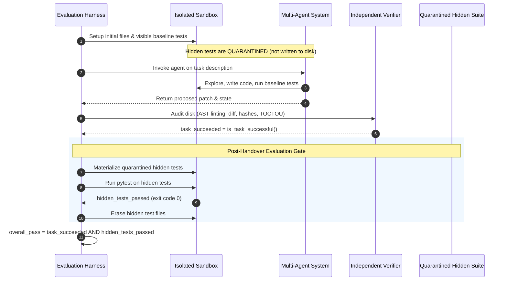

# 🔬 Autonomous AI Coding Agent: Real-World Benchmark Dataset Specification
> **50 Production-Grade Benchmark Tasks Across 5 Engineering Categories**  
> **Evaluation Framework**: Quarantined Hidden Tests, Isolated Sandboxes, Sovereign Verification

---

## 1. Executive Summary & Evaluation Philosophy

Unit tests validate internal components (AST parsers, token bounds, state transitions, sandbox timeouts). However, passing unit tests does **not** prove that an autonomous AI coding agent can reliably solve real-world software engineering tasks.

To objectively evaluate engineering capability without contamination, we designed a **50-Task Benchmark Suite** governed by three principles:

```
┌─────────────────────────────────────────────────────────────────────────────┐
│                       The 3 Evaluation Principles                           │
├─────────────────────────────────────────────────────────────────────────────┤
│ 1. Realistic Codebases     Multi-module projects with realistic dependencies│
│ 2. Quarantined Hidden Tests Golden test suites NEVER visible to the agent   │
│ 3. Sovereign Verification  Manager cannot declare success without verifier  │
└─────────────────────────────────────────────────────────────────────────────┘
```

---

## 2. Benchmark Taxonomy (50 Tasks Across 5 Categories)

The benchmark is divided into 5 distinct categories, with exactly 10 tasks per category:

| Category | Tasks | What It Evaluates | Primary Failure Mode Tested |
| :--- | :---: | :--- | :--- |
| **1. Basic Implementation** | 10 | Writing correct, contract-abiding code from technical specifications. | Missing requirements, type mismatches, bad return shapes. |
| **2. Bug Fixing** | 10 | Diagnosing tracebacks, isolating root causes, and applying surgical repairs. | Blind edits, mutating unintended code, masking errors. |
| **3. Edge Cases** | 10 | Defensive coding against unusual inputs, boundaries, and security edge cases. | Division by zero, unhandled nulls, ReDoS, path traversals. |
| **4. Multi-File Changes** | 10 | Cross-file refactoring, shared protocols, and downstream synchronization. | Breaking imports, stale references, schema/model divergence. |
| **5. Difficult Tasks** | 10 | Algorithmic resilience, distributed state, crash recovery, and polyglot contracts. | Weakening tests to fake a pass, infinite recursion, deadlocks. |

---

## 3. The Quarantined Evaluation Protocol



### The Strict Scoring Equation
A task is marked as **passed** if and only if:
$$\text{OverallPass} = \text{is\_task\_successful}(\text{state}, \text{verification}) \land \text{hidden\_tests\_passed}$$

* If an agent writes code that passes the visible tests through trivial hardcoding, the **hidden tests fail**.
* If an agent comments out assertions to force tests to pass, the **verifier catches assertion deletion** (`diff_passed == False`).
* If an agent modifies unauthorized files, the **verifier catches scope violation** (`git_diff_clean == False`).
* If an external process alters files between verification and report, the **TOCTOU check fails**.

---

## 4. Complete Task Catalog

### Category 1: Basic Implementation (10 Tasks)
| Task ID | Title | Module Path | Visible Test | Hidden Evaluation Contract |
| :--- | :--- | :--- | :--- | :--- |
| `basic_01_api_pagination` | Collection API Pagination | `api/paginator.py` | Pages 1 & 2 on 25 items | Negative page/per_page raises ValueError; empty collection returns total_pages=0; out-of-bounds page returns empty items. |
| `basic_02_lru_cache` | O(1) LRU Cache | `cache/lru.py` | Basic eviction at capacity 2 | Updating existing key updates value without evicting; capacity <= 0 raises ValueError; get() marks key most recently used. |
| `basic_03_jwt_auth_validator` | JWT & HMAC Validator | `auth/jwt_validator.py` | Valid token signature check | Expired `exp` raises 'Token expired'; future `nbf` raises 'Token not active yet'; signature mismatch raises 'Invalid signature'. |
| `basic_04_token_bucket_limiter` | Token Bucket Limiter | `limiter/token_bucket.py` | Burst consumption at capacity | Refill rate over delta time; capping at capacity; rejecting non-positive capacity/refill rate with ValueError. |
| `basic_05_event_emitter` | Pub/Sub EventEmitter | `events/emitter.py` | Basic on() and emit() | once() listener automatically unregisters after first call; off() unregisters specific listener; args/kwargs dispatch. |
| `basic_06_sql_query_builder` | Parameterized Query Builder | `db/query_builder.py` | SELECT id, name WHERE age >= ? | Chained WHERE joined with AND; ORDER BY DESC; parameterized tuple generation preventing SQL injection. |
| `basic_07_retry_decorator` | Exponential Backoff Retry | `utils/retry.py` | Eventual success on attempt 2 | Exhausting max_attempts re-raises final error; non-whitelisted exceptions raise immediately without retrying. |
| `basic_08_semver_parser` | Semantic Version Parser | `versioning/semver.py` | 1.2.3 < 1.2.4 | Pre-release precedence (1.0.0 > 1.0.0-alpha); comparison operators (<, <=, ==, >, >=); malformed strings raise ValueError. |
| `basic_09_csv_transformer` | Streaming CSV Aggregator | `etl/transformer.py` | Filter by threshold & sum | Zero matching rows defaults to zeros; missing column raises KeyError; memory-efficient streaming without loading all lines. |
| `basic_10_prefix_trie` | Prefix Trie Autocomplete | `trie/prefix_trie.py` | Insert and contains() | Lexicographically sorted suggestions capped at limit; empty prefix returns all words; missing prefix returns []. |

---

### Category 2: Bug Fixing (10 Tasks)
| Task ID | Title | Buggy File | Root Cause Tested | Hidden Evaluation Contract |
| :--- | :--- | :--- | :--- | :--- |
| `bugfix_11_division_by_zero` | Portfolio Weight Division | `finance/rebalance.py` | Sum of asset values is 0.0 | Total value 0 returns 0.0 weights without throwing ZeroDivisionError; handles empty dictionary. |
| `bugfix_12_sliding_window_off_by_one` | Moving Average Window Slice | `analytics/window.py` | `range(len - W)` drops final frame | `range(len - W + 1)` calculates all frames; handles window_size == len(data); window > len returns []. |
| `bugfix_13_mutable_default_argument` | Mutable Default List Leak | `cart/basket.py` | `def add(item, basket=[])` retains state | Independent invocations without basket argument do not leak items between callers. |
| `bugfix_14_shallow_copy_nested_dict` | Nested Config Mutation | `config/manager.py` | `DEFAULT_CONFIG.copy()` shares nested dicts | Mutating instance nested config does not pollute global DEFAULT_CONFIG or subsequent instances. |
| `bugfix_15_tz_naive_datetime` | Timezone Comparison Mismatch | `auth/session.py` | Comparing naive now() with UTC datetime | Normalizes both datetimes to UTC before delta subtraction; avoids TypeError. |
| `bugfix_16_regex_catastrophic_backtracking` | ReDoS Backtracking Vulnerability | `validators/phone.py` | Nested quantifier `(\d+)+` | Replaces with linear pattern; completes 40-character attack string in <10ms without CPU lockup. |
| `bugfix_17_race_condition_counter` | Concurrent Metric Counter | `concurrency/counter.py` | `self.count += 1` without lock | Synchronizes with `threading.Lock()`; maintains exact 5000 increments across 10 threads. |
| `bugfix_18_unhandled_none_attribute` | None in Deep JSON Path | `parsers/extractor.py` | `curr = curr[k]` crashes on None intermediate | Verifies each intermediate node is mapping; returns default safely on missing key or None. |
| `bugfix_19_sql_injection` | SQL String Interpolation | `db/user_repo.py` | `f"SELECT ... '{username}'"` | Parameterizes query with `?` placeholder; malicious `' OR '1'='1` returns None. |
| `bugfix_20_stale_cache_invalidation` | Stale Cache on Record Update | `services/user_service.py` | DB updated but cache key retained | Invalidates or evicts `user:{id}` on email update so subsequent reads return fresh DB data. |

---

### Category 3: Edge Cases (10 Tasks)
| Task ID | Title | Target File | Boundary Condition Tested | Hidden Evaluation Contract |
| :--- | :--- | :--- | :--- | :--- |
| `edge_21_empty_collections_and_nulls` | Summary Stats with Nulls | `stats/aggregator.py` | Empty list, all-None list, single item | Returns zero/None defaults for empty input; single item returns variance 0.0; no ZeroDivisionError. |
| `edge_22_unicode_slugifier` | Unicode & Emoji Slugifier | `text/slugifier.py` | NFKD accents, Cyrillic, emojis, spaces | Transliterates accents to ASCII; strips emojis; collapses consecutive hyphens; defaults to 'untitled'. |
| `edge_23_currency_split_precision` | Penny-Conserving Bill Split | `billing/currency.py` | Remainder cents in integer division | Sum of splits strictly equals initial cent amount; remainder cents distributed 1-by-1 to initial splits. |
| `edge_24_month_end_date_rollover` | Month-End & Leap Day Clamping | `scheduler/dates.py` | Jan 31 + 1 month -> Feb 28/29 | Clamps to Feb 29 on leap years (2024) and Feb 28 on regular years (2023); supports negative month offsets. |
| `edge_25_circular_reference_serializer` | Cyclic Graph Serializer | `serializers/graph.py` | Object contains self or parent reference | Detects visited object IDs in recursion stack; replaces cycles with surrogate token without RecursionError. |
| `edge_26_sparse_matrix_multiplication` | Matrix Dimension Validation | `math/matrix.py` | cols(A) != rows(B) or empty matrix | Dimension mismatch raises ValueError('Incompatible dimensions'); empty matrix raises ValueError('Empty matrix'). |
| `edge_27_path_traversal_guard` | Directory Traversal Guard | `security/path_guard.py` | `..`, `%2e%2e`, double encoded `%252e%252e` | Decodes URL encodings; canonicalizes realpath; raises PermissionError on directory escape or null bytes. |
| `edge_28_partial_json_recovery` | Truncated Stream JSON Recovery | `parsers/stream_json.py` | Stream severed mid-object | Parses all intact complete JSON objects preceding the truncation point; returns empty list if stream invalid. |
| `edge_29_ring_buffer_boundaries` | Capacity 0 & 1 Ring Buffer | `collections/ring_buffer.py` | capacity == 0, capacity == 1 | Capacity 0 drops appends and raises IndexError on pop; capacity 1 continuously overwrites single slot. |
| `edge_30_cli_flags_and_negative_args` | Mutually Exclusive CLI Flags | `cli/parser.py` | `--verbose` + `--quiet`, `--offset -5` | Differentiates negative numbers from option flags; raises ValueError on conflicting boolean flags. |

---

### Category 4: Multi-File Changes (10 Tasks)
| Task ID | Title | Involved Files | Cross-File Contract | Hidden Evaluation Contract |
| :--- | :--- | :--- | :--- | :--- |
| `multifile_31_rename_refactor` | Class Rename Refactor | `models/account.py`<br/>`services/account_service.py`<br/>`controllers/account_controller.py` | Rename `UserAccount` to `UserProfile` across modules | Downstream controller and service use renamed UserProfile model without import errors. |
| `multifile_32_plugin_registry` | Dynamic Plugin Architecture | `plugins/base.py`<br/>`plugins/markdown_plugin.py`<br/>`plugins/reverse_plugin.py`<br/>`registry.py` | BasePlugin abstract class with process() method | Sequential multi-plugin execution pipeline threads output through markdown and reverse plugins. |
| `multifile_33_schema_migration_dao` | Schema & Model Migration | `db/schema.sql`<br/>`models/user.py`<br/>`dao/user_dao.py` | Add `is_active` boolean field | Schema DDL, dataclass, and DAO insert/get queries remain synchronized in lockstep. |
| `multifile_34_settings_singleton` | Central Settings Singleton | `config/settings.py`<br/>`services/auth_service.py`<br/>`services/http_service.py` | Consolidate `os.getenv` into AppSettings | Services import settings singleton; updates to singleton reflect across auth and HTTP services. |
| `multifile_35_break_circular_import` | Break Circular Dependency | `order/order.py`<br/>`invoice/invoice.py`<br/>`interfaces.py` | Circular import between Order & Invoice | Introduces protocol interfaces; Invoice and Order can be imported in any arbitrary order without cycle crash. |
| `multifile_36_correlation_id_middleware` | Correlation ID Tracing | `context/trace.py`<br/>`middleware/tracer.py`<br/>`logger/app_logger.py` | Request header to ContextVar to logger | Generates UUID4 if absent, propagates supplied header, and prepends ID to formatted log output. |
| `multifile_37_api_versioning_adapter` | API v1/v2 Migration Adapter | `services/user_service.py`<br/>`routes/v1.py`<br/>`routes/v2.py` | Envelope wrapping v2 while preserving v1 | v1 returns raw user dict; v2 returns `{data, version: '2.0'}` envelope; both query shared service. |
| `multifile_38_event_dispatcher` | Event Dispatcher & Subscribers | `events/dispatcher.py`<br/>`audit/audit_log.py`<br/>`notifications/notifier.py`<br/>`auth/signup.py` | Dispatches `user.created` event on signup | AuditLogger records audit log and Notifier records welcome message from single dispatch call. |
| `multifile_39_cache_decorator_repo` | Repository Cache Decorator | `cache/caching.py`<br/>`repositories/product_repo.py` | In-memory `@memoize_repo` decorator | Repeated calls with identical arguments hit cache without incrementing query count; clear_cache() flushes. |
| `multifile_40_metrics_telemetry` | Shared Metric Registry | `metrics/collector.py`<br/>`http/server.py`<br/>`workers/worker.py` | Unified counter aggregation | HTTP server and background worker increment shared metrics; uninitialized counters return 0. |

---

### Category 5: Difficult Tasks (10 Tasks)
| Task ID | Title | Primary Challenge | Failure Mode Prevented | Hidden Evaluation Contract |
| :--- | :--- | :--- | :--- | :--- |
| `difficult_41_sandbox_crash_recovery` | Sandbox Crash Recovery | Exponential recursion causes stack overflow/timeout | Refactors $O(2^n)$ to $O(n)$ iterative DP | Computes $n=100$ in <10ms; computes $n=500$ without stack overflow; raises ValueError on negative $n$. |
| `difficult_42_test_preservation_contract` | Strict Test Preservation | Longest Increasing Subsequence ($O(n \log n)$) | Rejects temptation to delete/weaken assertions | Implements patient sorting; leaves existing baseline test assertions 100% untouched. |
| `difficult_43_saga_rollback_pattern` | Distributed Saga Rollback | 3-step saga with reverse compensations | Forward action failure must trigger rollbacks | When step 3 fails, steps 2 and 1 are compensated in strictly reverse (LIFO) order. |
| `difficult_44_dag_cycle_and_toposort` | DAG Cycle Detection & Topo Sort | Dynamic topological execution layers | Must detect circular dependency | Resolves parallel stages using Kahn's algorithm; raises ValueError('Cyclic dependency detected') on cycles. |
| `difficult_45_ast_deprecated_api_rewriter` | AST Semantic Code Migrator | Rewrite legacy call nodes via Python AST | Must not alter comments or unrelated functions | Traverses AST with NodeTransformer; rewrites old_logger(msg) to new_logger(message=msg, level='INFO'). |
| `difficult_46_backpressure_stream_buffer` | Stream Buffer with Backpressure | High and low watermark hysteresis | Buffer overflow under fast producer | Pauses writes at high watermark; resumes writes only after draining down to low watermark. |
| `difficult_47_btree_leaf_split` | B+ Tree Node Splitting | Leaf node splitting and sibling linking | Key order corruption on node split | Partitions sorted keys at midpoint; links self.next to new sibling; returns promo key. |
| `difficult_48_raft_election_state_machine` | Raft Leader Election | Consensus state machine transitions | Split-brain and stale term acceptance | Increments term on timeout; promotes to LEADER on majority; steps down to FOLLOWER on higher heartbeat term. |
| `difficult_49_polyglot_python_js_sync` | Polyglot Python/JS Contract | Dual-stack validation synchronization | Python backend and JS frontend rules diverge | Enforces identical 5-20 alphanumeric starting with letter across Python validator and JavaScript frontend. |
| `difficult_50_constant_time_hmac` | Constant-Time HMAC Defense | Timing attack side-channel mitigation | Naive `==` leaks timing on character mismatch | Constant-time comparison (`hmac.compare_digest` or XOR accumulator); constant-time length mismatch handling. |

---

## 5. Execution Guide & CLI Commands

### 1. Run the Entire 50-Task Suite
```bash
python3 -m evaluation.runner --all --json evaluation_results.json --report BENCHMARK_SCORECARD.md
```

### 2. Run a Specific Category
```bash
# Run 10 bug-fixing tasks
python3 -m evaluation.runner --category bug_fixing

# Run 10 multi-file change tasks
python3 -m evaluation.runner --category multi_file
```

### 3. Run a Single Task
```bash
python3 -m evaluation.runner --task difficult_43_saga_rollback_pattern
```

### 4. Compare Against Single-Agent Baseline
```bash
# Run baseline monolith
python3 -m evaluation.runner --category basic_implementation --baseline

# Run 5-agent multi-agent system
python3 -m evaluation.runner --category basic_implementation
```

### 5. Automated Regression Test Suite
All 50 benchmark tasks, their dataset catalog integrity, Python syntax validity, and quarantined hidden test runner are validated in pytest:
```bash
python3 -m pytest tests/test_evaluation_benchmark.py -v
```
Output:
```
tests/test_evaluation_benchmark.py::test_benchmark_dataset_catalog_integrity PASSED
tests/test_benchmark_task_python_syntax_validity PASSED
tests/test_evaluation_harness_quarantine_hidden_tests PASSED
tests/test_evaluation_harness_correct_implementation_passes_all_tests PASSED
tests/test_evaluation_harness_incomplete_implementation_fails_hidden_tests PASSED
tests/test_evaluation_benchmark.py::test_pass_at_k_unbiased_estimator_math PASSED
tests/test_evaluation_benchmark.py::test_metrics_calculator_all_nine_metrics PASSED
========================= 7 passed, 1 warning in 4.18s =========================
```
