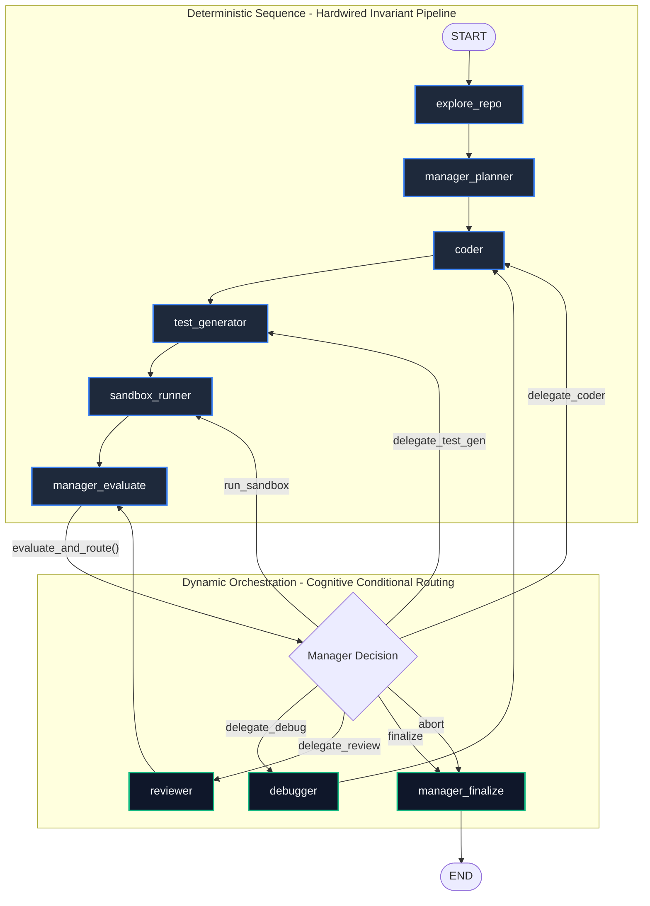

# Hybrid Orchestration Architecture: Architectural Decisions & Q&A

This document provides a comprehensive technical breakdown of the architectural decisions, state management, cryptographic verification, routing guarantees, and outcome boundaries of the autonomous multi-agent coding system built on LangGraph.

---

## 1. Why Hybrid Orchestration Instead of a Fully Dynamic Manager?

### The Failure Modes of Fully Dynamic LLM Orchestration
In a purely dynamic "ReAct" or LLM-driven manager architecture, every single step transition is prompted to a model. While this sounds flexible in theory, in production coding systems it introduces catastrophic reliability issues:

1. **Gate Bypassing & Pathing Hallucinations**:
   An LLM manager frequently hallucinates non-standard paths—such as delegating code review before code has even been executed in the sandbox, or writing code before discovering AST symbols and repository structure.
2. **Infinite Loops & Flaky Hand-offs**:
   When encountering nuanced errors, pure LLM routers easily get trapped in circular loops between agents without converging on deterministic termination conditions.
3. **Severe Token Latency & Cost Overhead**:
   Prompting a frontier LLM to decide routine linear handoffs (`explore` $\to$ `plan` $\to$ `code` $\to$ `test_gen` $\to$ `sandbox`) consumes hundreds of thousands of tokens and adds 5–10 seconds of round-trip network latency per step without adding any cognitive engineering value.

### The Hybrid Solution
Our system implements a **two-tier hybrid orchestration architecture**:



1. **Deterministic Backbone (Linear Pipeline Invariants)**:
   The construction sequence (`START` $\to$ `explore_repo` $\to$ `manager_planner` $\to$ `coder` $\to$ `test_generator` $\to$ `sandbox_runner` $\to$ `manager_evaluate`) is hardwired in the LangGraph topology. Software engineering invariants are guaranteed: code is always written before tests are generated; tests are always synthesized before sandbox execution; and results are always collected before evaluation begins.
2. **Dynamic Manager Gate (Remediation & Review Logic)**:
   At `manager_evaluate`, the Manager takes sovereign control through `route_manager_decision`. It inspects structured contracts (`TestResult`, `ReviewResult`, `iteration_count`) and dynamically routes:
   - To **Debugger** on test failure,
   - To **TestGenerator** if test assertions are diagnosed as defective,
   - To **Coder** if Reviewer raises blocking issues,
   - To **Reviewer** once tests pass,
   - To **Finalize** when all quality gates clear or retry budgets expire.

---

## 2. How LangGraph Maintains and Updates Shared State Between Agents

### 1. Centralized Typed Schema ([AgentState](../agent/core/state.py#L122-L173))
All inter-agent communication is mediated through `AgentState`, a `TypedDict(total=False)` storing strongly typed Pydantic models:

```python
class AgentState(TypedDict, total=False):
    # Task & Context
    task: str
    repo_path: str
    symbol_index: Dict[str, SymbolInfo]
    relevant_files: List[str]
    retrieved_code: Dict[str, str]
    plan: List[str]
    active_step: int
    
    # Structured Agent Artifacts
    manager_plan: Optional[ManagerPlan]
    manager_decision: Optional[ManagerDecision]
    coder_result: Optional[CoderResult]
    test_gen_result: Optional[TestGenResult]
    review_result: Optional[ReviewResult]
    debug_result: Optional[DebugResult]
    
    # Execution & Lifecycle
    proposed_patches: Dict[str, str]
    test_results: Optional[TestResult]
    iteration_count: int
    max_iterations: int
    error_history: List[str]
    agent_history: List[Dict[str, Any]]
    completed_actions: List[str]
    
    # Final Verification & Outcome
    verification_result: Optional[VerificationResult]
    workflow_outcome: Optional[str]
    final_report: Optional[str]
    status: str
```

### 2. Functional Partial Updates (State Channel Reductions)
Agents do not mutate a shared memory pointer. Each LangGraph node is a pure function that returns a partial dictionary containing only its delta. LangGraph merges the delta into the state channel:

```python
def coder_node(state: AgentState) -> Dict[str, Any]:
    coder = CoderAgent(repo_path, policy=policy, approval_gate=gate)
    result: CoderResult = coder.implement(state)

    proposed = dict(state.get("proposed_patches", {}))
    proposed.update(result.patches)

    # Invalidate stale review_result so newly written code requires fresh review
    return {
        "coder_result": result,
        "proposed_patches": proposed,
        "completed_actions": completed,
        "agent_history": history,
        "status": "test_generation",
        "review_result": None,
    }
```

### 3. Durable SQLite Checkpointing ([SqliteCheckpointSaver](../agent/core/checkpointer.py#L42))
- After every node execution, LangGraph serializes the current state channels to disk using `JsonPlusSerializer` into SQLite (`checkpoints` and `checkpoint_blobs` tables).
- Runs are keyed by a **canonical stable thread ID** (`thread_<repo_basename>_<task_hash>`).
- If an unhandled exception or process termination occurs, the workflow can be resumed instantly with `app.invoke(None, config={"configurable": {"thread_id": thread_id}})`.

### 4. Idempotent Action Replay Guard ([completed_actions](../agent/core/state.py#L146))
To eliminate duplicate side-effects (e.g. reapplying patches or re-running expensive steps) upon recovery, `state["completed_actions"]` tracks uniquely scoped keys:
```python
action_key = f"coder:patch:{file_path}:iter{state.get('iteration_count', 0)}"
if action_key not in completed:
    completed.append(action_key)
```

---

## 3. How SHA-256 Prevents Stale Reviewer Approvals

### The Risk of In-Memory Boolean Flags
In naive agent systems, reviewer approval is tracked as a boolean (`approved: bool = True`). This introduces a serious vulnerability:
- If a coder modifies files *after* the reviewer audited them, or if disk contents are altered between iterations, the approval flag persists.
- The system would declare "Success" based on an approval of code that no longer exists on disk.

### The Cryptographic Binding Solution

1. **Audit-Time Content Hashing ([ReviewerAgent](../agent/agents/reviewer.py#L51-L100))**:
   When `ReviewerAgent.review_code()` inspects modified files, it computes a cryptographic SHA-256 digest of every file's byte contents:
   ```python
   reviewed_hashes = {}
   for rel, content in file_contents.items():
       reviewed_hashes[rel] = hashlib.sha256(content.encode("utf-8")).hexdigest()
   ```
   These hashes are immutably recorded in [`ReviewResult.reviewed_file_hashes`](../agent/core/state.py#L104-L107).

2. **On-Disk Re-Verification ([IndependentVerifier](../agent/verification/verifier.py#L567-L594))**:
   During finalization, the `IndependentVerifier` independently re-reads each reviewed file directly from the filesystem and recomputes its SHA-256 hash:
   ```python
   for rel, expected_hash in review_res.reviewed_file_hashes.items():
       fpath = self.repo_path / rel
       if not fpath.exists():
           reviewer_tampered_files.append(f"{rel} (deleted after review)")
       else:
           curr_hash = hashlib.sha256(fpath.read_bytes()).hexdigest()
           if curr_hash != expected_hash:
               reviewer_tampered_files.append(f"{rel} (modified after review: expected {expected_hash[:8]}, got {curr_hash[:8]})")
   ```
   - **Post-Review Tampering**: If even a single byte changed on disk after the review, `curr_hash != expected_hash`. The verifier revokes `reviewer_approved = False`.
   - **Scope Completeness**: The verifier inspects the Git diff. If any modified production Python file was never reviewed (`mod_file not in review_res.reviewed_file_hashes`), approval is revoked.
   - **Outcome Downgrade**: Any discrepancy forces `WorkflowOutcome.COMPLETED_WITH_FAILURES` with explicit diagnostics.

3. **Lifecycle State Invalidation ([agent/core/graph.py](../agent/core/graph.py#L137, #L247))**:
   Whenever `coder_node` or `debugger_node` runs, `state["review_result"]` is reset to `None`, making it impossible for a previous approval to leak into a future iteration.

---

## 4. What Happens If the Manager Produces an Invalid Routing Decision?

### The LangGraph KeyError Vulnerability
LangGraph enforces strict validation: if a conditional routing function returns a string that is not mapped in `add_conditional_edges()`, LangGraph throws a fatal runtime `KeyError`.

### Two-Tier Fail-Safe Defense ([route_manager_decision](../agent/core/graph.py#L295-L336))

1. **Exhaustive Routing Table ([DECISION_TO_NODE_MAP](../agent/core/graph.py#L285-L293))**:
   Every allowed `ManagerDecision.next_action` literal maps to an active graph node:
   ```python
   DECISION_TO_NODE_MAP: Dict[str, str] = {
       "delegate_coder": "coder",
       "delegate_test_gen": "test_generator",
       "run_sandbox": "sandbox_runner",
       "delegate_debug": "debugger",
       "delegate_review": "reviewer",
       "finalize": "manager_finalize",
       "abort": "manager_finalize",
   }
   ```

2. **Defensive Fallback Protocol**:
   ```python
   def route_manager_decision(state: AgentState) -> str:
       decision: Optional[ManagerDecision] = state.get("manager_decision")
       
       # Guard 1: Missing or None decision
       if not decision:
           logger.warning("No ManagerDecision found in state; falling back safely to 'manager_finalize'.")
           return "manager_finalize"

       action = getattr(decision, "next_action", None)
       # Guard 2: Missing action attribute
       if not action:
           logger.warning("ManagerDecision missing next_action; falling back safely to 'manager_finalize'.")
           return "manager_finalize"

       # Guard 3: Explicit cancellation
       if action == "abort":
           state["cancelled"] = True
           state["status"] = "cancelled"
           return "manager_finalize"

       # Guard 4: Unrecognized or hallucinated string
       target_node = DECISION_TO_NODE_MAP.get(action)
       if not target_node:
           logger.warning(f"Unrecognized action '{action}'. Falling back safely to 'manager_finalize'.")
           return "manager_finalize"

       return target_node
   ```

3. **Why Fall Back to `manager_finalize`?**:
   Falling back to `manager_finalize` ensures that the graph safely terminates without crashing. At `manager_finalize`, the `IndependentVerifier` evaluates the codebase. Since invalid decisions indicate failure or corruption, the verifier fails closed and flags `WorkflowOutcome.COMPLETED_WITH_FAILURES`.

---

## 5. How Do You Guarantee That Reaching the Retry Limit Cannot Produce a False Success?

### The Flaw in Naive Loops
Many agent frameworks loop until `iteration == max_iterations`, exit the loop, and assume success simply because execution terminated without a fatal crash.

### Architectural Guarantees Against False Success

1. **Retry Budget Expiration Signals Finalization, Never Success**:
   In [`ManagerPlannerAgent.evaluate_and_route`](../agent/agents/manager.py#L180-L193), when `iteration >= max_iter` with unresolved defects, the Manager routes to `"finalize"` purely to prevent infinite loop resource exhaustion:
   ```python
   if test_res and not test_res.passed:
       if iteration >= max_iter:
           return ManagerDecision(
               next_action="finalize",
               target_agent="manager",
               reasoning=f"Max iterations ({max_iter}) reached with failing tests. Halting to prevent infinite loop.",
               directives={"status": "max_iterations_reached"}
           )
   ```

2. **Decoupled Sovereign Authority ([IndependentVerifier](../agent/verification/verifier.py#L35))**:
   The Manager does not determine the final outcome. The terminal outcome is computed exclusively by the `IndependentVerifier`, which does not accept self-reported agent assertions.

3. **Strict Four-Pillar Verification Equation**:
   ```python
   all_passed = (
       tests_passed          # 0 test failures, baseline regression free
       and lint_res.passed   # Clean AST syntax and no undefined symbols
       and diff_res.passed   # Baseline tests preserved, no assertions weakened
       and reviewer_approved # Score >= 8.0, 0 blocking issues, SHA-256 match
   )

   if all_passed:
       outcome = WorkflowOutcome.COMPLETED_SUCCESSFULLY
   else:
       outcome = WorkflowOutcome.COMPLETED_WITH_FAILURES
   ```
   If the retry limit was reached with failing tests or unresolved reviewer objections, `tests_passed` or `reviewer_approved` will be `False`. Thus, `all_passed` evaluates to `False`, forcing the outcome to `WorkflowOutcome.COMPLETED_WITH_FAILURES`.

4. **Cancellation and Blocked Precedence**:
   If the workflow was aborted or blocked by security policy, top-level guard clauses intercept verification before `all_passed` is even evaluated:
   - `cancelled=True` $\to$ `WorkflowOutcome.CANCELLED`
   - `blocked=True` $\to$ `WorkflowOutcome.BLOCKED`

### Verified via Automated Tests
This invariant is validated by [`test_retry_limits_strictly_fail_and_never_produce_success`](../tests/test_multi_agent_baseline_comparison.py#L271-L327):
- **Case A**: Test failures at `iteration_count == max_iterations` strictly produce `COMPLETED_WITH_FAILURES` (`verified = False`).
- **Case B**: Reviewer rejection at `iteration_count == max_iterations` strictly produces `COMPLETED_WITH_FAILURES` (`verified = False`).

---

## 6. Implementation Boundaries Hardening & Defense

To ensure industrial-grade production readiness and address critical edge-case failure modes, the system hardens four key implementation boundaries:

### Boundary A: Polyglot Hash Coverage (Policy-Based Review Invariant)
- **The Vulnerability**: Naive implementations check only `.py` files, allowing production JavaScript, Bash scripts, SQL schema migrations, and configuration templates (`.js`, `.sh`, `.sql`, `.yaml`, `.html`) to slip into production unreviewed.
- **The Hardening**: Introduced [`should_be_reviewed(rel_path: str) -> bool`](../agent/agents/reviewer.py#L26-L40). Instead of a naive extension check, a strict inclusion/exclusion policy audits all production assets while explicitly filtering out test suites (audited separately for assertion preservation), caches (`.pytest_cache`, `__pycache__`), build outputs (`node_modules`, `dist`), VCS files (`.git`), and binary assets.
- **Verification Gate**: [`IndependentVerifier.verify`](../agent/verification/verifier.py#L589-L594) iterates over all changed files. If any file satisfying `should_be_reviewed` is missing from `ReviewResult.reviewed_file_hashes`, reviewer approval is rejected immediately with `WorkflowOutcome.COMPLETED_WITH_FAILURES`.

### Boundary B: TOCTOU (Time-of-Check to Time-of-Use) Protection
- **The Vulnerability**: Even with cryptographic hashing, an external process, daemon, or post-review tool could alter working-tree files on disk after verification checks succeed but before final report delivery.
- **The Hardening**: Implemented immutable repository snapshot manifest capture ([`verified_manifest`](../agent/verification/verifier.py#L605-L621)) and root SHA-256 digest calculation ([`snapshot_hash`](../agent/verification/verifier.py#L73-L80)).
- **Handover Invariant**: At the conclusion of verification and before final report generation, [`IndependentVerifier`](../agent/verification/verifier.py#L662-L676) audits working-tree disk state against `verified_manifest`. Any file mutation or deletion during/after verification triggers a TOCTOU violation and flags `COMPLETED_WITH_FAILURES`. The final artifact delivered by `manager_finalize_node` cryptographically binds to this immutable snapshot.

### Boundary C: Cooperative Cancellation at Node Boundaries
- **The Vulnerability**: Checking cancellation flags exclusively at Manager routing gates allows currently executing or queued sub-agents to wastefully perform expensive LLM completions, apply disk patches, or launch container sandboxes after an operator or safety signal requested termination.
- **The Hardening**: Every pipeline node in [`agent/core/graph.py`](../agent/core/graph.py) (`explore_repo_node`, `manager_planner_node`, `coder_node`, `test_generator_node`, `sandbox_runner_node`, `debugger_node`, `reviewer_node`, `manager_evaluate_node`) executes an immediate guard check at entry:
  ```python
  if state.get("cancelled") or state.get("abort_requested"):
      return {"cancelled": True, "status": "cancelled"}
  ```
- **Cost & Safety Defense**: LLM calls and sandbox executions are halted before execution begins, ensuring immediate cooperative termination.

### Boundary D: Centralized Retry Metering
- **The Vulnerability**: Decentralized retry increments spread across different nodes create unmetered execution loopholes (such as `delegate_test_gen` looping without decrementing budget) or double-incrementing bugs (where both `debugger_node` and `manager_evaluate_node` consume iterations).
- **The Hardening**: Consolidated iteration accounting strictly inside [`manager_evaluate_node`](../agent/core/graph.py#L230-L236) across ALL remediation actions:
  ```python
  REMEDIATION_ACTIONS = {"delegate_coder", "delegate_debug", "delegate_test_gen", "run_sandbox"}
  if decision.next_action in REMEDIATION_ACTIONS:
      updates["iteration_count"] = state.get("iteration_count", 0) + 1
      updates["review_result"] = None
  ```
- **Defensive Safeguards**: Removed redundant increments from `debugger_node`, establishing `manager_evaluate_node` as the single authoritative source of truth. Additionally, [`ManagerPlannerAgent.evaluate_and_route`](../agent/agents/manager.py#L154-L194) bounds both `force_sandbox_rerun` and `delegate_test_gen` against `max_iterations`, routing directly to `"finalize"` when the budget is exhausted.

---

## 7. Verification Status & Test Suite Proof

All architectural guarantees and implementation boundaries are validated by a 100% passing automated test suite:
- **Total Test Count**: **89 Automated Tests, 1 Deprecation Warning, 0 Failures**
- **Test Command**: `python3 -m pytest -v` (Execution duration: ~50 seconds)
- **Targeted Test Suite**: [`tests/test_implementation_boundaries.py`](../tests/test_implementation_boundaries.py) validates Hash Coverage, TOCTOU, Node Cancellation, and Centralized Retry Metering across 10 specialized automated test cases.
